# General Overview

_Wed, 29 May, 2024_ · [Getting Started (3)](https://smart-hospital.in/category/getting-started) · vendor article: https://smart-hospital.in/article/general-overview

### General Overview

Wed, 29 May, 2024

[Articles](https://smart-hospital.in/articles)[Getting Started](https://smart-hospital.in/category/getting-started)

---

## **Using Smart Hospital**

Before start using Smart Hospital consider a general scenario of typical hospital have different departments like Billing, Appointment  
OPD, IPD, Pharmacy, Pathology, Radiology, Blood Bank, Ambulance, Operation Theatre, Blood Bank, Accounts, Admin etc. where we perform different patient and hospital related activities.  
  
Apart from above we also like to provide access to our Smart Hospital to different users like Doctors, Accountants, Pharmacist, Radiologist, Pathologist, and Patient. For these Smart Hospital have 9 inbuilt user's roles - Super Admin, Admin, Doctor, Accountant, Pathologist, Radiologist, Nurse, Receptionist and Patient. Virtually you can create unlimited number of user roles for staff members.  
  
**Admin Panel -**Login to Admin Panel through URL - **<http://yourdomain/site/login>  
  
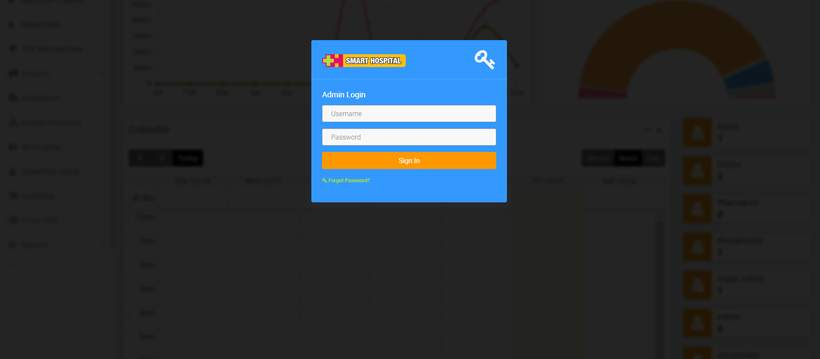**After successful login you will reach to Admin Dashboard. Below you can find navigational overview of user screen.  
  
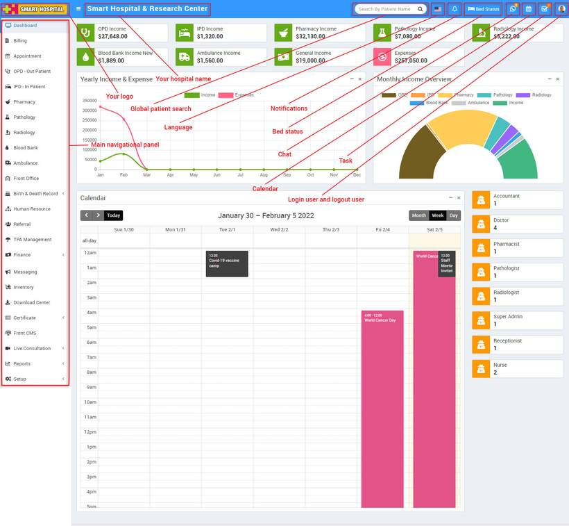  
  
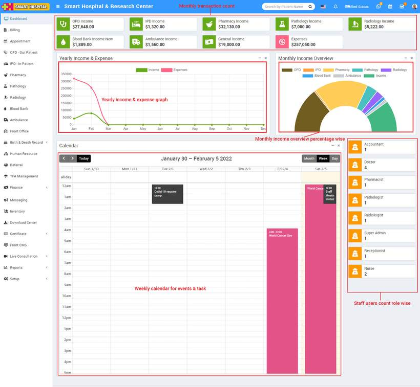 **Admin Panel consist 28 modules listed below -**1. **Billing** - To manage patients billing details.  
2. **Appointment** - To manage all patients online/offline booking details.  
3. **OPD** - Out Patient - for all OPD patient registration, visits, revisits, old OPD patients  
4. **IPD** - In Patient - for all IPD patients admission, consultant register, diagnosis, timeline, IPD charges, payments, bill and discharged ipd patients  
5. **Pharmacy** - for all medicine list, stock, and pharmacy bills  
6. **Pathology** - for all pathology test details and patient test records  
7. **Radiology** - for all radiology test details and patient test records  
8. **Operation** Theatre - for managing patient operation activities and operation records  
9. **Blood Bank** - for managing blood group available blood stock, donor details and blood issue details  
10. **Ambulance** - for managing ambulance vehicles and ambulance call details  
11. **Front Office** - for all OPD appointment and reception/front office related activities like enquiries, calls, visitors, postal receive/dispatch  
12. **Birth And Death Record** - for managing all details of newly born babies birth and patients death.  
13. **Human Resource** - for all the information related to staff members can be manage here like staff search, profile, attendance, payroll, leaves.  
14. **Referral** - for managing all referred patients records.  
15. **TPA Management** - Third Party Administrator for managing changes and records of insurance or mediclaim companies  
16. **Finance** - for managing general income and expense  
17. **Messaging** - it works like a notice board basically a messaging system for communication to patient and staff  
18. **Inventory** - manage all the assets of your hospital with stocks and store under inventory module  
19. **Download** **Center** - for managing downloadable documents that need to distribute staff  
20. **Certificate** - design and generate Patients's and Staff's ID Card here  
21. **Front CMS** - manage front website of Smart Hospital here by creating pages, menus, events, gallery, news  
22. **Zoom Live Consultation** - for patient zoom live consultation and for staff live meetings.  
23. **Reports** - all the various reports related to different modules can be found here  
24. **Patient** - all patient related details can be found here  
25. **Notifications** - all automated notifications can be found here  
26. **Calendar & ToDo List** - track and manage all daily/monthly activities and create your task in todo list  
27. **Setup** - configure Smart Hospital here for different settings like hospital, sessions, admin password, SMS, Paypal, backup / restore, languages  
28. **One Click Updater** - to install new update in existing system  
  
Steps to setup your Smart Hospital -  
  
In the Admin panel go to **Setup > Settings > General Setting** in upper right side click on **Edit** button to update your hospital data.  
  
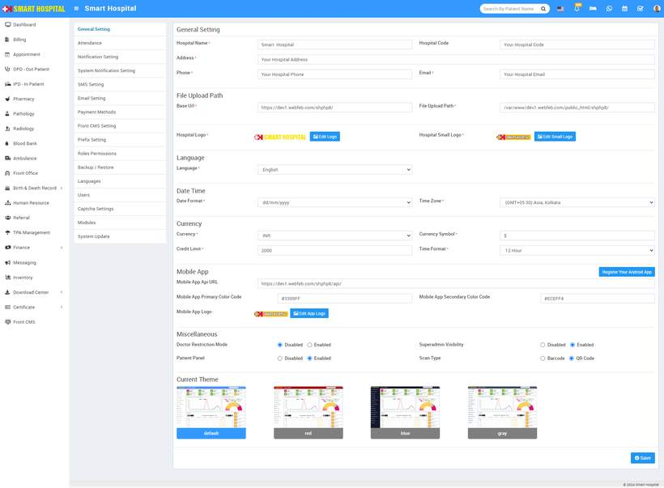  
  
2. Update your Hospital Name, Address, Phone, Email, Hospital Code (Hospital Code is your hospital registration / accreditation no), Language (language in which you want to run your Smart Hospital), Language RTL Text Mode (for Arabian side languages), Timezone, Time Format, Currency (ISO standard 3 digit currency code), Currency Symbol and Credit Limit (used for IPD module balance amount credit limit), Doctor Restriction Mode (if Doctor Restriction Mode is disabled then all doctors can see other doctors patients in their account and if Doctor Restriction Mode is enabled then doctors can see only their assigned patients in OPD, IPD, OT and Appointment) now click on Save button to update record, Superadmin Visibility (if Superadmin Visibility is disabled then superadmin will not be visible to system for other staff users and if Superadmin Visibility is enabled then other staff users can see superadmin in system) now click on Save button to update record.  
  
3. For updating your hospital logo click on right column Edit Logo buttons.  
  
4. For enabling automated email/sms notification on different events go to Setup > Settings > Notification Setting page.  
  
5. For automated SMS messaging add any one of available SMS Gateway with the required details from Setup > Settings > SMS Setting.  
  
6. For automated Email messaging by default SendMail is selected in Smart Hospital. If your hosting server supports SendMail then your will get emails by default otherwise you have to select SMTP email engine. For SMTP you can use any free or paid smtp service like Gmail. To enter your SMTP server details go to **Setup > Settings > Email Setting > SMTP**.  
  
7. To enabling online payment in Patient Panel update your payment gateway account details for this, go to **Setup > Settings > Payment Methods** select your appropriate payment gateway and add you payment gateway account details then click on save button and enable it from right side box.  
  
8. At this point we have completed basic settings of our hospital. Now we will add our hospital other details in Smart Hospital like Hospital Charges, Bed, Ward, Floor, Departments, Doctors etc.  
  
9. For adding Charges Type go to **Setup > Hospital Charges > Charge Type**, Here first we will add Charge Type, for this click on **+ Add Charge** Type button. Now enter Charge Type. Here 5 default Charge Type are available.  
  
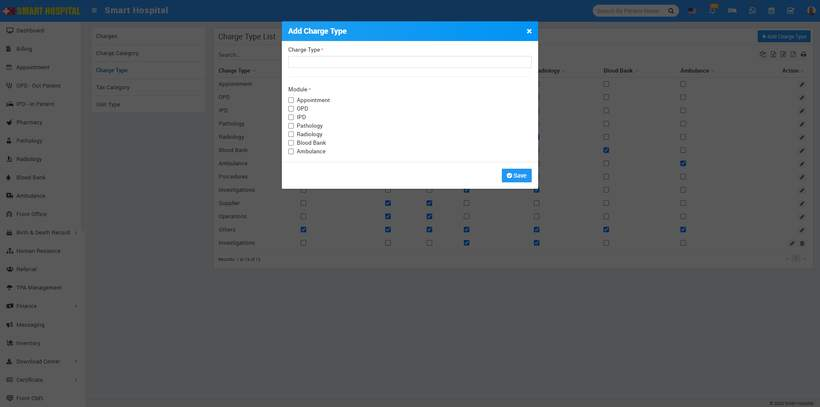  
  
For adding Hospital Charge Category go to **Setup > Hospital Charges > Charge Category**, Here first we will add Charge Category, for this click on **+ Add Charge Category** button. Now enter Name, Description and select Charge Type like Procedures (is for general ipd charges like doctor visit), **Investigations** (is for pathology/radiology lab test or other investigations), **Supplier** (is for other things supply like oxygen charges), **Operation Theatre** (is for operation theatre charges) and Other (is for other miscellaneous charges).  
  
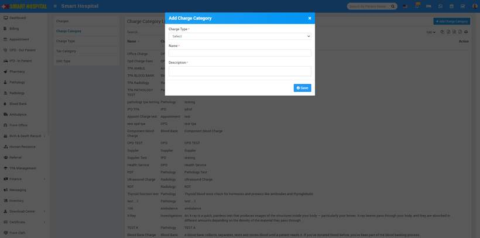  
  
Now we will add Charges for this click on **+ Add Charge** button. Now select **Charge Type**, **Charge Category**, enter **Charge Code** (it is like short code to differentiate two charges for same charge type and charge category), then enter Standard Charge, Description and if there is any TPA (Third Party Administrator or Insurance organization) is present then enter Scheduled Charge for this also).  
  
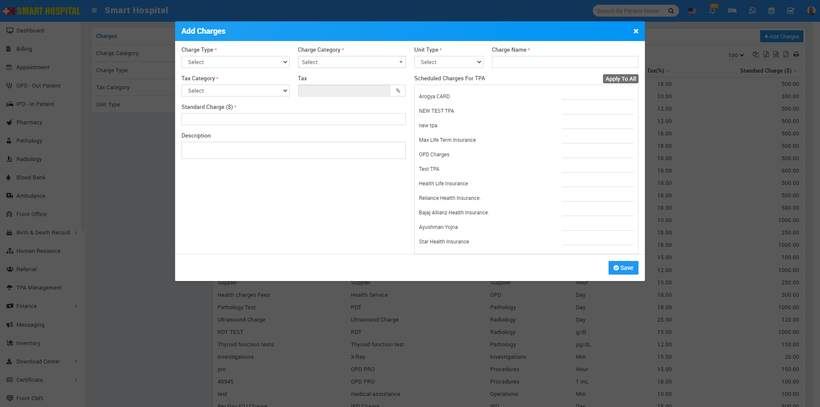  
  
10. For adding Tax Category go to **Setup > Hospital Charges > Tax Category**, Here first we will add Charge Type, for this click on **+ Add Charge** Type button. Now enter the **Name** and **Percentage**   
  
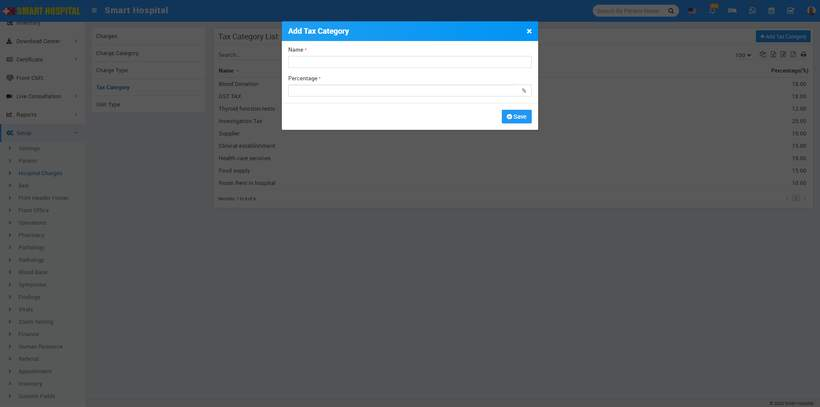  
  
11. For adding Charges Type go to **Setup > Hospital Charges > Unit Type**, Here first we will add Unit Type, for this click on **+ Add Unit Type** button. Now enter Unit name and click to **Save**.  
  
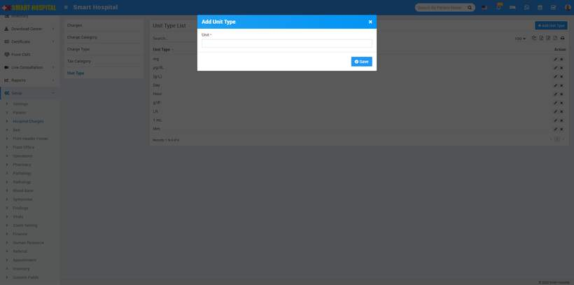  
  
12. For adding Bed and their details go to **Setup > Bed**. Here first we will add Floors, Bed Groups, Bed Type. To add Floors click on **+ Add button** then enter **Floor Name** and **Description**.  
  
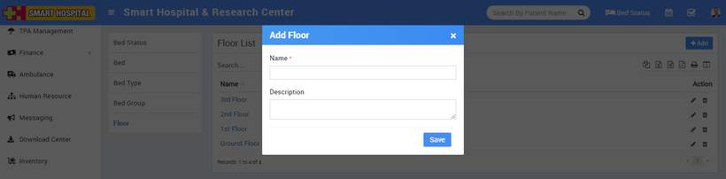  
  
To add Bed Group click on **+ Add** button then enter **Bed Group Name**, select **Floor and** also select the **Color** of the Bed for easy identification and enter **Description**.  
  
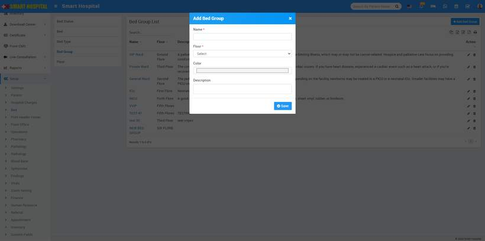  
  
To to add Bed Type click on **+ Add** button then enter **Bed Type Name**.  
  
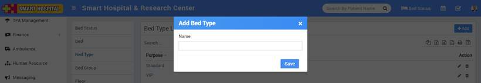  
  
Now to add Bed click on + Add button then enter **Bed Name**, select **Bed** Type and **Bed Group and** if you want show as bed to not available just check the checkbox of **Not available for use**  
  
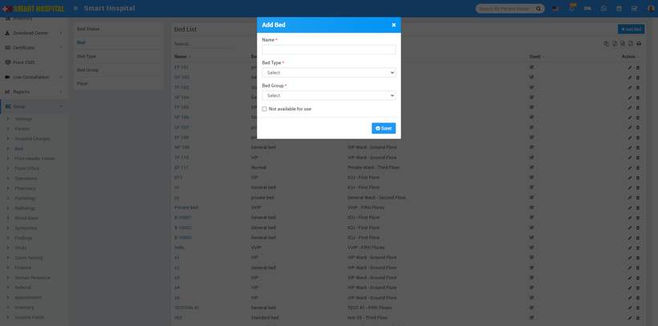  
  
At Bed Status page we can check current status of all bed.  
  
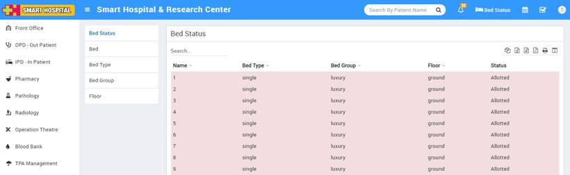  
  
13. For adding header and footer in OPD prescription, IPD Bill, Pharmacy Bill, Payslip go to **Setup > Print Header Footer**.  
  
To add OPD Prescription Header and Footer click on **+ Add** button now select Header image then enter Footer text.  
  
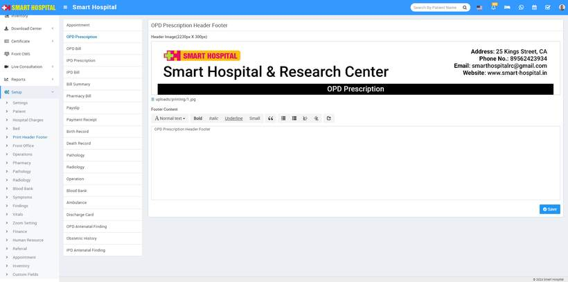  
  
Repeat same process for other module like OPD Bill, IPD Prescription, IPD Bill, Bill,  Pharmacy Bill, Payslip, Payment Receipt, Birth Record, Death Record, Pathology, Radiology, Operation, Blood Bank Ambulance and Discharge Card.  
  
14. To setup Front Office go to **Setup > Front Office.  
  
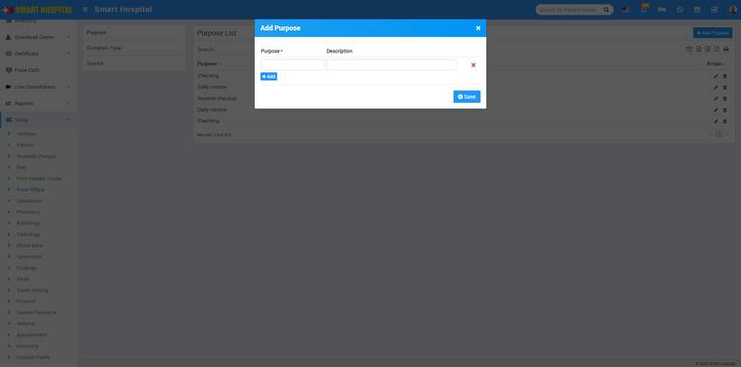**In this form you can enter the **Purpose** and **Description** and if you want to add the multiple purpose simply click on **Add** button showing below of purpose, and add the details Follow same procedure to add **Complain Type** and **Source**.  
  
15. To setup Pharmacy go to **Setup > Pharmacy**To add Medicine Category click on **+ Add Medicine Category** now enter Medicine Category Name. **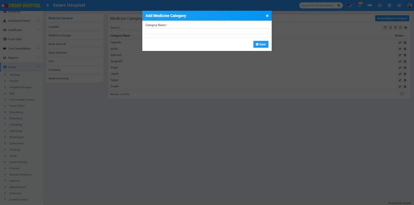**To add Supplier go to Setup > Pharmacy >Supplier and then enter now enter **Supplier Name**, **Supplier Contact**, **Contact Person Name**, **Contact Person Phone**, **Drug License Number,** **Address and** then click on **Save** button.  
  
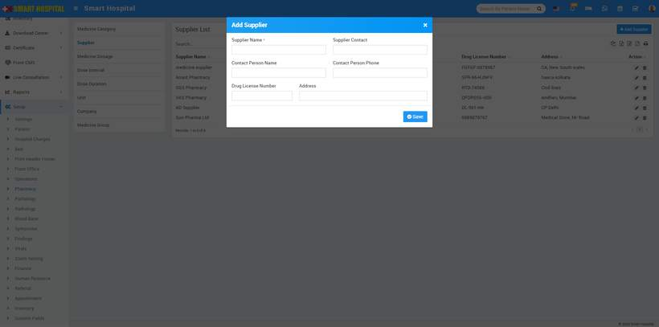  
  
To add Medicine Dosage click on **+ Add Medicine Dosage** now enter **Medicine Category**, **Dosage**.  
  
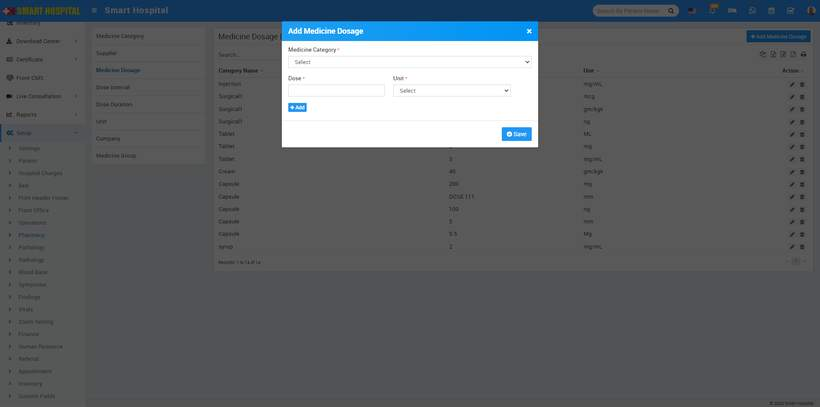  
  
To add Dosage Duration click on **+ Add Dosage Duration** button now enter **Dosage Duration**.  
  
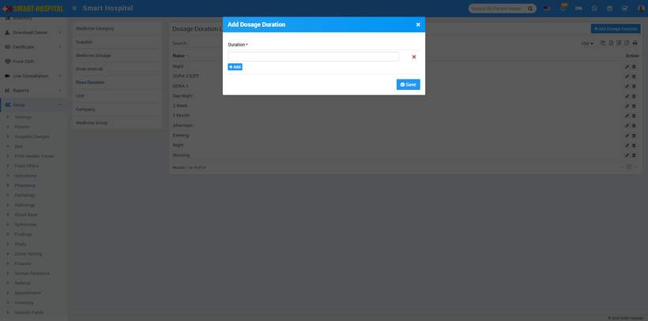  
  
To add Dosage Interval click on **+ Add Dosage Interval** button now enter **Dosage Interval**.  
  
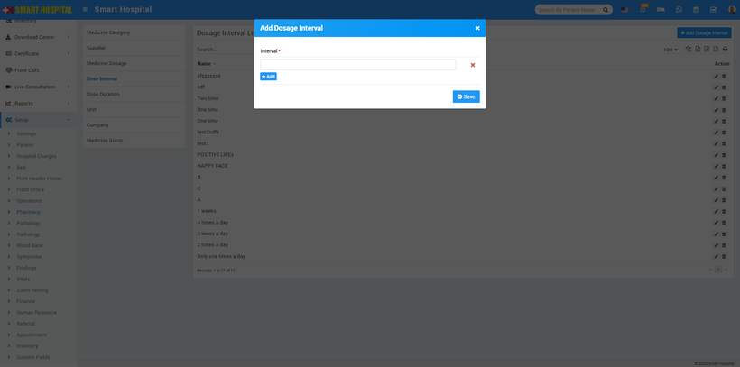  
  
14. To setup **Pathology** go to **Setup > Pathology**.  
  
To add Pathology Category click on **+Add Pathology Category** now enter **Pathology Category Name**.  
  
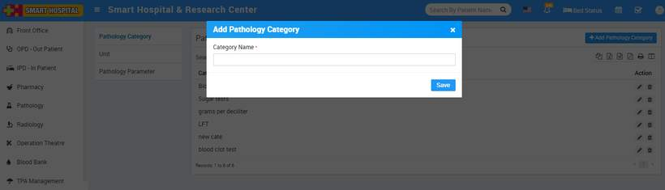  
  
To add pathology unit click on **+ Add Unit** button now enter **Unit Name**.  
  
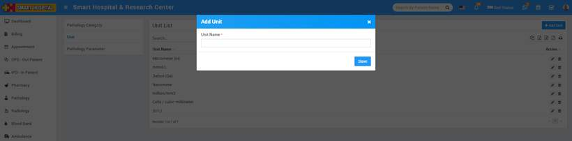  
  
To add pathology parameter click on **+ Add Pathology Parameter** button now enter **Parameter Name**, **Reference Range From to To**, **Unit** and **Description** and then click on the **Save** button.  
  
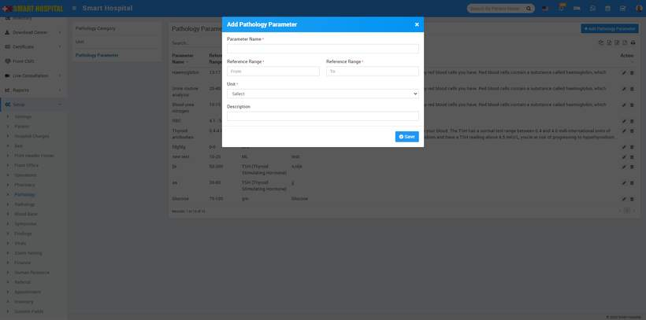  
  
  
15. To setup **Radiology** go to **Setup > Radiology**To add Radiology Category click on **+ Add Radiology Category** now enter **Radiology Category Name.  
  
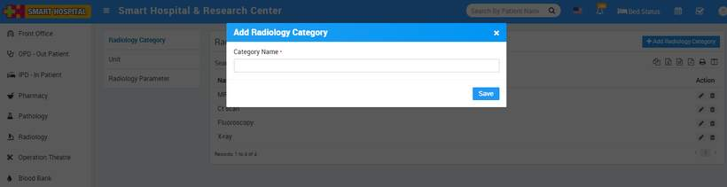**To add radiology unit click on **+ Add Unit** button now enter **Unit Name**.  
  
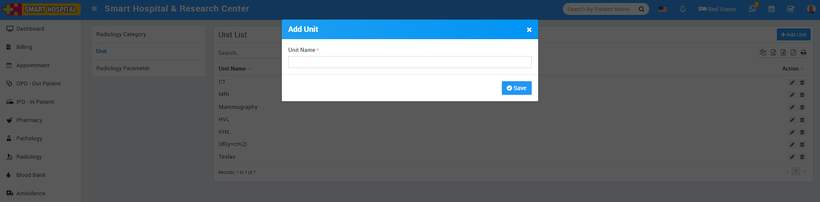  
  
To add radiology parameter click on **+ Add Radiology Parameter** button now enter **Parameter Name**, **Reference Range From to To**, **Unit** and **Description** and then click on the **Save** button.  
  
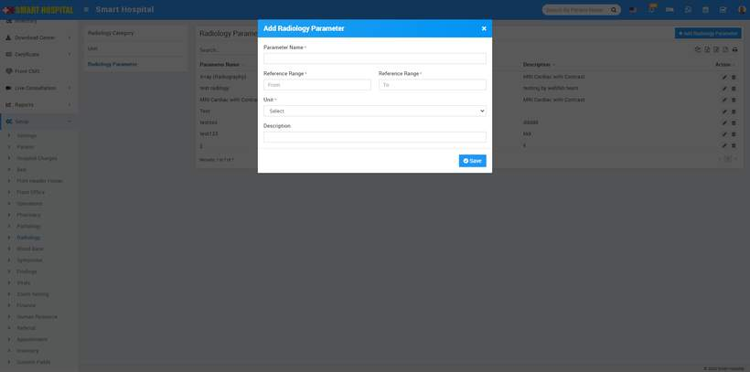  
  
16. To setup **Finance** go to **Setup > Finance**To add Income Head click on **+ Add Income** **Head** button now enter **Income Head** and **Description,** you can also add the multiple details of income head by click on **Add** button showing at the below of income head  
  
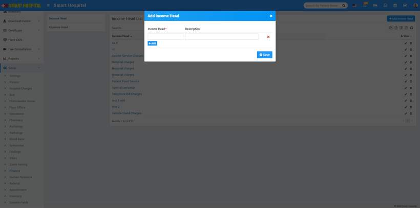  
  
To add Expense Head click on **+ Add Expense Head** button now enter **Expense Head** and **Description**. you can also add the multiple details of Expense Head by click on **Add** button showing at the below of Expense Head   
  
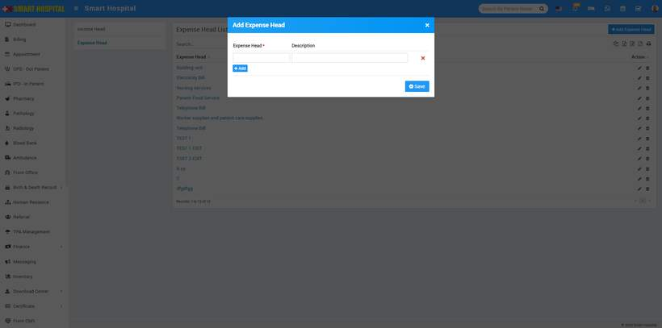  
  
  
17. To setup Human Resource go to **Setup > Human Resource**.   
  
To add Leave Type click on **+ Add** **Leave Type** button now enter Leave Type Name.  
  
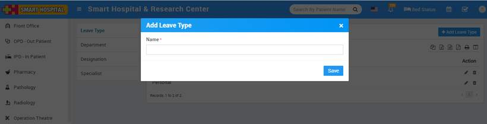  
  
To add Department click on **+ Add Department** button now enter Department Name.  
  
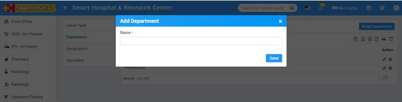  
  
To add Designation click on **+ Add Designation** button now enter Designation Name.  
  
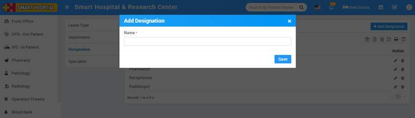  
  
To add Specialist click on **+ Add Specialist** button now enter **Specialist Name**.  
  
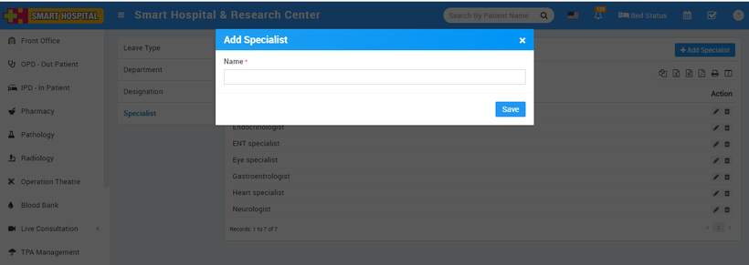  
  
18. To setup Inventory go to **Setup > Inventory**  
  
To add Item Category click on **+ Add Item Category** now enter **Item** Category and **Description**. you can also add the multiple details of **Item Category** by click on **Add** button showing at the below of **Item Category**  
  
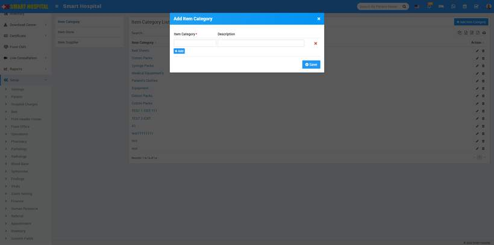  
  
  
To add Item Store click on **+ Add Item Store** button now enter Item Store Name, **Item Stock Code** and **Description**.  
  
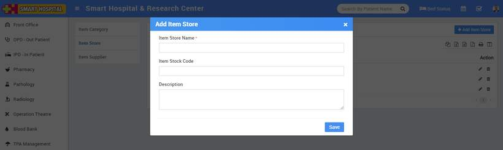  
  
To add Item Supplier click on + **Add Item Supplier** button now enter **Item Supplier Name**, **Phone**, **Email**, **Contact Person Name**, **Address**, **Contact Person Phone**, **Contact** **Person Email** and **Description**.  
  
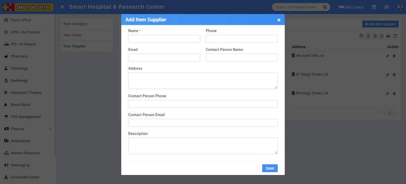  
  
19. To add blood bank product, go to **Setup > Blood Bank** then click on + Add Product and then select **Type** and and enter product **Name** and then click on **Save** button.  
  
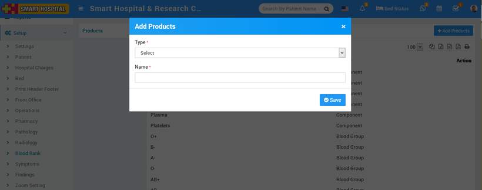  
  
20. To add symptoms go to **Setup > Symptoms**  
  
To add symptoms type click on **+ Add Symptoms Type** then enter **Symptoms Type** and then click on the **Save** button.  
  
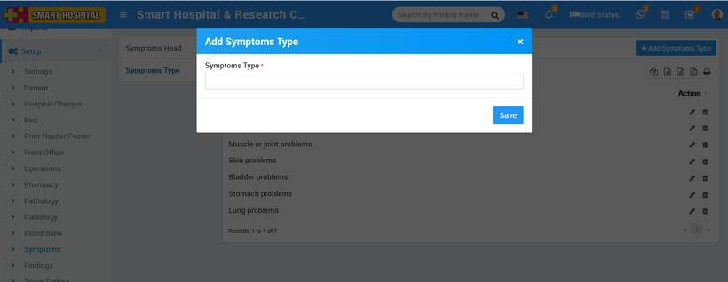  
  
To add symptoms head click on + Add Symptoms Head then enter **Symptoms** **Head**, **Symptoms** **Type** and **Description** then click on the **Save** button.  
  
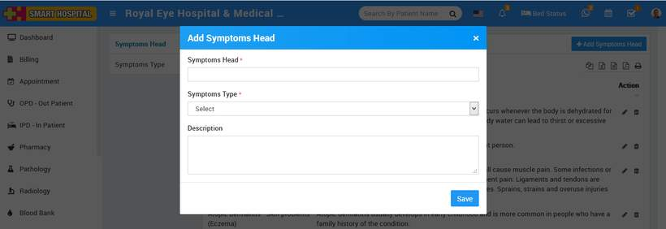  
  
21. To add Finding go to **Setup > Findings**  
  
To add finding category click on **+ Add Findings category** then enter **Finding Category** and then click on the **Save** button.  
  
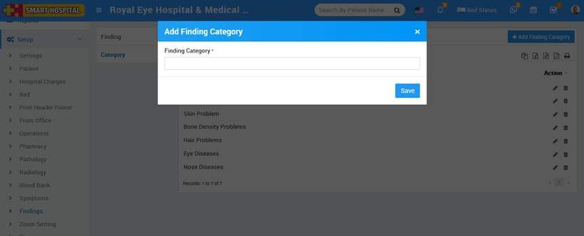  
  
To add Findings click on **+Add Finding** then enter **Finding**, **Category** and **Description** then click on the **Save** button.  
  
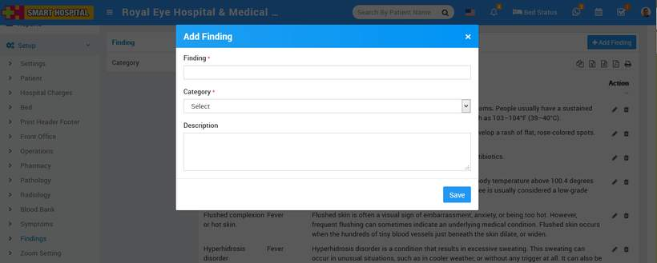  
  
22. To add Referral go to **Setup > Referral**  
  
To add referral category click on **+ Add Referral Category** then enter **Name** and then click on the **Save** button.  
  
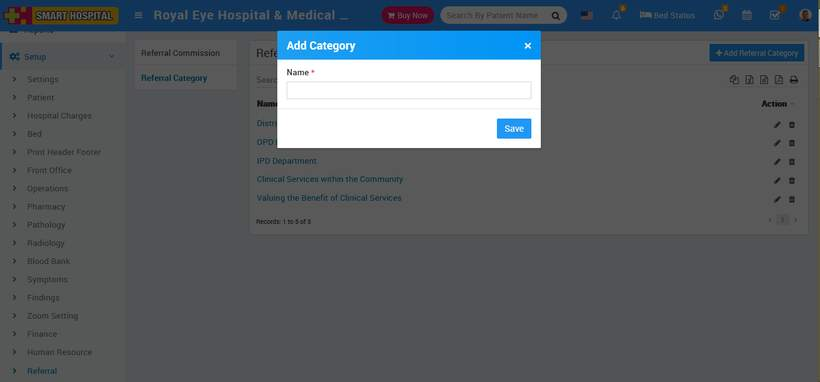  
  
To add Referrlal Commision click on **+Add Referral Commission** then enter **Category** and **Standard Commission** then click on the **Save** button.  
  
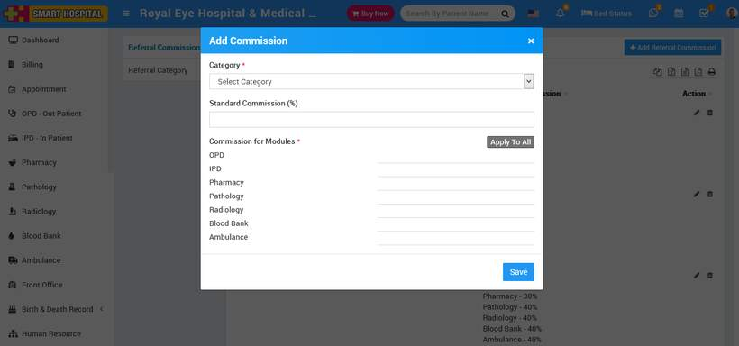  
  
23. Great! you have completed your Smart Hospital setup. Now further we will understand working of all the modules one by one in detail  
  
**1. Billing Module**In Smart Hospital there is a feature of centralized billing so hospital staff not need to go to each module to generate patient bill individually for individual modules.  
  
       In centralized Billing module there are two ways to generate patient bill -  

* One is for single module (like Appointment, OPD, Pathology, Radiology etc) which purpose where patient comes for a particular treatment like patient had came for only blood test so in this case staff need to only generate their blood test bill which it can generate from Pathology tab.
* Second one is for a billing of multiple treatments of patients under OPD / IPD which can be generate through a Case ID of patient.

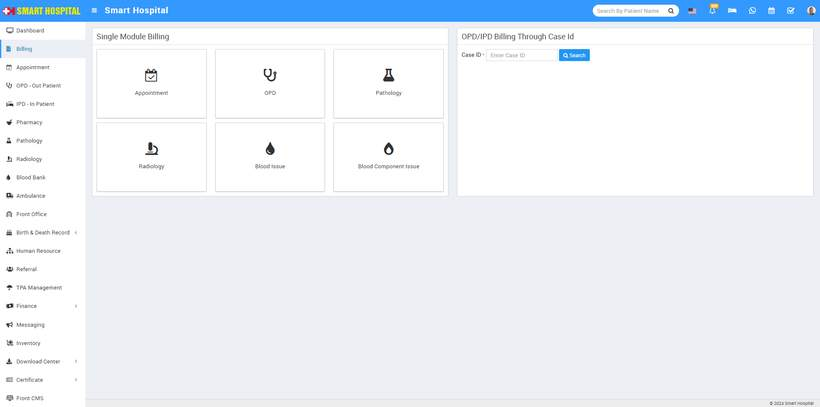  
  
For example to generate patient Pathology bill go to **Billing > Pathology**. Here you can see all patient pathology reports so to generate or print pathology test bill for previously created pathology patient records, click on **View Reports** button available at last column on mouseover.  
  
  
  
Now click on **Print Bill** icon present at top right corner at header, this will print all tests bill in a single bill.  
  
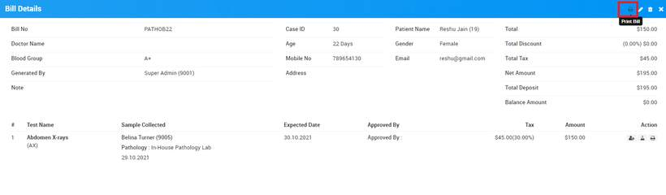  
  
Once you click on this Print Bill icon, it will be shown like this  
  
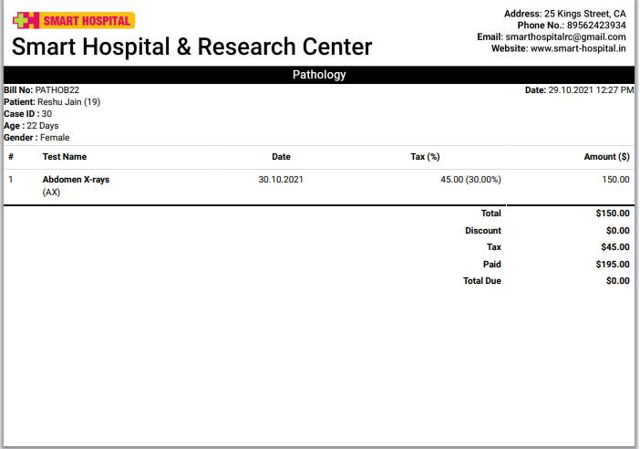  
  
  
  
Follow the above procedure to generate single module billing for all module like Appointment, Radiology, Pharmacy, Ambulance etc.  
  
  
To generate OPD/IPD billing through Case ID, go to Billing > OPD/IPD Billing Through Case ID here enter patient case id (you can get case id from patient OPD or IPD record) then click on search button.  
  
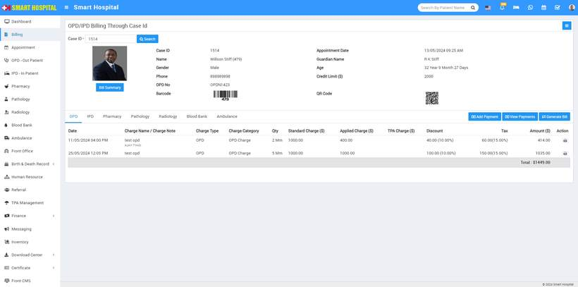  
  
Now here you can see patient overall treatment details and charges from different modules OPD, IPD, Pharmacy, Pathology, Blood Bank and Ambulance which are linked through Case ID and Prescription No.  
  
To generate or print overall treatment bill on one bill or can say single bill print click on **Bill Summary** button. Here you can check all modules bill details. To print this bill click on Print button present at top right corner.  
  
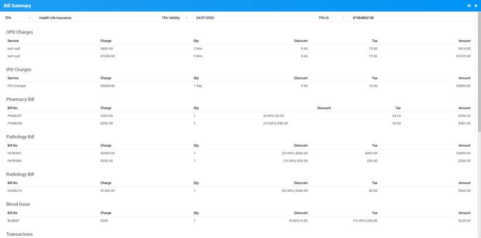  
  
You can also print individual module bill from print option present at respective module list page under details option.  
  
Repeat same procedure to generate billing for all module like IPD,Pathology, Radiology, BloodBank, Ambulance and Pharmacy.  
  
  
**2. Appointment Module -**   
  
Online Apoointment fetaure provides the facility to patient to book their appointment online. Here patient can book their opd appointment for any date according to available slots by making payment online. We have also given the feature that patient can reschedule their appointmnet time if required.  
  
In Smart Hospital you can create Appointment for OPD only, so after that Doctor can move patient in IPD for further treatment if required.  
  
Book Appointment from front site -  
  
  
  
Book Appointment from Admin Panel -  
  
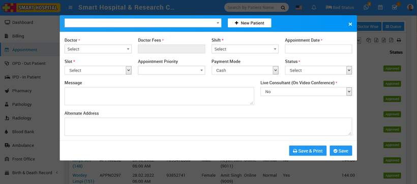  
  
Once Appointment approved, patient can be moved in OPD/IPD.  
  
**3. OPD Module -**  
  
OPD or the out patient department is a wing of the hospital where the patient can seek consultation with a general physician or a specialist to discuss the health issues.  
  
In a hospital, it is the general OPD ward where patients are provided medical assistance and treatment. Under an OPD category, you are not required to stay or get admitted to the hospital. Modern OPDs provide a wide range of services such as illness diagnosis, medical tests and minor surgical injuries.  
  
To add new OPD patient click on **+ Add Patient** button now enter Select Patient from dropdown or **add +New Patient**, **Guardian Name**, **Gender**, **Age**, **Blood** **Group**, **Marital** **Status**, **Patient** **Photo**, **Phone**, **Email**, **Address**, **Remarks**, **Any Known Allergies**, **Height**, **Weight**, **BP**, **Symptoms**, **Note**, **Appointment Date**, **Case**, **Casualty**, **Old Patient**, **Apply TPA (Third Party Administrator)**, **Reference**, **Consultant Doctor**, **Charge Category**, **Charge**, **Tax**, **Standard Charges**, **Applied Charges**, **Amount**, **Payment Mode**, **Paid Amount** and select **Live Consultation** (if yes than live consultation for the patient will create and it will list on patient profile Live Consultation tab).  
  
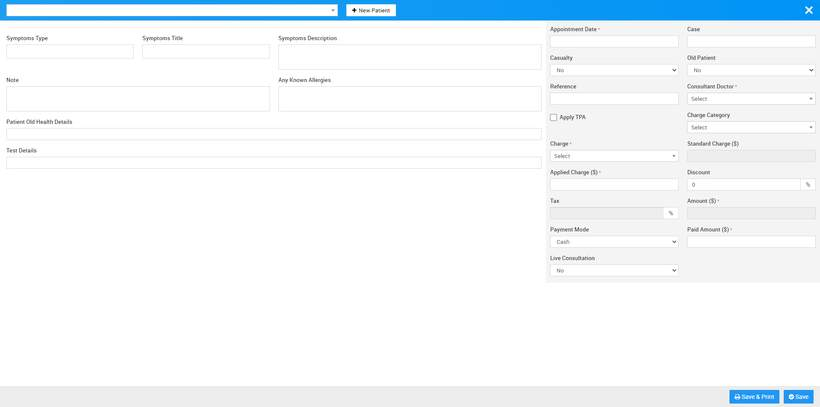  
  
  
**4. IPD Module -**  
  
IPD (In Patient Department) module is for managing those patient who admit in hospital for their issues/disease treatment.  
  
To add new IPD patient click on **+ Add Patient** button. select Patient Name from dropdown or click on **+ New Patient** button to add new patient then enter **Admission Date**, **Case**, **Casualty**, **Old Patient**, **TPA** (Third Party Administrator), **Credit Limit**, **Reference**, **Consultant** **Doctor**, **Bed Group**, **Bed Number** and select **Live Consultation** (if yes than live consultation for the patient will create and it will list on IPD patient profile Live Consultation tab).  
  
  
  
**5. Pharmacy Module -**  
  
Pharmacy module is for managing medicines stock, selling and generating medicine bill.  
  
This module have 5 Section -  

* Add new medicine
* Import medicine
* Add medicine stock
* Add medicine bad stock
* Generate Pharmacy Bill

  
  
To add new medicine click on **+ Add Medicine** button here enter **Medicine Name**, **Medicine** **Category**, **Medicine** **Company**, **Medicine** **Composition**, **Medicine** **Group**, **Supplier**, **Unit**, **Minimum** **Level**, **Reorder Level**, **VAT**, **Unit/Packing**, **VAT Account**, **Note** and **Medicine** **Photo**.  
  
  
  
To import medicines click on **Import Medicine** button. Here select Medicine Category from dropdown and select CSV file, then click on Import Medicine button.  
  
  
  
To add medicine stock you should enter purchased medicine details, for this click on **Purchase** button here you can see list of purchased medicines. ****In Smart Hospital you can add medicine Bad Stock for those medicine which are indicating "Out of stock". To add medicine bad stock or return stock click on **+ Add Bad Stock** button here enter **Batch Number**, **Expiry Date**, **Outward Date Quantity** and **Note**. ****

In Pharmacy there are two ways to generate Pharmacy bill that are generate pharmacy bill manually or you can generate patient pharmacy bill through their prescription id.

So for manually generate medicine sales bill click on Generate Bill button at pharmacy bill page, here first select patient or add new patient to generate patient pharmacy Bill from **+New Patient** button here bill no will be auto generated Number so you need to add **Medicine Category, Medicine Name, Batch Number, Quantity, Sale Price, Tax Amount**. To add more medicine click on "**+Add**" button, then add **Hospital Doctor, Doctor Name, Note**, custom field details (if any) then after adding all medicine enter **Discount and Tax** if any, to calculate final bill click on **Calculate** button then click on **Save** button. After this bill will be display on pharmacy bill page. To see bill details click on **Show** button now here you can also Print medicine bill.

**  
  
6.Pathology Module -**Pathology module is for managing patient pathology test and reports. In Smart Hospital we have provided the feature so staff can arrange collected patient's sample, payments for pathology tests and provide pathology test reports through Smart Hospital application to patients**.  
  
This module have 2 Section -**

* Add Pathology Test
* Add Patient in pathology and View/Print their Report

  
To add pathology test go to **Pathology** and then click on **+ Add Pathology** Test button.  
  
  
To add patient test report for a pathology test, first you need to generate a Pathology Test bill. So go to generate pathology test bill click on **+ Generate** **Bill** button present at Pathology page. ****After generate pathology bill you can view Reports and Add/View Payment. **7. Radiology Module -**Radiology module is for managing patient radilogy test and reports. In Smart Hospital we have provided the feature so staff can arrange collected patient's sample, payments for radiology tests and provide radiology test reports through Smart Hospital application to patients. **This module have 2 Section -**

* Add Radiology Test
* Add Patient in radiology and View/Print their Report

To add Radiology then click on **Radiology Test** button then click on **+ Add Radiology Tes**t button. ****To add patient test report for a radiology test, first you need to generate a Radiology Test bill. So to generate radiology test bill click on **+ Generate Bill** button present at Radiology page. **  
  
8 . Blood Bank Module -**Blood Bank module is for managing blood bank status, **component status**, **donor details** and **blood and component** issue details.This module consisting following sections -

* Add Donor details
* Issue Blood
* Add component
* Issue component in blood bank

To add Donor details go to **Blood Bank > Donor Details > Add Blood Donor**, here enter **Donor Name**, **Date Of Birth**, **Blood Group**, **Gender**, **Father Name**, **Contact Number** and **Address** then click on **Save** button. ****There are two ways to issue Blood, first you can issue blood from Blood Bank Status page and other is go to **Blood Bank > Blood Issue Details > Issue Blood**. ****To issue blood click on Issue Blood button, here enter Patient from Select Patient (search for available patient) or create new patient from **+ New Patient** Button or add patient by entering Case ID (you can find Case Id from OPD or IPD detail of Patient) now enter **Issue Date**, **Hospital Doctor**, **Reference Name**, **Technician**, **Blood Group**, **Bag**, **Charge** **Category**, **Charge Name**, **Standard Charge**, **Note**, **Discount**, **Tax**, **Payment Mode** and **Payment Amount** (Payment Amount will automatically calculate) then click on **Save & Print** or **Save** button.   
  
To add component in Blood Bank go to **Blood Bank > Component Issue > Components > Add Components**. Here select **Blood Group** and **Bag** then enter **Components Name, Bag, Volume, Unit, Lot and Institution** then click on **Save** button.   
  
  
To issue component click on **+Issue Component** button, here enter Patient from Select Patient (search for available patient) or create new patient from + New Patient Button or add patient by entering Case ID (you can find Case Id from OPD or IPD detail of Patient) and if require then **Apply TPA (Third Party Administrator)** now enter Issue Date, Hospital Doctor, **Reference Name**, **Technician**, **Blood Group**, **Components**, **Bag**, **Charge** **Category**, **Charge** **Name**, **Standard Charge**, **Note**, **Discount**, **Tax**, **Payment Mode** and **Payment Amount** (Payment Amount will automatically calculate) then click on **Save & Print** or **Save**button.  **  
  
9. Ambulance Module -**Ambulance module is for managing ambulance vehicles and ambulance calls for patient travelling.This module consisting following sections : -

* Add ambulance vehicle
* Add ambulance call

To add new ambulance vehicle, click on Ambulance link then click on the **Ambulance List** button, this will redirect you in Ambulance List page, now click on **+ Add Ambulance** button and then add new ambulance vehicle.  
 ****To add new ambulance call go to Ambulance module and  click on **+ Add Ambulance Call** button. Here select Patient Name from dropdown (or click on **+ New Patient** button to add new patient or Enter Case ID so patient details will auto fill here) then add patient's to ambulance call.  
  
  
  
**10. Front Office Module -**   
  
This module has 4 sections -  

* **Add Visitor**          -  This section  used for managing visitor’s records coming in hospital
* **Phone Call Log**   -  This section used for managing incoming or outgoing call details
* **Postal**                  -  This section used for managing postal inward documents for managing postal receive/dispatch.
* **Complain**            -  This section used for for managing any complain raise by any person.

  
  
****11.  Birth an Death Record Module -****This module has 2 sections -

* **Birth Record**        - This section manage all babies birth record happened in hospital. .
* **Death Record**       -  This section manage all expired patient record happened in hospital.

To add record, click on **+ Add Birth Record** , here you enter **Child Name**, **Gender**, **Weight**, **Child Photo**, **Birth Date**, **Phone**, **Address**, **Mother Name,** **IPD/OPD Number**, **Mother Photo**, **Father Name**, **Father Photo**, **Report**, **Attach Document**(Any ID Proof or other required document), **Custom Field**(Optional).  
  
  
  
To add record, click on **+ Add Death Record**, here you enter **Case ID**, **Patient** **Name**, **Death Date**, **Guardian Name**, **Report**, **Custom Field** (optional).  
  
  
  
**11.  Human Resource Module -**The main function of the Human resource module is to make necessary staff arrangements, maintain staff attendance for the hospital.  
  
This module has 4 sections -  

* **Staff Directory**
* **Staff Attendance**
* **Payroll**
* **Leaves**

**Staff Directory -** In this section you can search all active staff members. You can filter staff members by **Role** or search by any **keyword**. You can also see staff directory in two views Card View or List View.  
  
  
  
To add new staff member click on **+ Add Staff** button from top right corner of this page. Enter **Staff ID**, select **Role** (roles can be manage from **Setup > Settings > Roles Permission**), **Designation**, Department, **First Name**, **Last Name**, **Father Name**, **Mother Name**, **Gender**, **Marital Status**, **Date Of Birth**, **Date Of Joining**, **Phone**, **Emergency** **Contact Number**, **Email**, **Photo**, **Current Address**, **Permanent Address**, **Qualification**, **Work Experience**, **Specialization**, **Note**, **EPF No** (Employee Provident Fund Number), **Basic Salary**, **Contract Type**, **Work Shift**, **Location**, **Leaves**(Sickness, Personal), B**ank Account Title**, **Bank Account Number**, **Bank Name**, **IFSC Code**, **Bank Branch Name**, **Facebook URL**, **Twitter URL**, **LinkedIn URL**, **Instagram URL**, **Upload Resume**, **Joining Letter** and **Other Documents** then click on **Save** button.  
  
  
  
**Payroll -**  
  
In this section we will generate monthly salary of staff members. Select **Role**, **Month** and **Year** then click **Search** button to see staff members list and their payroll status. Now you can see staff list, from Status column you can see current salary status available option from **Action** column. Payroll has three status **Not Generated** -> **Generated** -> **Paid**. If status is **Not Generated** then you can see **Generate Payroll** button, if status is Generated then you can see Proceed To Pay button and if status is Paid then you can see **View** **Payslip** button in **Action** column. If status is Generated or **Paid** then you can revert this status in previous status.  
  
  
  
Now click on **Generate Payroll** button from **Action** column. At this page you can see staff profile, attendance, approve leaves details. In earning column add earning **Type** and **Amount** then in deduction column enter deduction **Type** and **Amount** (from top right corner **Attendance** section you can check this month all attendance and approve details based on this you can calculate deduction for this staff) then in Payroll Summary column enter any tax if applied then finally click on **Calculate** button to calculate Net Salary amount then click on **Save** button to save this salary generation.  
  
  
  
Now come again on payroll page and check this staff payroll status for same month now it should be **Generated** and in **Action** column **Proceed To Pay** button should be visible. Here click on **Proceed To Pay** button to pay generated salary to this staff. Now at Proceed To Pay modal popup window you can **Staff, Net Payment Amount, Month-Year**, select **Payment mode** through which you are paying salary,**Payment Date**, and **Note** then click on **Save** button.  
  
  
  
Now come again on payroll page and check this staff payroll status for the same month now it should be **Paid** and in **Action** column **View Payslip** button should be visible. Here click on **View Payslip** button to see and print payslip.  
  
  
  
**Leave -**   
  
In this section you can apply for leave request or if you have permissions then you can approve other leave request. For approve leave request click on **Approve Leave Request** button here you can view, approve or manually submit staff leave request. Click on **View** icon button from **Action** column to see details of applied leave request. Now at this modal popup window you can see details of leave request and change its status to **Approve/Disapprove/Pending** then enter any Note then click on **Save** button.  
  
To add leave request manually click on + **Add Leave Request** button from top right corner. Here select **Role, Staff Name, Apply Date, Leave Type, Leave Date, reason, Note, Attach Document** and **Status** of leave request then click on **Save** button  
  
  
  
To apply self leaves click on **Apply Leave** button, here logged in staff user can apply/view leave request for his own only. To view applied leaves click on **View** icon button from **Action** column. To apply leave click on **+Apply Leave** button from top right corner.  
  
  
  
**12. Referral -**  
  
This module has 2 sections -  

* **Add Referral Person**
* **Add Referral Payment**

Most often, patients get referral **to see a specialist from their primary care physician** or from a doctor at a hospital. Doctors refer patients based on what they feel is necessary for them, and this is how many specialists get the bulk of their patient base.  
  
To Add Referral Person click on **Referral**link present at the side menu then click on**Referral Person** and then click on **+Add Referral Person** button, here enter **Referrer Name**, **Referrer Contact**, **Contact Person Name**, **Contact Person** **Phone**, **Category**, **Standard** **Commission** **(%),** **Address** and **Commission** **for Modules (%)** details and click on **Save** button.  
  
  
  
To add Referral Payment go to Referral module then click on **+Add Referral Payment** button. Here add **Patient, Patient Type, Bill No/Case Id, Patient Bill Amount, Payee, Commission Percentage (%), Commission Amount** and then click on **Save** button.  
  
  
  
**13. TPA Module -**TPA module is for managing third party administrator or Mediclaim insurance provider companies. A third-party administrator is a company that provides operational services such as claims processing and employee benefits management under contract to another company. Insurance companies and self-insured companies often outsource their claims processing to third parties. With the help of TPA patient can get lots of discount in hospital charges.  
  
To add new TPA click on **+ Add TPA** button here enter **TPA Organization Name, Code, Contact Number, Address, Contact Person name, Contact Person Phone** then click on **Save** button.  
  
****  
  
To check TPA list associated with the hospital, login from superadmin, admin panel and then click on the TPA Management link present in the the left sidebar, by clicking this link you can check all TPA list.  
  

**Add TPA charges on hospital charges -**

To add TPA charges on hospital charges, go to **Setup > Hospital Charges**, this will redirect you in **Charges Details List** page, here click on  **+Add Charges** button present at the top right corner of the page, then enter all mandatory details like **Charge Type**, **Charge Category**,**Unit Type**,**Charge Name**,**Tax Category**,**Tax Category**and **Scheduled Charges For TPA**(enter amount for different TPA) and then finally click on the**Save** button.  
  
  
  
Once TPA amount is saved, you can use it in different module. For example you have added TPA for OPD charges, now when you add any opd charge you need to selected TPA and **Charge** **Category**, **Charge** and this will automatically calculated your TPA amount. For example your OPD consultation Fees was Rs.150 and you have select CGHS TPA for which opd consultation charge was Rs.100 so your applied charge will be Rs.100 .  
  
  
  
**13. Finance Module -**  
This module has 2 sections -

* **Income**
* **Expense**

**Income** - Here we will manage all general income coming from different Income Heads. To add new income click on **+ Add Income** button, here enter **Income Head, Name, Invoice Number, Date, Amount, Attach Document and Description  
  
  
  
Expense -** Here we will manage all expenses coming from different Expense Heads. To add new expense click on + Add Expense button here enter **Expense Head**, **Name**, **Invoice** **Number**, **Date**, **Amount**, **Attach** **Document** and **Description**.  
  
  
  
**14.Messaging Module -**  
  
This module is for sending different messages to different users.  
  

This module has 2 sections -

* **Add Notification**
* **Send Email**
* **Send SMS**

  
**Notice Board** is for sending common messages to all staff members to add new notice board message click on **+Post New Message** button, here enter **Message Title, Message Text, Notice Date, Publish On Date and Message To** different types of staff users  
  
  
  
To send Email click on **Send Email** button. Here you can send two types of email either group email or individual user email. To send group email click on **Group** tab, here enter**Email Title, Attachment, Message Text, Message To** select different users group. Open **Individual** tab to send Email to individually selected Patient, Admin and Accountant.  
  
  
  
To send SMS click on **Send SMS** button. Here you can send two types of sms either group sms or individual user sms. To send group sms click on **Group** tab, here enter**SMS Title, Send Through SMS or Mobile App, Message Text, Message To** select different users group. Open **Individual** tab to send SMS to individually selected Patient, Admin and Accountant.  
  
  
  
  
  
**15. Inventory -**Inventory module is for managing different assets or items present in hospital. First we will add items then add item stocks then we will manage issue and return of items to different staff members.

This module has 2 sections -

* **Add Item**
* **Add Item Stock**
* **Issue Item**

To see items, click on **Item** button. At this page to add new items click on **+ Add Item** button here enter **Item Name**, **Item Category**, **Unit, Purchase Price** and **Description  
  
**To add item stock click on **+ Add Item Stock** button, here enter Item **Category**, **Item Name**, **Supplier**, **Store**, **Quantity**, **Purchase Price**, **Date**, **Description** and **Attach Document**.  
  
  
  
To see issue or return item click on **Issue Item** button.

To issue an item click on **+ Add Issue Item** button, here enter **User Type, Issued to, Issue By, Issue Date, Return Date, Note, Item Category, Item**and **Issue Quantity**.

  
  
You can view this added record in the Issue Item List page.  
  
  
  
To return an item click on Click To **Return** button.  
  
  
  
**16. Download Center Module -**Download Center is for managing different documents which should be available for download to other staff members.  
  
To upload document, go to the Upload/Share Content, here click on **+ Upload** button, first select the **Content Type** and you can either **Upload your File** or **Upload Youtube Video Link** and click on **Save**.  
  
  
  
To add content type, go to the **Download Center > Content Type,** On the right top of the page you can see the **Add Content Type** Button available, simly click on **Add Content Type** form would be open simply enter the details and click on **Save** button, **Content Type** will add successfully.  
  
  
  
For **Content Share List**, go to the **Download Center > Content Share List**, In the page you can see all the contents details and its Link which you shared simply click on **View** icon details will be display  
  
  
  
And click on **Link** icon showing next to the **View** icon under **Action** column  
  
  
  
**16. Certificate Module -**  
  
In Smart Hospital Certificate is a document that is used to generate patient profile so you can take just printout of it and simply paste it into Patient file in which all patients records and their health related data is available Certificate   

This module has 6 sections -

* **Add Certificate**
* **Add Patient ID Card**
* **Add Staff ID Card**
* **Generate Certificate**
* **Generate Patient ID Card**
* **Generate Staff ID Card**

  
To add patient certificate, go to **Certificate > Certificate > Certificate Template** then click on the **+ Add Certificate Template**button, present at the top right corner of the page and then enter **Certificate Name** (certificate name is only for certificate design reference purpose it will not be print on actual certificate)**, Header Left Text, Header Center text, Header Right Text, Body Text** (enter specified keywords for replacing student data dynamically at time of certificate generation)**, Footer Left Text, Footer Center Text, Footer Right Text, Certificate Design – Header Height, Footer Height, Body Height, Body Width, Patient  Photo, Background Image** and then click on **Save** button. You can view this added record in the**Certificate List**  page.  
  
  
  
  
  
  
Now select patient for generate certificate and click on **Generate** button present at right side in the patient list, at click of this button certificate will be generate.  
  
  
  
To generate certificate, go to **Certificate > Generate Certificate** then select **Module,****Patient Status** and**Certificate** and then click on **Search** button. The list of patient will be shown in the below of the page.  
  
**Note -** Repeat same procedure for Patient ID card and Staff ID card.  
  
**17. Front CMS Module -**  
  
This module used for managing hospital front website. First we will upload different images or files used in front website in Media Manager then we will create front website menu in Menus then we will add different Pages, Events, Galleries, News and Banner images.  
  

This module has 7 sections -

* **Add Media Manager**
* **Add Banner Images**
* **Add Events**
* **Add Gallery**
* **Add News**
* **Add Menus**
* **Add Pages**

  
**Add Media Manager -**  
  
To upload file (like images)  and YouTube videos , go to **Front CMS > Media Manager** then Choose or drag file in the **Upload Your File**option so selected file will be upload in your Smart hospital on Media Manager. Also to**upload youtube video enter youtube url at****Upload Youtube Video URL** section and then click on **Submit** button. Uploaded file and youtube video will show at Media Manager list page.  
  
  
  
  
**Add Banner Image -**  
  
To add banner image, go to **Front CMS > Banner** then click on **Add** **Image** button present at top right corner in the **Banner Images** page, at click of this button **Media Manager** modal will be open, here select the file which you want to add in banner image ( you can search  any file by its file type ( image, Video, Text, Zip, Pdf etc.) ) then click on **Add** button.  
  
  
  
**Add Event -**To add event, go to **Front CMS****then click Down Arrow icon and then click on****Add Event** button present at top right corner in Page List page. Here you can add all events scheduled past/future in your hospital. To add new event click on **+ Add** button. Here enter **Event Title**, **Event Venue**, **Event Start Date**, **Event End Date**, **Description**, **SEO Detail Meta Title**, **Meta Keyword**,**Meta Description** then select Sidebar Setting, Featured Image then click on **Save** button.  
  
  
  
**Add Gallery -**  
  
To add new gallery go to **Front CMS then click Down Arrow icon and then**click on Add Gallery button. Here you can add all image/video galleries of your hospital. To add new gallery click on + Add button. Here enter gallery Title, Description, Gallery Images, SEO Detail Meta Title, Meta Keyword, Meta Description then select Sidebar Setting, Featured Image then click on **Save** button.  
  
  
  
**Add News -**  
  
To add new news go to **Front CMS then click Down Arrow icon and then**click on Add News button. Here you can add all News/Notices of your hospital. To add new news click on + Add button. Here enter news Title, News Date, Description, SEO Detail Meta Title, Meta Keyword, Meta Description then select Sidebar Setting, Featured Image then click on **Save** button.  
  
  
  
**Add Menus -**  
  

Front CMS module for managing hospital front website. First we will upload different images or files used in front website in Media Manager then we will create front website menu in Menus then we will add different Pages, Events, Galleries, News and Banner images.

To add menu, go to **Front CMS > Menus**, Here by default you will get two menu **Main Menu** and **Bottom Menu**. Here you can add more menu but these other menu will be only display in front site if you will add them in front site theme additionally. To add more menus enter **Menu** and **Description** and then click on **Save** button. You can view this added menu record in the**Menu List** on the right of the page.  
  
  
  
To add menu item click on **Add (+)** icon present at **Action** column in the menu list, at click of this icon **Add Menu Item** page will be open.

  
  
Here enter **Menu Item, External URL, Open In New Tab, External URL Address, Pages** and then click on **Save** button. You can view this added record in the **Menu Item List** on the right side of the page. Here you can arrange menu order and add menu item up and down in menu item list.  
  
**Add Pages -**To add pages, go to **Front CMS** then click on**Add Page** button present at top right corner in page list page, then enter the page **Title,** select **Page Type** (Standard, Events (page to show all Events), Notice (page to show all News/Notices) and Gallery (page to show all images/video Galleries) and **Description, Add Media, SEO Detail** click on **Add (+)** icon enter details here **Meta Title, Meta Keyword, Meta Description** and then select **Sidebar Setting** to show and hide sidebar and select **Featured Image** (featured image will be show only those themes or pages which have support for featured image) and then click on **Save** button.  
  
  
**18. Reports  Module -**  
Here in this section you can check all modules reports.  
  

