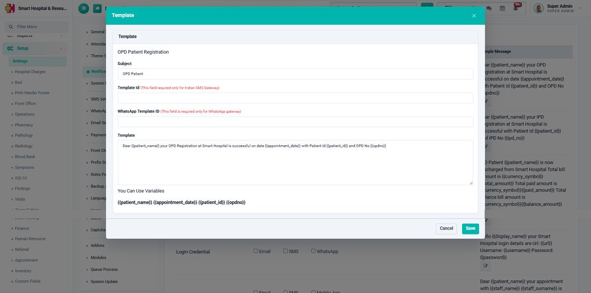

# How to enable WhatsApp for a Notification Event?

_Sat, 25 Jul, 2026_ · [Getting Started (3)](https://smart-hospital.in/category/getting-started) · vendor article: https://smart-hospital.in/article/how-to-enable-whatsapp-for-a-notification-event

### How to enable WhatsApp for a Notification Event?

Sat, 25 Jul, 2026

[Articles](https://smart-hospital.in/articles)[WhatsApp Messaging](https://smart-hospital.in/category/whatsapp-messaging)

---

Once a WhatsApp provider is configured and enabled (see the Twilio or Meta setup articles), go to **Setup → Settings → Notification Setting**. Every event the system can notify about — **OPD Patient Registration**, **IPD Patient Registration**, **IPD Patient Discharge**, **Login Credential**, **Appointment Approved**, **Live Meeting**, **Live Consult**, **OPD Patient Discharged**, **Forgot Password**, and more — is listed with a checkbox per delivery channel: **Email**, **SMS**, **Mobile App** and **WhatsApp**.

Tick the **WhatsApp** checkbox next to any event to start sending that event over WhatsApp as well.  
  
  
  
  
Click the small edit icon next to an event's sample message to open its **Template** dialog. Besides the message **Subject** and **Template** text (which can use placeholders such as `{{patient_name}}`, `{{appointment_date}}`, `{{patient_id}}`), this dialog also has a **WhatsApp Template ID** field.  
  

