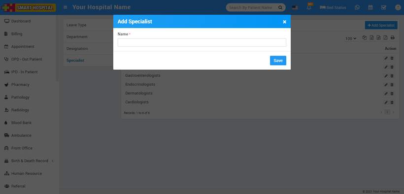
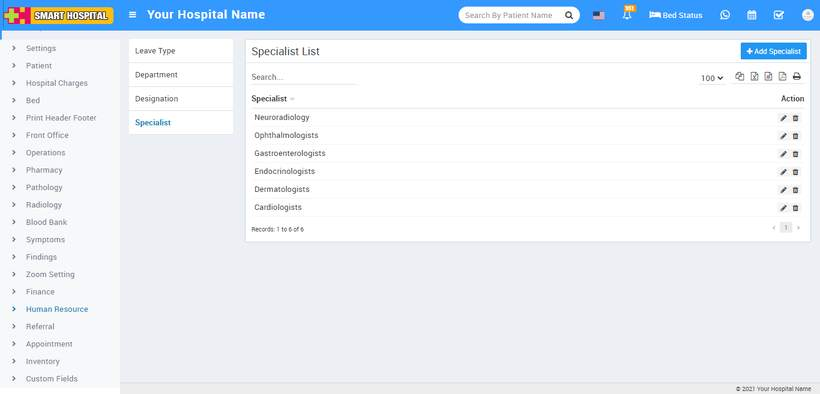

# How to add Specialist?

_Tue, 26 Oct, 2021_ · [Human Resource (13)](https://smart-hospital.in/category/human-resource) · vendor article: https://smart-hospital.in/article/how-to-add-specialist

### How to add Specialist?

Tue, 26 Oct, 2021

[Articles](https://smart-hospital.in/articles)[Human Resource](https://smart-hospital.in/category/human-resource)

---

**Specialist** is very useful feature in Smart Hospital which is helpful to characterized doctors between different specialties.

To add **Specialist**, go to **Setup >** **Human Resource >** **Specialist** then enter **Name** and then click on**Save** button.  
  

You can view this added record in the **Specialist** **List** on the right side of the page.  
  

To edit specialist click on**Edit** icon and to delete department click on **Delete** icon present in the Specialist list.
