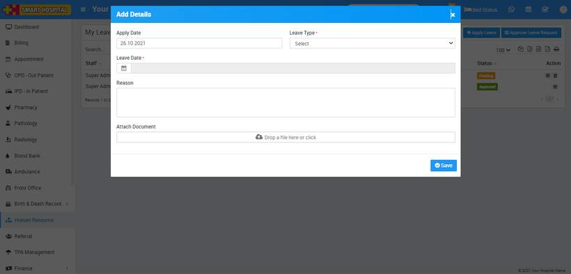
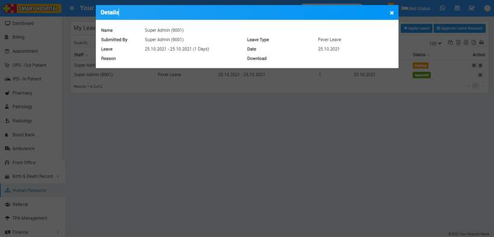
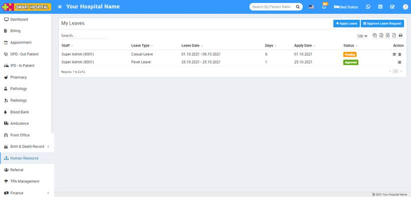
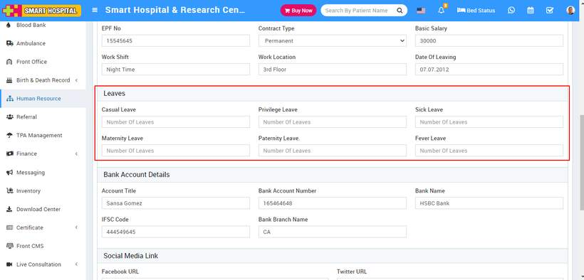

# How to apply Leave in Smart Hospital?

_Thu, 02 Dec, 2021_ · [Human Resource (13)](https://smart-hospital.in/category/human-resource) · vendor article: https://smart-hospital.in/article/how-to-apply-leave-in-smart-hospital

### How to apply Leave in Smart Hospital?

Thu, 02 Dec, 2021

[Articles](https://smart-hospital.in/articles)[Human Resource](https://smart-hospital.in/category/human-resource)

---

To apply leave, go to **Human Resource > Approve Leave Request > Apply Leave** then click on the **Apply Leave** button present at top right corner in leaves page, at click of this button **Add Details** modal will be open. Here select **Apply Date, Available Leave,** **Leave Date, Reason**and **Attach Document** and then click on **Save** button.  
  
  

To view apply leave click on **View** icon present at **Action** column in the leaves page, at click of this icon **Details** modal will be open. Here you can see the details of staff member.  
  

To delete apply leave click on **Delete** icon present at **Action** column in the leaves page.  
  
  
  
  
Note - Before apply for leave make sure you have assigned leave to staff from Human Resource > Edit Staff at Leave section otherwsie on Leave Type drop down no record will be shown.  
  

