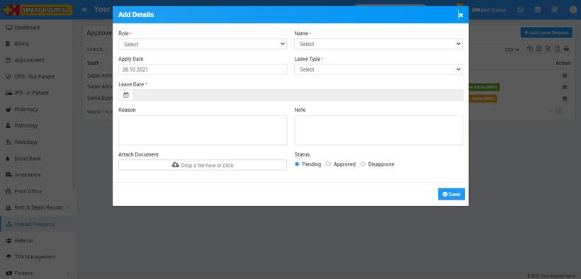
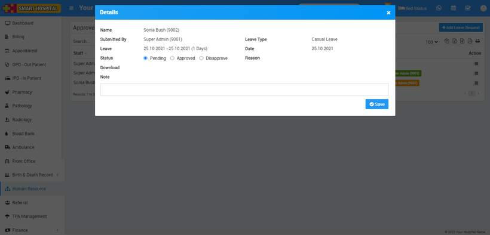

# How to approve Leave Request?

_Tue, 26 Oct, 2021_ · [Human Resource (13)](https://smart-hospital.in/category/human-resource) · vendor article: https://smart-hospital.in/article/how-to-approve-leave-request

### How to approve Leave Request?

Tue, 26 Oct, 2021

[Articles](https://smart-hospital.in/articles)[Human Resource](https://smart-hospital.in/category/human-resource)

---

To add leave request, go to **Human Resource > Approve Leave Request**then click on **Add Leave Request** button present at top right corner in the approve leave request page, at click of this button **Add Details** modal will be open.  
  
Here select **Role, Name, Apply Date, Leave Type, Leave Date, Reason, Note, Attach Document** and **Status** and then click on **Save** button.  
  

To view approve leave request click on **View** icon present at**Action** column in the approve list page, at click of this icon**Details** modal will be open. Here you can see details of staff member.  
  

