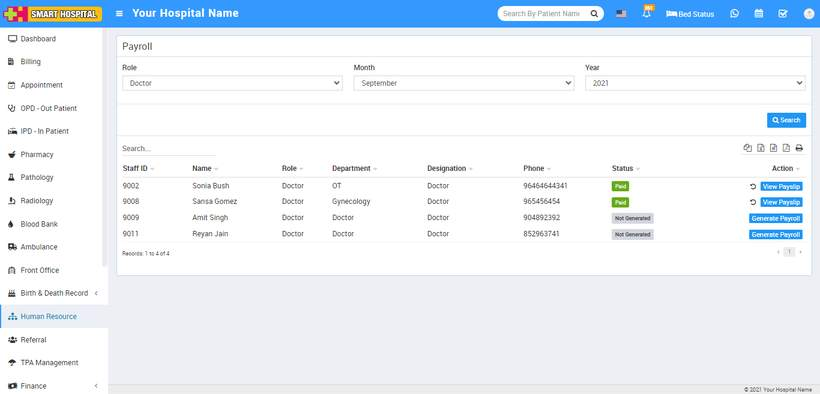
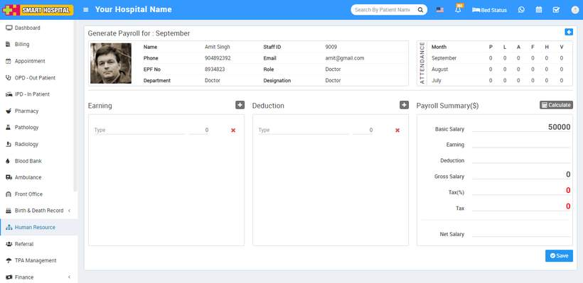
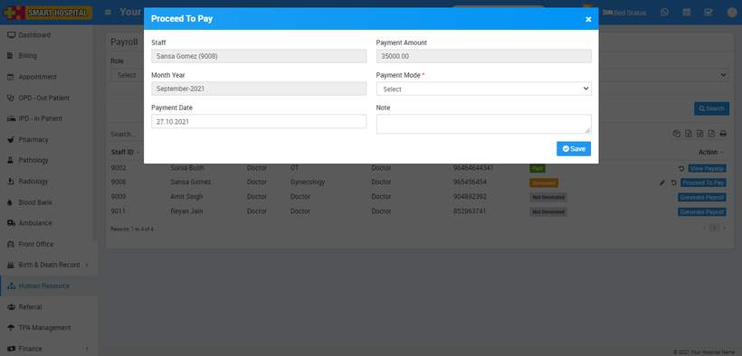
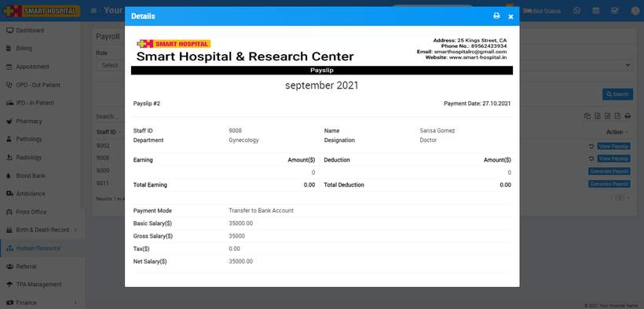
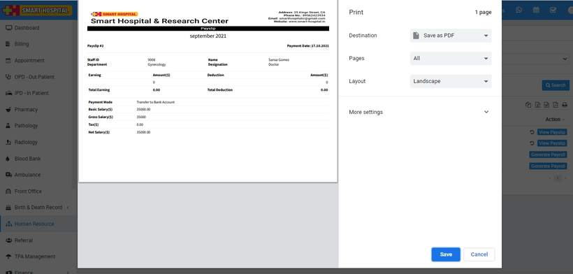

# How to generate Payroll?

_Tue, 26 Oct, 2021_ · [Human Resource (13)](https://smart-hospital.in/category/human-resource) · vendor article: https://smart-hospital.in/article/how-to-generate-payroll

### How to generate Payroll?

Tue, 26 Oct, 2021

[Articles](https://smart-hospital.in/articles)[Human Resource](https://smart-hospital.in/category/human-resource)

---

To generate payroll for staff members, go to **Human Resource > Payroll** then select **Role, Month** and**Year** and then click on **Search** button. Here you can see staff member list and their payroll status and current salary from action column.  
  
If status is paid to then you can see**View Payslip** button and if status is generated then you see **Proceed To Pay** button and if status is not available then you can see **Generate Payroll** button present in **Action** column.  
  

Now click on **Generate Payroll** button present at **Action** column in staff list, at click of this button **Staff Details** page will be open. You can see staff member profile and attendance.

Here enter earning **Type** and **Amount** present in earning column. To add more earning type and amount click on **Add** icon and to delete earning type and amount click on **Remove** icon.  
  
Here enter deduction **Type** and**Amount** present in deduction column. To add more deduction type and amount click on **Add** icon and to delete deduction type and amount click on **Remove** icon.  
  
To view staff member basic salary, click on **Calculate** button present in **Payroll Summary** column. Here you can see salary details and then click on **Save** button.  
  

Now click on **Proceed To Pay** button present at **Action** column in staff list, at click of this button **Proceed To Pay** modal will be open. Here you can see **Staff Name, Payment Amount, Month Year** and select **Payment Mode, Payment Date,** **Note** and then click on **Save** button.  
  

Now click on **View Payslip** button present at **Action** column in staff list, at click of this button **Details** modal will be open. Here you can see staff payslip details.  
  

To print payslip click on **Print** icon present at top right corner in the **Details** page, at click of this icon print modal will be open.  
  

**Note:** Do not print payslip directly, here select the Destination (save as pdf) and save pdf file and then print payslip using this pdf file.
