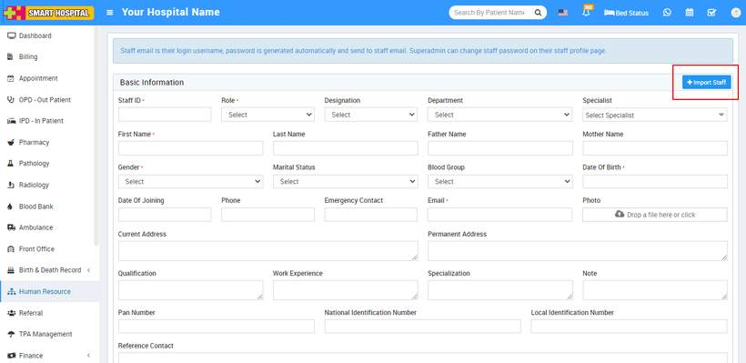
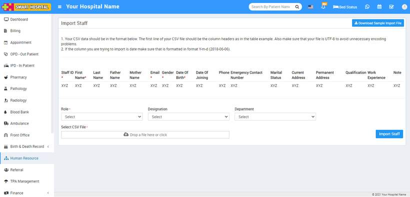

# How to import Staff?

_Mon, 01 Nov, 2021_ · [Human Resource (13)](https://smart-hospital.in/category/human-resource) · vendor article: https://smart-hospital.in/article/how-to-import-staff

### How to import Staff?

Mon, 01 Nov, 2021

[Articles](https://smart-hospital.in/articles)[Human Resource](https://smart-hospital.in/category/human-resource)

---

To import staff, go to**Human Resource > Add Staff > Import Staff** click on the **Import Staff** present at top right corner on the right side in the Basic Information page, at click of this button **Staff Import** page will be open.  
  
  
  
You have to follow all the necessary instructions given. Here you can also add multiple staff at the same time for this, you have to create a CSV file format. You can also download the sample file from top right corner by clicking on **Download Sample Import File** button.  
  
  
  
You should not delete the first row of CSV file. It is necessary to fill the required field in this file. After completing the file, here select**Role, Designation** and **Department** and then you have to select this CSV file on **Select CSV File** option and then click on **Staff Import** button.
