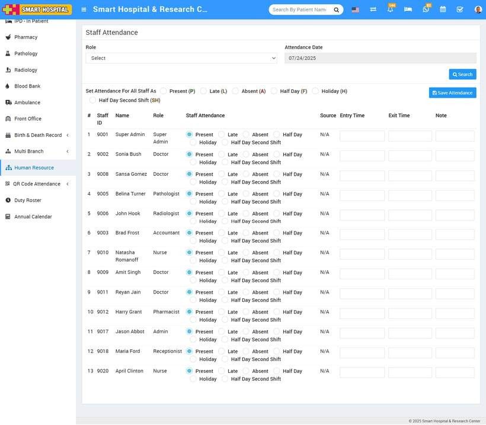

# How to mark staff attendance?

_Sat, 02 Aug, 2025_ · [Human Resource (13)](https://smart-hospital.in/category/human-resource) · vendor article: https://smart-hospital.in/article/how-to-mark-staff-attendance

### How to mark staff attendance?

Sat, 02 Aug, 2025

[Articles](https://smart-hospital.in/articles)[Human Resource](https://smart-hospital.in/category/human-resource)

---

To mark staff attendance, go to**Human Resource > Staff Attendance** then select here **Role** and **Attendance Date** and then click on **Search** button. The list of staff will be shown in the below of the page.  
  
  
  
  

Here, you can select the **attendance status** for staff members—**Present, Late, Absent, Half Day, Holiday, or Half Day (Second Shift)**.

Additionally, you will see a **"Source"** column, which indicates how the attendance was marked—whether it was through **Biometric**, **Manual Entry**, or **QR/Barcode Attendance** and then click on the **Save Attendance** button. (If attendance has been already submitted then you will get message of **"Attendance Already Submitted You Can Edit Record"** in this case you can still edit exiting attendance.)
