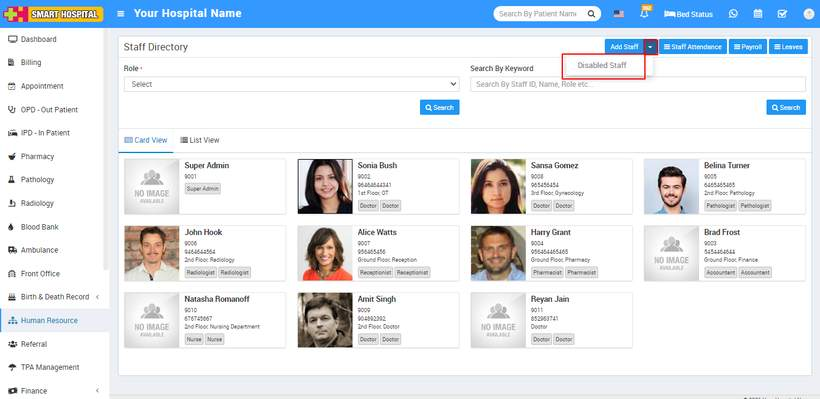
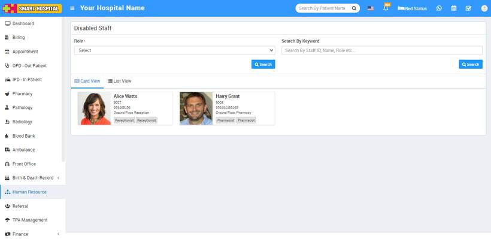
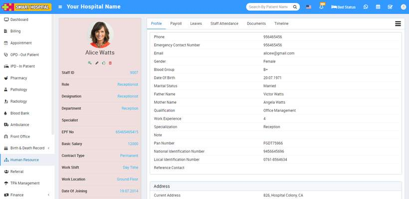

# How to view disabled Staff?

_Tue, 26 Oct, 2021_ · [Human Resource (13)](https://smart-hospital.in/category/human-resource) · vendor article: https://smart-hospital.in/article/how-to-view-disabled-staff

### How to view disabled Staff?

Tue, 26 Oct, 2021

[Articles](https://smart-hospital.in/articles)[Human Resource](https://smart-hospital.in/category/human-resource)

---

To view disabled staff, go to **Human Resource > Add Staff > Disabled Staff** then select **Role** and then click on**Search** button. You can also search any disabled staff by entering any matching Keyword in the **Search By Keyword**Text Box and then click on**Search** button. The list of disabled staff will be shown below of the page.  
  
  
  

To view staff details click on**Show** icon present in staff card. Here you can view basic detail of staff like **Profile, Payroll, Leaves, Attendance, Documents, Timeline.  
  
**

To edit staff click on **Edit** icon and to enable staff click on Enable icon and to delete staff click on **Delete** icon present in staff profile page.
