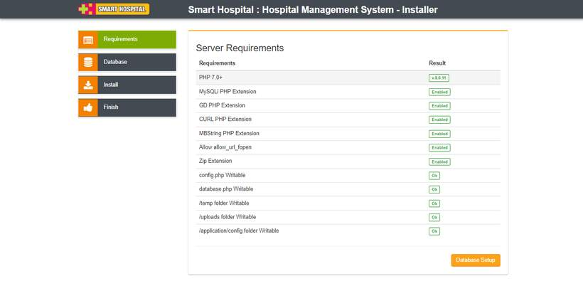
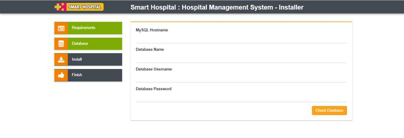
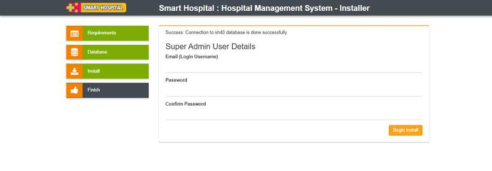
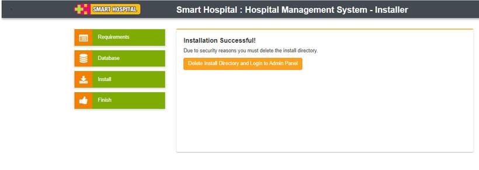

# General Installation

_Mon, 18 Oct, 2021_ · [Installation(7)](https://smart-hospital.in/category/getting-started/installation) · vendor article: https://smart-hospital.in/article/general-installation

### General Installation

Mon, 18 Oct, 2021

[Articles](https://smart-hospital.in/articles)[Getting Started](https://smart-hospital.in/category/getting-started)[Installation](https://smart-hospital.in/category/installation)

---

Smart Hospital comes with a simple automatic installer.

#### - Configure database connection

You need to have previously setup database from the cPanel or your hosting provider.  
Here is a good tutorial [how to setup MySQL database in cPanel](https://www.namecheap.com/support/knowledgebase/article.aspx/9363/2180/how-to-create-and-maintain-mysql-databases-in-cpanel) if you are not familiar with this.

1. Login to cPanel by accessing www.yourdomain.com/cpanel and navigate go MySQL Databases.
2. Create database first.
3. Create user and setup your password.
4. Add the user to database by selecting the database and the username.

  
Make sure you have checked All privileged when adding the user to database.

#### - Install

Find the folder **smart\_hospital\_src** in your downloaded package from Codecanyon. This folder contains complete source code files need to install Smart Hospital. Upload all the files under this folder to your hosting folder and navigate to your url **http://yourdomain.com/** . After hitting url **http://yourdomain.com/** system redirects to **http://yourdomain.com/install/start** to start installer.

You will need to pass the server requirements in order to install Smart Hospital.  
  

Click **Database Setup** and populate the fields according to your database setup.

If any errors found while connecting you will be notified otherwise you should see the credentials screen.  
  

Enter **Super Admin Email and Password** for your Admin Panel Login.  
  
  
  
Great! You have successfully installed Smart Hospital. At last step click on **Delete Install Directory and Login** button to go to Admin Panel Login page.  
  

If you need help for installation, do not hesitate to open [Support Ticket](http://support.qdocs.in/)

After successful installation you need to setup few things about your hospital. Smart Hospital comes with some predefined data but you still need to configure them as per your hospital.
