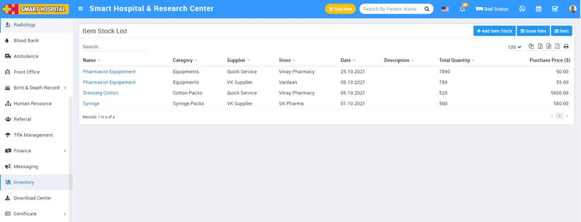

# About Inventory.

_Tue, 02 Nov, 2021_ · [Inventory (4)](https://smart-hospital.in/category/inventory) · vendor article: https://smart-hospital.in/article/about-inventory

### About Inventory.

Tue, 02 Nov, 2021

[Articles](https://smart-hospital.in/articles)[Inventory](https://smart-hospital.in/category/inventory)

---

Inventory Module is used to maintain entire Inventory record including hospital uniforms, bill book and many more. The main purpose of this module is to make hospital equipment tracking easy.  
  
**Inventory Module Workflow:** First we will add items then add item stocks then we will manage issue and return of items to different staff members.  
  

