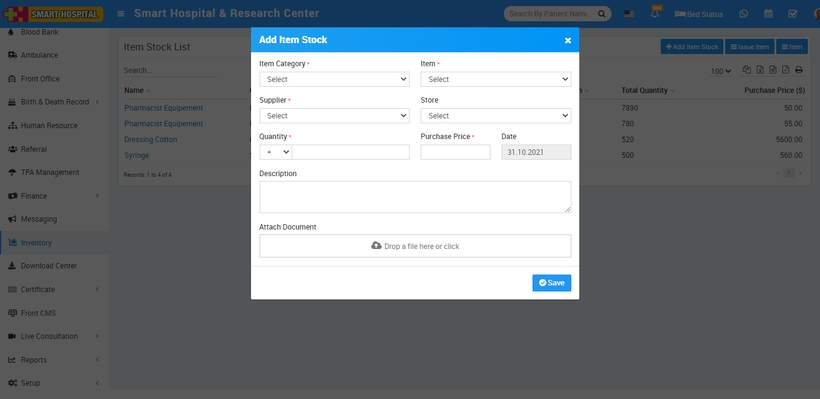
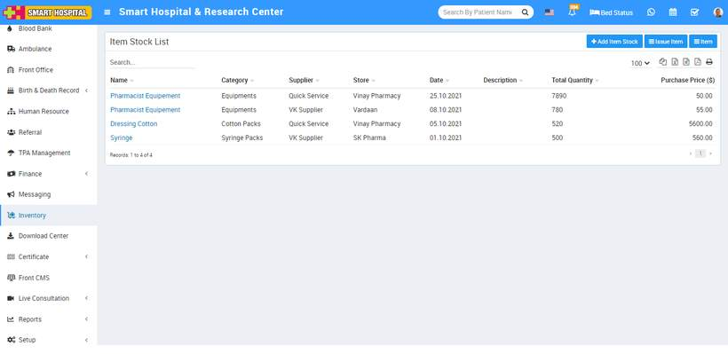

# How to add Item Stock?

_Sun, 31 Oct, 2021_ · [Inventory (4)](https://smart-hospital.in/category/inventory) · vendor article: https://smart-hospital.in/article/how-to-add-item-stock

### How to add Item Stock?

Sun, 31 Oct, 2021

[Articles](https://smart-hospital.in/articles)[Inventory](https://smart-hospital.in/category/inventory)

---

To add item stock go to inventory click on **+ Add Item Stock** button, here enter **Item Category, Item Name, Supplier, Store, Quantity, Purchase Price, Date, Description** and **Attach Document** and then click on **Save** button.  
  
  
  
You can view this added record in the Item Stock List page.  
  
  
  
To edit Item Stock click on the **Edit** icon and to delete the Item Stock click on the **Delete** icon present at last column and will show on mouse hover.
