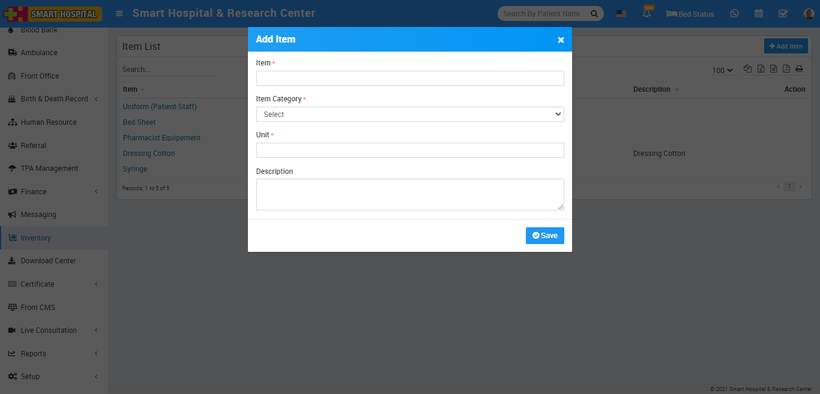
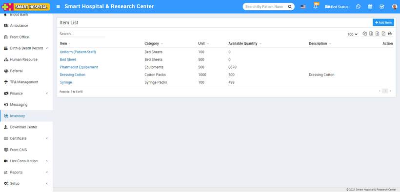

# How to add Item?

_Sun, 31 Oct, 2021_ · [Inventory (4)](https://smart-hospital.in/category/inventory) · vendor article: https://smart-hospital.in/article/how-to-add-item

### How to add Item?

Sun, 31 Oct, 2021

[Articles](https://smart-hospital.in/articles)[Inventory](https://smart-hospital.in/category/inventory)

---

To see items click on Item button. At this page to add new items click on **+ Add Item** button here enter **Item Name, Item Category, Unit, Description** and then click on **Save** button.  
  

You can view this added record in the Item List page.  
  
  
  
To edit item click on the **Edit** icon and to delete the item click on the **Delete** icon present at Action column and will show on mouse hover.
