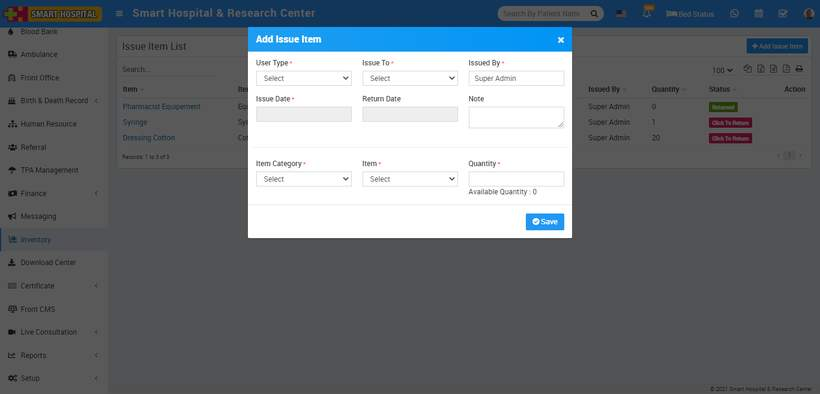

# How to check issue and return item?

_Sun, 31 Oct, 2021_ · [Inventory (4)](https://smart-hospital.in/category/inventory) · vendor article: https://smart-hospital.in/article/how-to-check-issue-and-return-item

### How to check issue and return item?

Sun, 31 Oct, 2021

[Articles](https://smart-hospital.in/articles)[Inventory](https://smart-hospital.in/category/inventory)

---

To see issue or return item click on Issue Item button.

To issue an item click on **+ Add Issue Item** button, here enter **User Type, Issued to, Issue By, Issue Date, Return Date, Note, Item Category, Item** and **Issue Quantity**.  
  
   
  
  
You can view this added record in the Issue Item List page.  
  

To delete the issued item click on the **Delete** icon present at Action column and will show on mouse hover.

To return an item click on Click To **Return** button.  
  

