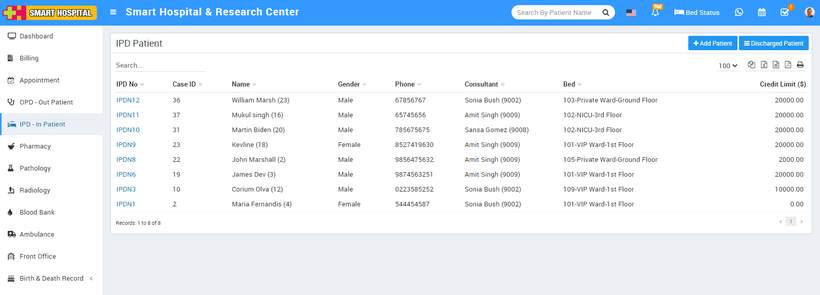

# About IPD - In Patient

_Mon, 01 Nov, 2021_ · [IPD - In Patient (19)](https://smart-hospital.in/category/ipd-in-patient) · vendor article: https://smart-hospital.in/article/about-ipd-in-patient

### About IPD - In Patient

Mon, 01 Nov, 2021

[Articles](https://smart-hospital.in/articles)[IPD - In Patient](https://smart-hospital.in/category/ipd-in-patient)

---

An **inpatient department** or IPD is a unit of a hospital or a healthcare facility where patients are admitted for medical conditions that require appropriate care and attention. An Inpatient Department of the hospital is equipped with beds, medical equipment, round the clock availability of doctors and nurses.  
  

