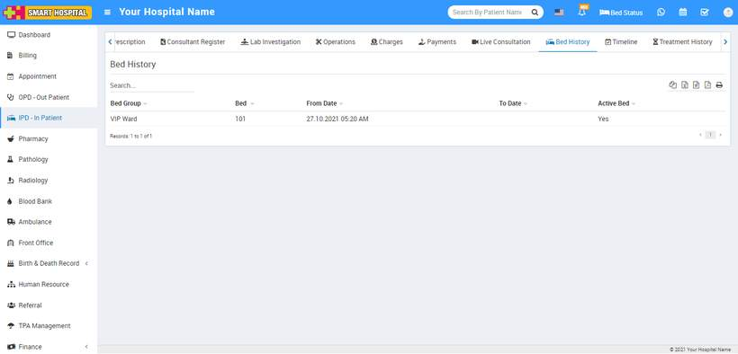

# Bed History

_Mon, 01 Nov, 2021_ · [IPD - In Patient (19)](https://smart-hospital.in/category/ipd-in-patient) · vendor article: https://smart-hospital.in/article/bed-history

### Bed History

Mon, 01 Nov, 2021

[Articles](https://smart-hospital.in/articles)[IPD - In Patient](https://smart-hospital.in/category/ipd-in-patient)

---

In IPD –In Patient you will find Bed History tab, The Bed History shows the assignment of beds to the patient under different categories like Bed history when patient was admitted at ICU.

Under Bed History tab you can see **Bed Group, Bed, From Date, To Date** and **current status of Bed**.  
  
  

