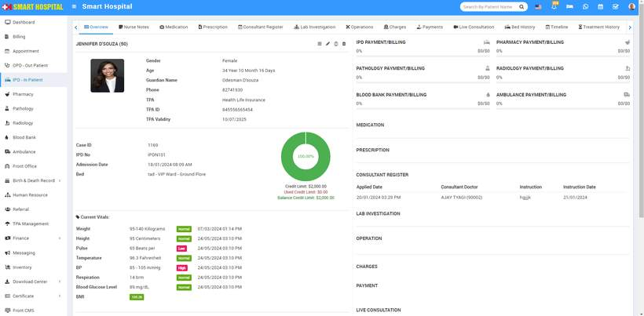

# BMI For IPD - In Patient

_Fri, 30 Aug, 2024_ · [IPD - In Patient (19)](https://smart-hospital.in/category/ipd-in-patient) · vendor article: https://smart-hospital.in/article/bmi-for-ipd-in-patient

### BMI For IPD - In Patient

Fri, 30 Aug, 2024

[Articles](https://smart-hospital.in/articles)[IPD - In Patient](https://smart-hospital.in/category/ipd-in-patient)

---

In the **IPD - In Patient** for **BMI**, you need to go to the IPD - In Patient. Here, select the patient whose BMI details you want to see. Click on the IPD number of the patient. The patient's overview page will open, where you can see the **BMI** details  
  

