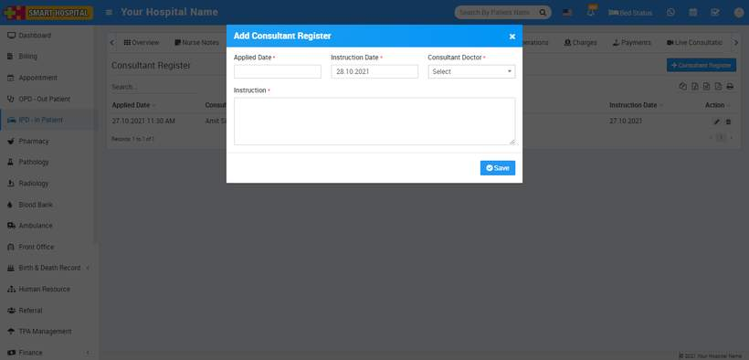
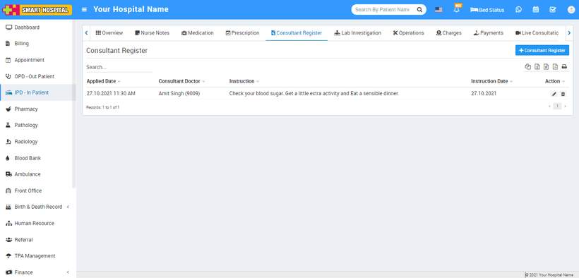

# Consultant Register

_Mon, 01 Nov, 2021_ · [IPD - In Patient (19)](https://smart-hospital.in/category/ipd-in-patient) · vendor article: https://smart-hospital.in/article/consultant-register

### Consultant Register

Mon, 01 Nov, 2021

[Articles](https://smart-hospital.in/articles)[IPD - In Patient](https://smart-hospital.in/category/ipd-in-patient)

---

Consultant Register tab has all details about instructions given by doctors day to day for this patient's treatment. To add instruction click on **+ Add Consultant Instruction** button here enter **Applied Date, Instruction Date, Consultant Doctor** and **Consultant Instruction** then click on **Save** button.

You can view this added record under **Consultant Register tab.  
  
**

To edit Consultant Register added record click on**Edit** icon and to delete it click on **Delete** icon present in the Consultant Register list.
