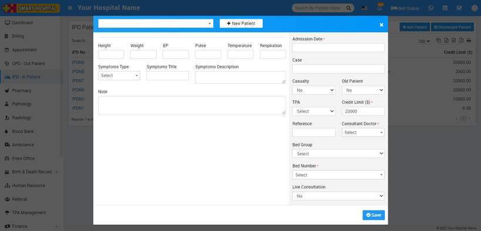
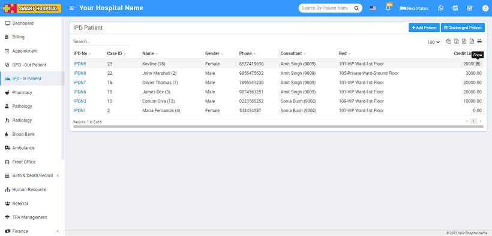
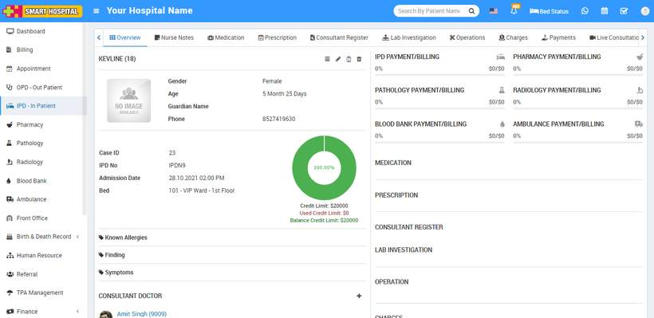

# How to add IPD patient?

_Mon, 01 Nov, 2021_ · [IPD - In Patient (19)](https://smart-hospital.in/category/ipd-in-patient) · vendor article: https://smart-hospital.in/article/how-to-add-ipd-patient

### How to add IPD patient?

Mon, 01 Nov, 2021

[Articles](https://smart-hospital.in/articles)[IPD - In Patient](https://smart-hospital.in/category/ipd-in-patient)

---

IPD (In Patient Department) module is for managing those patient who admit in hospital for their issues/disease treatment.

To add new OPD patient click on **+ Add Patient** button. select Patient Name from dropdown or click on **+ New Patient** button to add new patient then enter **Admission Date, Case, Casualty, Old Patient, TPA (Third Party Administrator), Credit Limit, Reference, Consultant Doctor, Bed Group, Bed Number** and select **Live Consultation** (if yes than live consultation for the patient will create and it will list on IPD patient profile Live Consultation tab).  
  

After adding patient it will list all IPD Patient page. To see patient details click on **Show** button.  
  

Here we can see 8 tabs **Nurse Notes, Medication, Operation Theatre, Consultant Register, Lab Investigation, Timeline, Prescription, Charges, Payments, Treatment History, Live Consultation** and **Bed History**.

