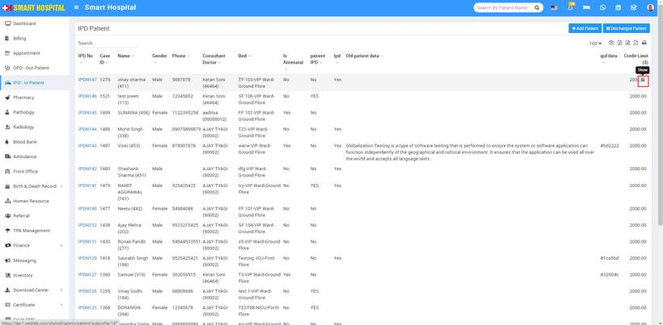
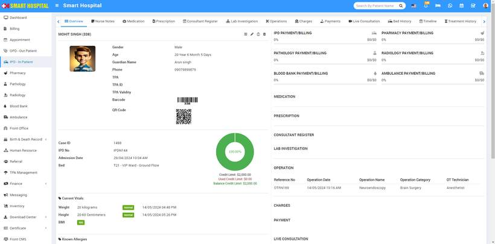
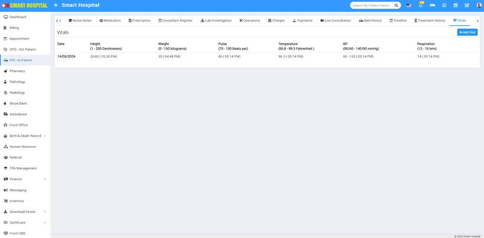
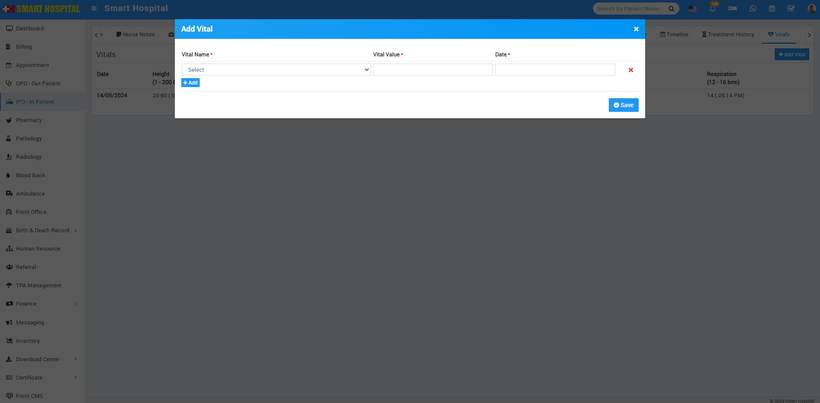
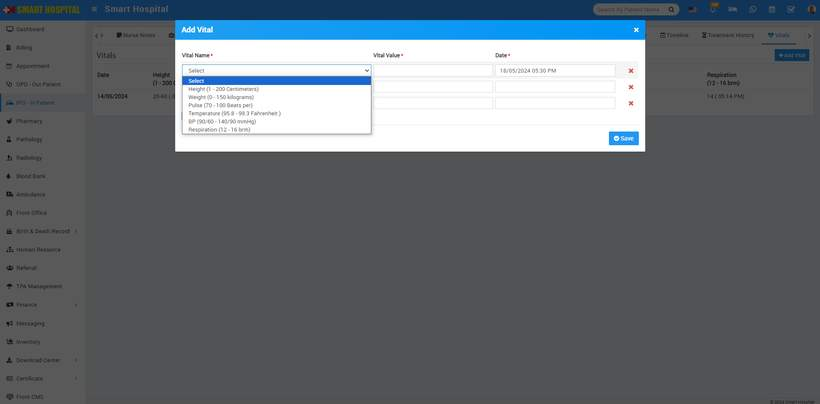
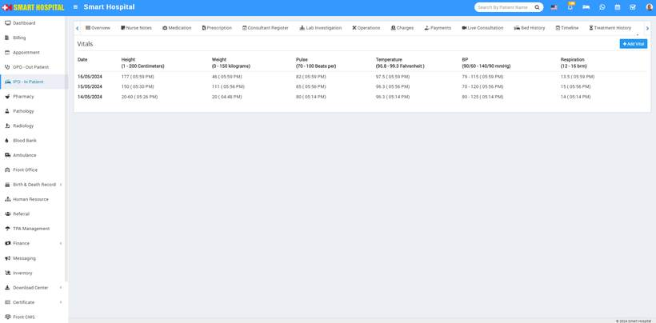
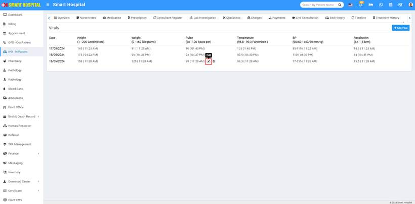
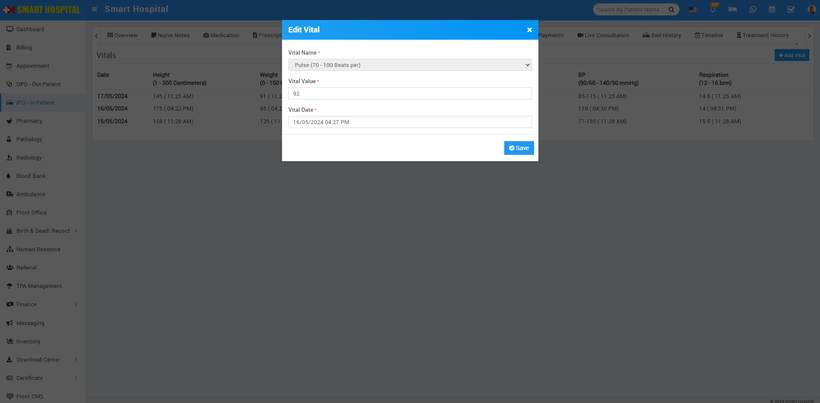

# How to add the vitals details of the patient in IPD - In Patient ?

_Fri, 30 Aug, 2024_ · [IPD - In Patient (19)](https://smart-hospital.in/category/ipd-in-patient) · vendor article: https://smart-hospital.in/article/how-to-add-the-vitals-details-of-the-patient-in-ipd-in-patient

### How to add the vitals details of the patient in IPD - In Patient ?

Fri, 30 Aug, 2024

[Articles](https://smart-hospital.in/articles)[IPD - In Patient](https://smart-hospital.in/category/ipd-in-patient)

---

To add the vitals details from **IPD - In Patient**, simply go to **IPD - In Patient**and click on it, here **IPD Patient** page will be open   
  
  
  
You can choose the any both of option, both option will give the vitals path, first you go to top right last option for the vitals and add the details or you can go via show icon and reach the vitals option both are same to add the vitals details of the patient Now click on **Show** icon displaying at the last column while hovering the mouse on it, patient **Overview** page will open, here you can see all the patient related details   
  
  
  
  
Simply click on **Vitals**, the Vitals form window will open. If you have previously added some details for this patient's vitals, you can see them on this page  
  
  
  
Now click on the **Add Vitals** button to add the patient's vital details, vitals window willl be open  
  
  
  
Next, click on **Vitals Name**. A dropdown will open, and you can select one value from the multiple options. Then, enter the **Vital Value** and the **Date**. You can also add multiple fields of vitals for that patient by clicking on the add button and then saving it  
  
  
  
After **Save** the vitals details of the patient it will show in below  
  
  
  
Now if you want to **Edit** the **Vitals** which you save recently, simply mouse hover on the value its will show you **Edit** with **Delete** options  
  
  
  
Simply click on the **Edit** icon. The **Edit** Vitals window will open. Now update the details of the vitals and **save,** If you want to delete the vitals value of the patient, you can also do that by clicking on the **Delete** icon  
  
  
  
After click on Save, Vitals details will be save succesfully
