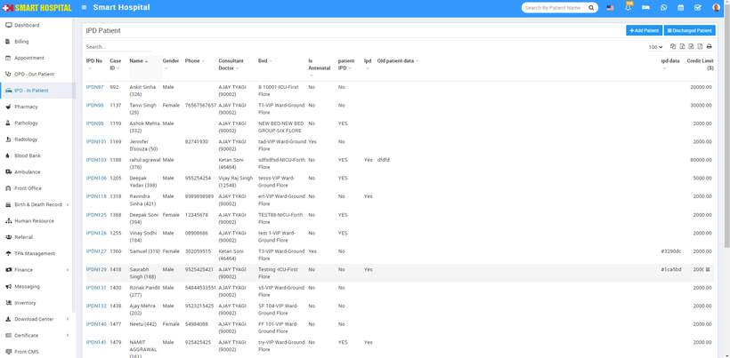
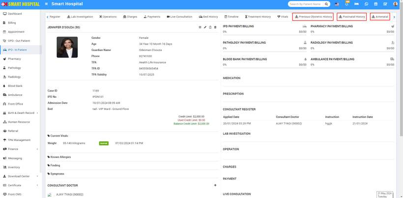

# How to see the details for Previous Obstetric History, Postnatal History, and Antenatal History in IPD - In Patient?

_Fri, 30 Aug, 2024_ · [IPD - In Patient (19)](https://smart-hospital.in/category/ipd-in-patient) · vendor article: https://smart-hospital.in/article/how-to-see-the-details-for-previous-obstetric-history-postnatal-history-and-antenatal-history-in-ipd-in-patient

### How to see the details for Previous Obstetric History, Postnatal History, and Antenatal History in IPD - In Patient?

Fri, 30 Aug, 2024

[Articles](https://smart-hospital.in/articles)[IPD - In Patient](https://smart-hospital.in/category/ipd-in-patient)

---

To see the details for **Previous Obstetric History, Postnatal History** and **Antenatal History** in IPD - Outpatient, simply first you need to go to **IPD - In Patient** module in hospital, after click on this module IPD Patient page will be open, here you can see multiple patient details will be displayed  
  
  
  
  
In the above list, you have to choose a patient who must be **female** and have **Yes** in the '**Is Antenatal**' column. Then you can see all three options—**Previous Obstetric History**, **Postnatal History**, and **Antenatal History**—displayed in the **IPD - In patient  
  
**
