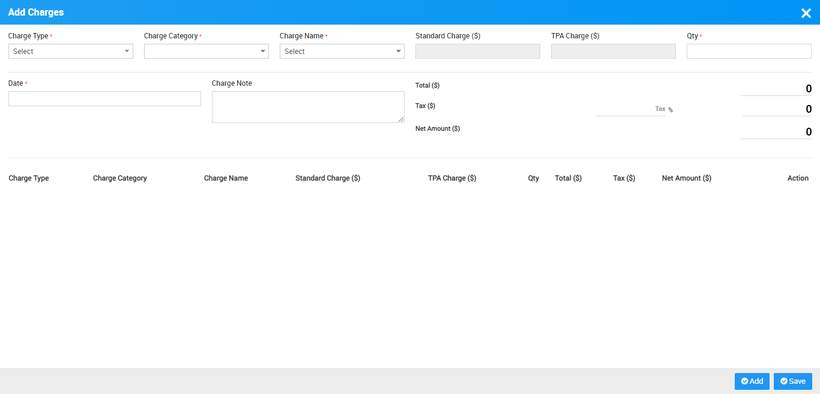
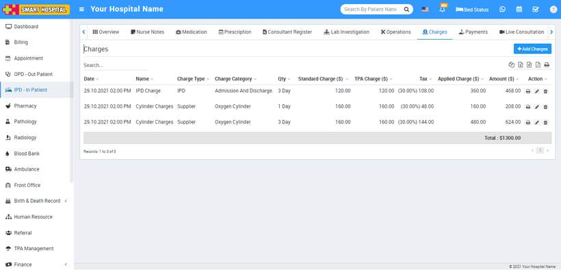

# IPD Charges

_Mon, 01 Nov, 2021_ · [IPD - In Patient (19)](https://smart-hospital.in/category/ipd-in-patient) · vendor article: https://smart-hospital.in/article/ipd-charges

### IPD Charges

Mon, 01 Nov, 2021

[Articles](https://smart-hospital.in/articles)[IPD - In Patient](https://smart-hospital.in/category/ipd-in-patient)

---

To add charges in for IPD patient, go to the **IPD – In Patient** click on Show button icon present at **Action** column or IPD No.

Now click on **Charges** tab. Here to add charges for IPD patient click on **+Add Charges** button, here you should add **Charge Type, Charge Category, Charge Name** and other details and click on **Save** button.  
  
  
  
  
  
  
You can check these added charges at Charge list.  
  
  
  
  
  
You can also Print, Edit and Delete the applied charges from options available at **Action** column.
