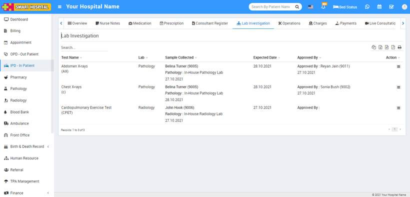
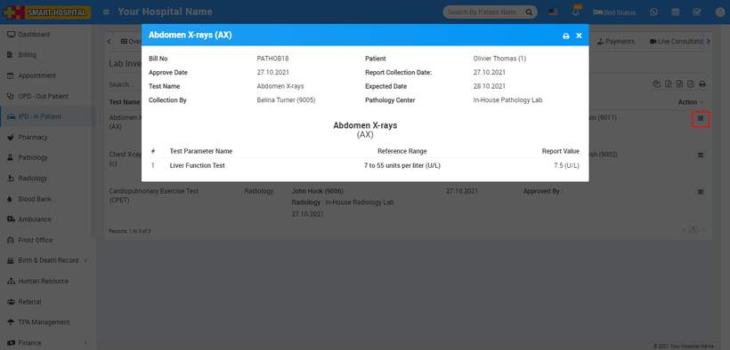

# IPD Lab Investigation

_Mon, 01 Nov, 2021_ · [IPD - In Patient (19)](https://smart-hospital.in/category/ipd-in-patient) · vendor article: https://smart-hospital.in/article/ipd-lab-investigation

### IPD Lab Investigation

Mon, 01 Nov, 2021

[Articles](https://smart-hospital.in/articles)[IPD - In Patient](https://smart-hospital.in/category/ipd-in-patient)

---

In IPD patient list you can also check patient all **Pathology** and **Radiology** test under **Lab Investigation** tab.  
  
  
  
  
  
Here in Lab Investigation List you can check all listed lab reports of. You can check lab test report details from show option available at **Action** column.  
  
  

Also you can print Test Report from print icon present at show report details popup.
