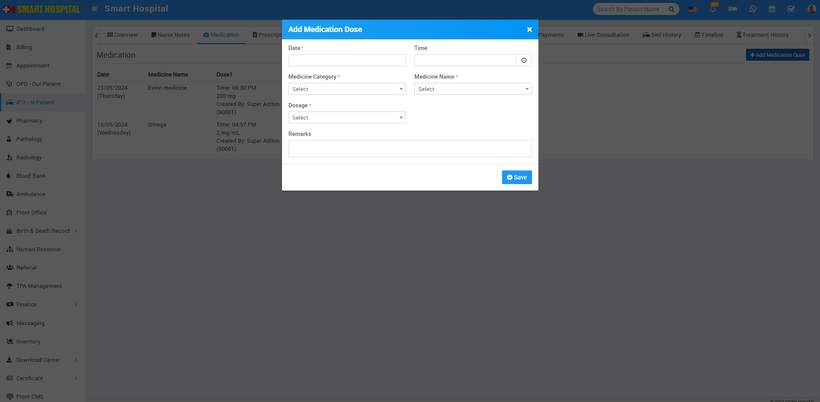
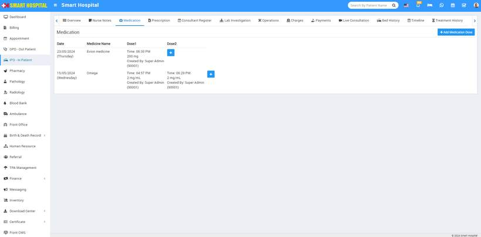
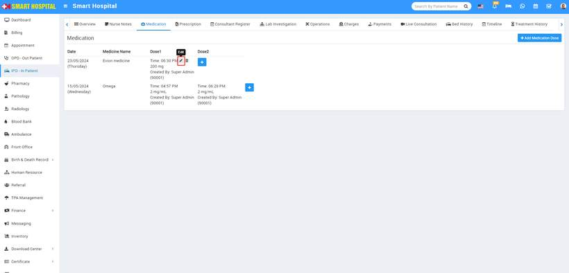

# IPD Medication

_Thu, 23 May, 2024_ · [IPD - In Patient (19)](https://smart-hospital.in/category/ipd-in-patient) · vendor article: https://smart-hospital.in/article/ipd-medication

### IPD Medication

Thu, 23 May, 2024

[Articles](https://smart-hospital.in/articles)[IPD - In Patient](https://smart-hospital.in/category/ipd-in-patient)

---

Medication is for comparing a patient's medication orders to all of the medications that the patient has been taking. This reconciliation is done to avoid medication errors such as omissions, duplications, dosing errors, or drug interactions.

To add medication for IPD patient go to **IPD – In Patient** then click to detail option (show button icon will show for this at last column on mouse hover) then click on IPD no (under which IPD you want to create) here you will get Medication tab to add Medication for patient.

To add Medication click on **+ Add Medication** here enter **Date, Time, Medication Category, Medication Name, Dosage** and **Remarks** then **Save** button.  
  

You can view this added record in the Medication List under the Medication tab. You will also see the information about who created this medicine, as shown here: **created by Super Admin**  
  

To edit Medication click on**Edit** icon and to delete Medication click on **Delete** icon present in the Medication list.

