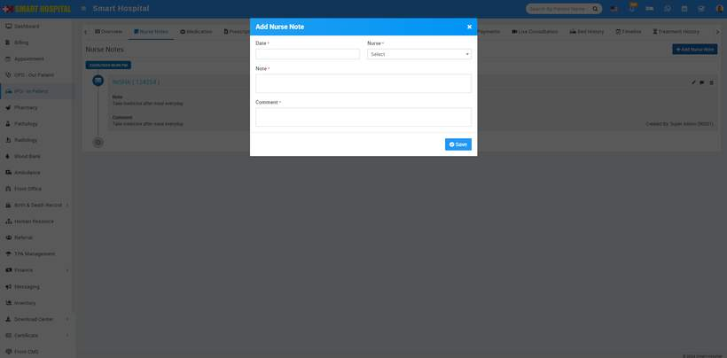
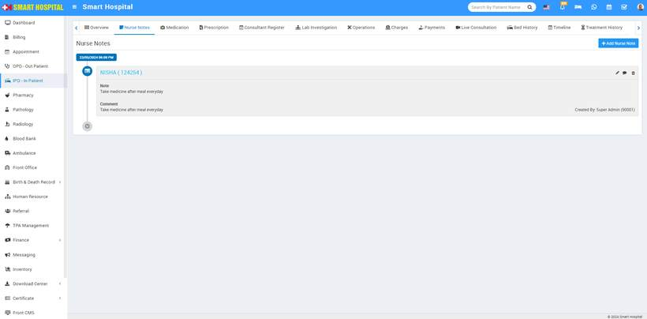
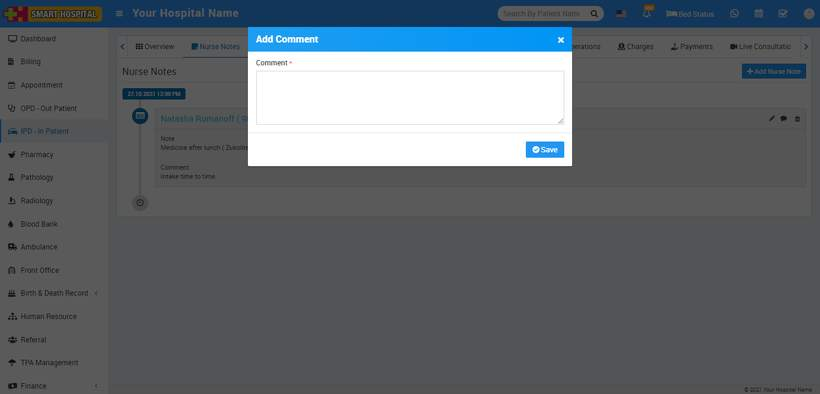

# IPD Nurse Notes

_Thu, 23 May, 2024_ · [IPD - In Patient (19)](https://smart-hospital.in/category/ipd-in-patient) · vendor article: https://smart-hospital.in/article/ipd-nurse-notes

### IPD Nurse Notes

Thu, 23 May, 2024

[Articles](https://smart-hospital.in/articles)[IPD - In Patient](https://smart-hospital.in/category/ipd-in-patient)

---

A nursing note is a medical note into a medical or health record made by a nurse that **can provide an accurate reflection of nursing assessments, changes in patient conditions, care provided and relevant information to support the clinical team to deliver excellent care**.

To add nurse note for IPD patient, go to IPD- In Patient then click on a IPD No. or click on more details button (Show button icon will show on mouse hover at last column), here you will see Nurse Note tab so to add Nurse Note click on **+ Add Nurse Note** button here enter **Date, Nurse, Note, Comment** and then click on **Save**.  
  
  
  
  
  
You can view this added record under the Nurse Note tab. On the right-hand side, you can also see the name of the person who created this note. Currently this note was **created by: Superadmin**  
  

To edit Nurse Note click on**Edit** icon and to delete Nurse Note click on **Delete** icon present in the Nurse Note list.

You can also add comment in add Nurse Note from the Comment icon present at the right side of the **Nurse Note** List.  
  

