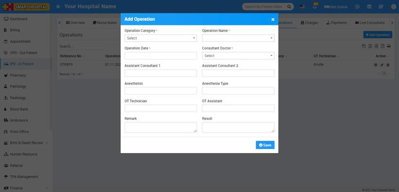
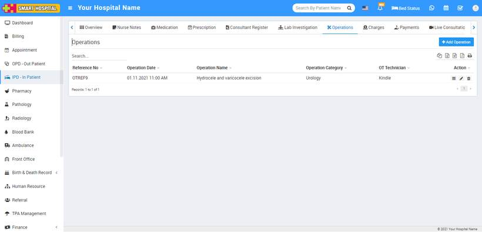
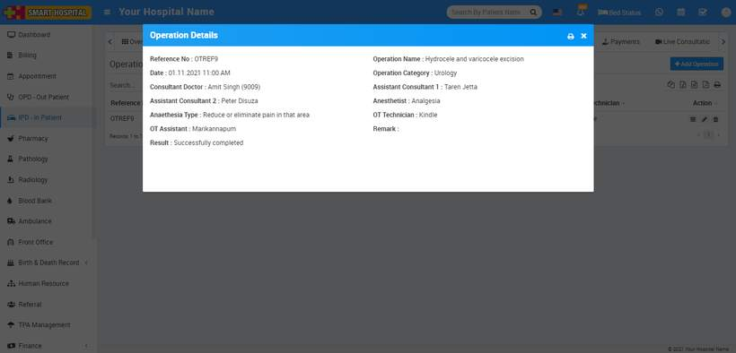

# IPD Operations

_Mon, 01 Nov, 2021_ · [IPD - In Patient (19)](https://smart-hospital.in/category/ipd-in-patient) · vendor article: https://smart-hospital.in/article/ipd-operations

### IPD Operations

Mon, 01 Nov, 2021

[Articles](https://smart-hospital.in/articles)[IPD - In Patient](https://smart-hospital.in/category/ipd-in-patient)

---

You can add operations done for IPD patients under Operation Theatre tab.

To add Operation for IPD patient go to **IPD – In Patient** then click to show button icon (will show for this at last column on mouse hover) or IPD No. here you will get **Operation Theatre** tab to add Operations for patient.  
  
  
To add operation record click on **+Add Operation** button here enter **Operation Category, Operation Name** (click here to see how to add operation category and name in Smart Hospital), **Operation Date**, **Consultant Doctor, Assistant Consultant 1, Assistant Consultant 2, Anesthetist, Anesthesia Type, OT Technician, OT Assistant, Remark, Result** then click on **Save** button.  
  
  

After create Operation record you can view this added record at **Operation Theatre** list page.  
  
  

To view added operation record click on view button icon present at **Action** column.  
  
  

To edit Operation record click on**Edit** icon and to delete Operation record click on **Delete** icon present in the Operation Theatre list.
