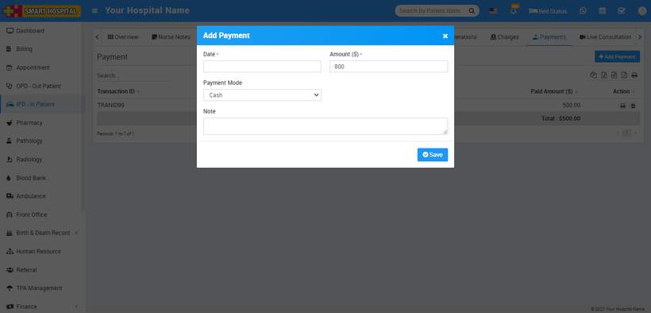
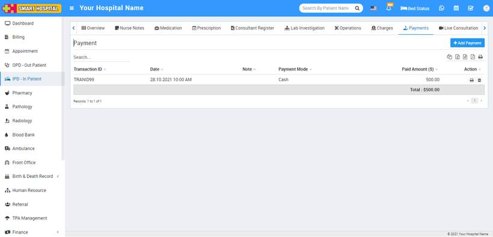

# IPD Payments

_Mon, 01 Nov, 2021_ · [IPD - In Patient (19)](https://smart-hospital.in/category/ipd-in-patient) · vendor article: https://smart-hospital.in/article/ipd-payments

### IPD Payments

Mon, 01 Nov, 2021

[Articles](https://smart-hospital.in/articles)[IPD - In Patient](https://smart-hospital.in/category/ipd-in-patient)

---

To add payment for IPD patient go to **IPD – In Patient** click on Show button icon present at **Action** column or IPD No. here you will get **Payment** tab to add patient Payment.

To add new payment click on **+ Add Payment** button here enter **Date, payment Amount, Payment Mode**and **Note** then click on **Save** button.  
  
  

To see patient IPD Payment details click **Payment** tab. Here you can see all payments done by patient.  
  
  
  
  
To print payment receipt click on print icon and to delete payment click on delete icon present at **Action** column.
