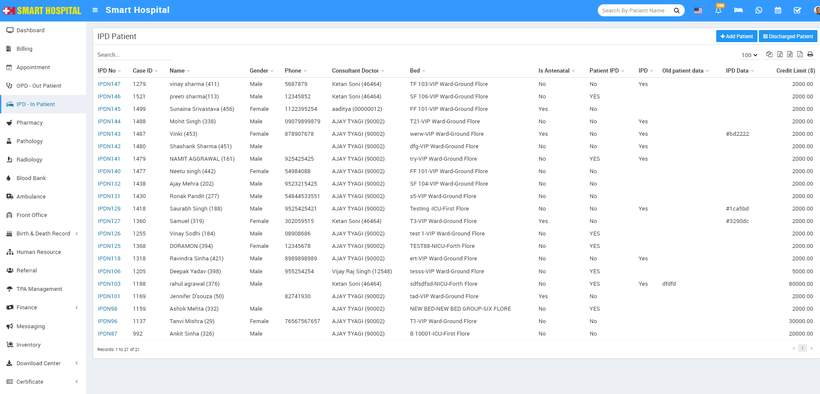
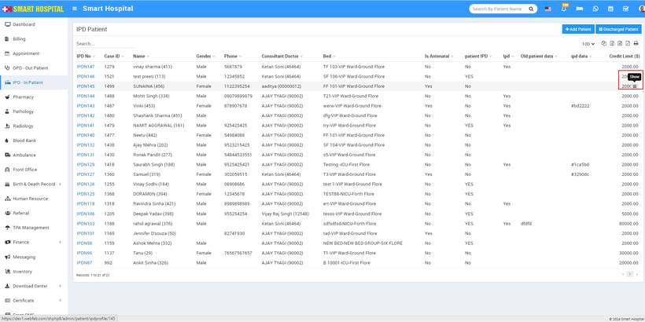
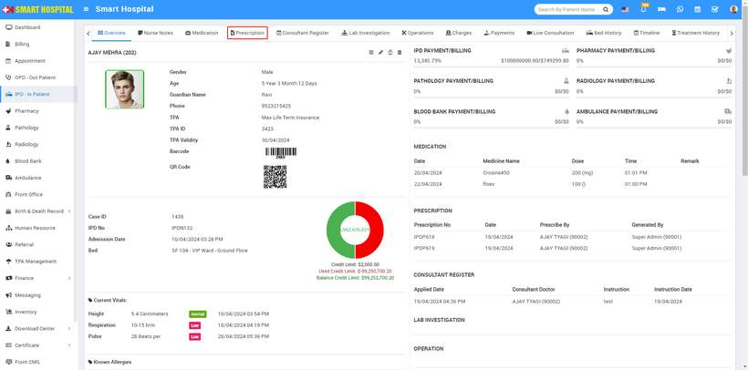
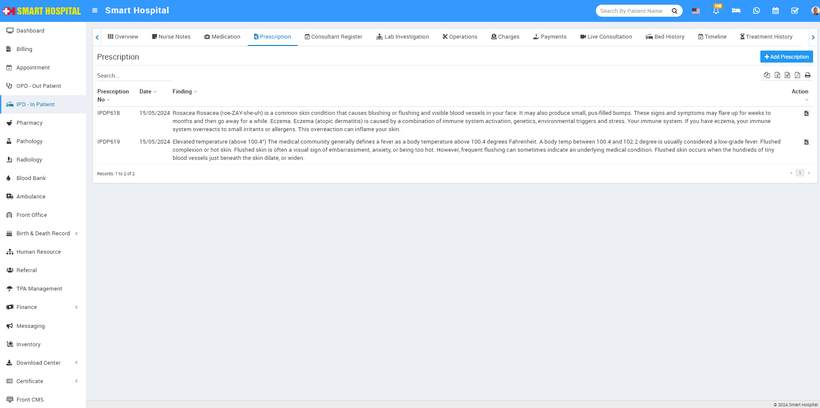
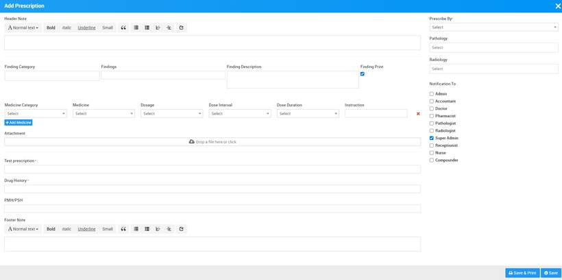
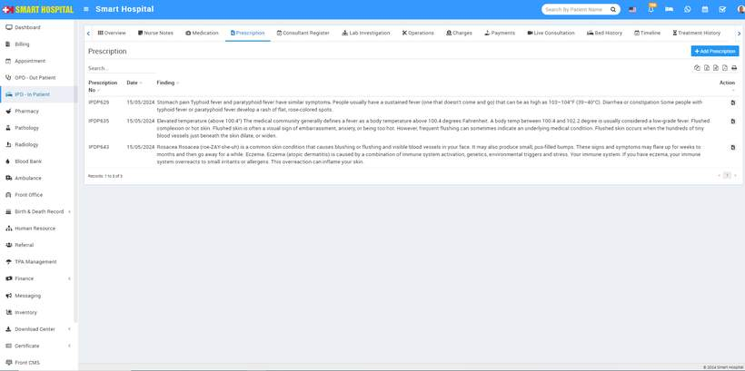
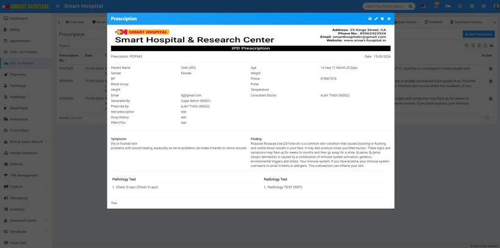
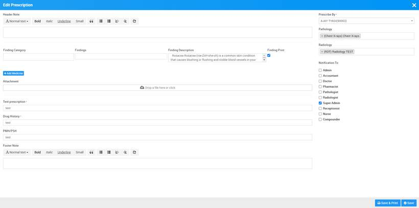

# IPD Prescription

_Wed, 15 May, 2024_ · [IPD - In Patient (19)](https://smart-hospital.in/category/ipd-in-patient) · vendor article: https://smart-hospital.in/article/ipd-prescription

### IPD Prescription

Wed, 15 May, 2024

[Articles](https://smart-hospital.in/articles)[IPD - In Patient](https://smart-hospital.in/category/ipd-in-patient)

---

To add prescription for IPD patient,  simply go to **IPD- In Patient** and click on it patient details will open in below  
  
  
  
At the last column of this page showing **Credit Limit**, and this column while you hovering the mouse on the credit limit **Show** icon will appear  
  
  
  
  
When you click on **Show** icon, patient details page will be open now go to the **Prescription   
  
**Now click on Prescription option, prescreption page will be open  
  

Now click on **+ Add Prescription** button, here in Add Prescription you can add **Header Notes, Findings details (Symptoms finding in patient), Medicines, Attachment, Footer Note, Prescribed By,** also in add prescription page you can prescribed **Pathology** and **Radiology** tests to patient and send notification from **Notification** **To** option to staff members.  
  
  
  
  
  
You can check this added record at Prescription list page.  
  
  
   
After add the prescription, click on View Prescription button icon present at Action column and to print prescription click on print icon present at Prescription page.  
  
  
  
Now if you want to edit the prescription simply click on **Edit** icon showing at the top of the page **Edit Prescription** page will be open and now you can edit the prescription accrodingly

 **  
  
  
How to add Findings**

Please [click here](https://smart-hospital.in/article/findings) to understand how to add Findings in Smart Hospital.
