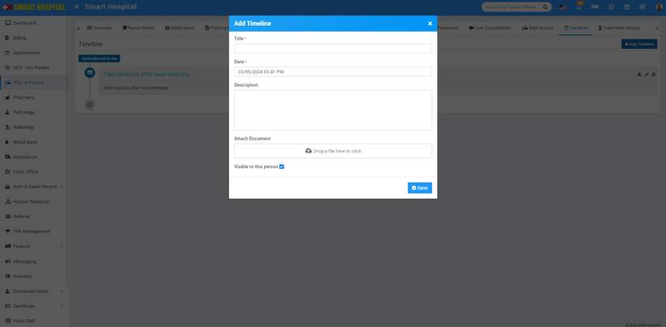
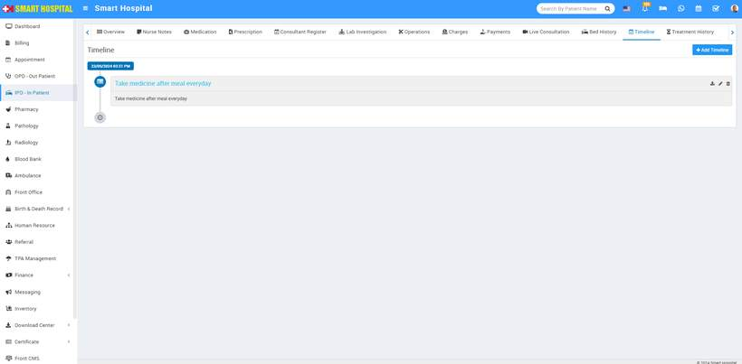

# Timeline -IPD In Patient

_Thu, 23 May, 2024_ · [IPD - In Patient (19)](https://smart-hospital.in/category/ipd-in-patient) · vendor article: https://smart-hospital.in/article/timeline-ipd-in-patient

### Timeline -IPD In Patient

Thu, 23 May, 2024

[Articles](https://smart-hospital.in/articles)[IPD - In Patient](https://smart-hospital.in/category/ipd-in-patient)

---

From **Timeline** feature you can add any notes or quick access details regarding patient.

To add Timeline for IPD patient go to **IPD – In Patient** click on Show button icon present at Action column or IPD No. Here you will find **Timeline** tab.

To add Timeline click on **+ Add Timeline** button then enter **Title, Date with time, Description, Attach Document** and check on **Visible** **to the Patient** (optional) then click on **Save** button.  
  
  
  
  
You can view this added Timeline at **Timeline** list page.  
  
  
  
  
To edit Timeline click on edit icon and to delete Timeline click on delete icon present at right side of timeline list.
