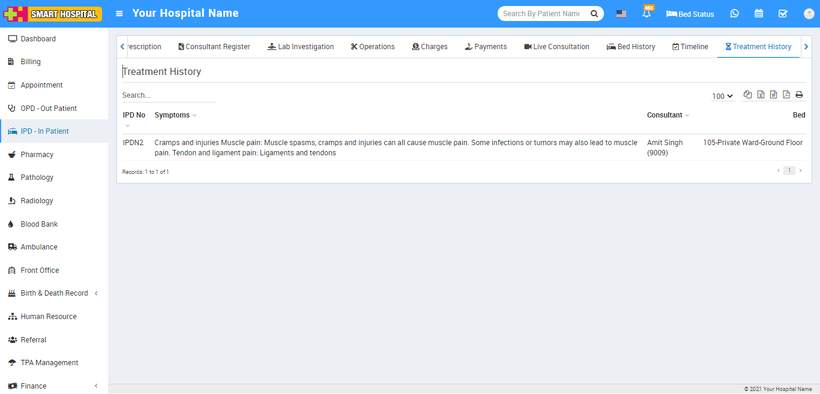

# Treatment History

_Mon, 01 Nov, 2021_ · [IPD - In Patient (19)](https://smart-hospital.in/category/ipd-in-patient) · vendor article: https://smart-hospital.in/article/treatment-history

### Treatment History

Mon, 01 Nov, 2021

[Articles](https://smart-hospital.in/articles)[IPD - In Patient](https://smart-hospital.in/category/ipd-in-patient)

---

At Treatment History tab under IPD patient list, you can check patients old visits and whatever treatment had been given to the patient.

Here you can also check **checkup details, charges, medication, operations** etc by click on IPD no.  
  
  

