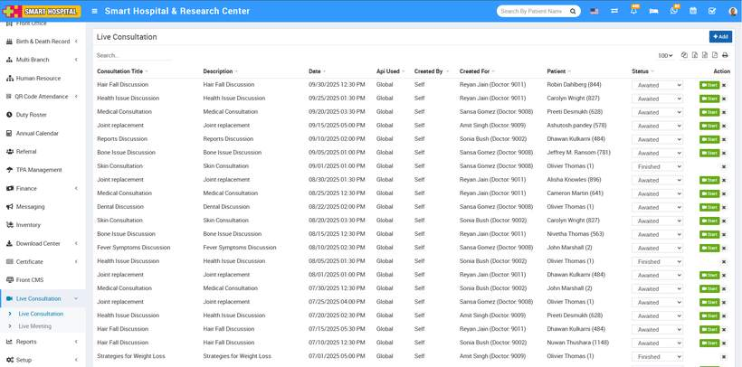
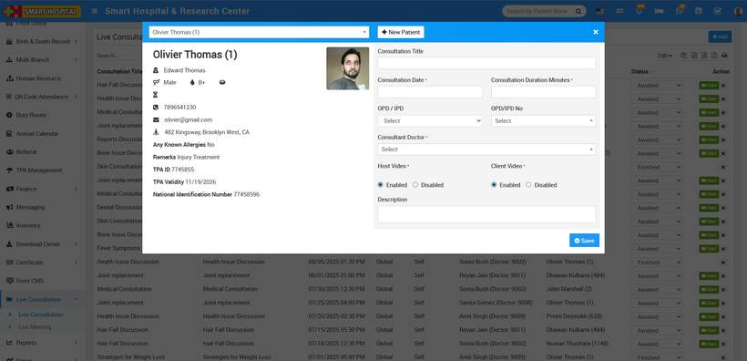

# How to add Live Consultation in Smart Hospital?

_Mon, 08 Sep, 2025_ · [Live Consultation (3)](https://smart-hospital.in/category/live-consultation) · vendor article: https://smart-hospital.in/article/how-to-add-live-consultation-in-smart-hospital

### How to add Live Consultation in Smart Hospital?

Mon, 08 Sep, 2025

[Articles](https://smart-hospital.in/articles)[Live Consultation](https://smart-hospital.in/category/live-consultation)

---

You can add Live Consultations for patients from **Live Consultation** **>** **Live Consultation**. Here you can also check list of **Live Consultations** created from Appointment, OPD and IPD modules for patients.  
  

Using **Live Consultation** Patients can consult to doctor through zoom video call.

To add new **Live Consultation** click on Add button here select patient and fill other fields details then click on **Save** button.  
  

