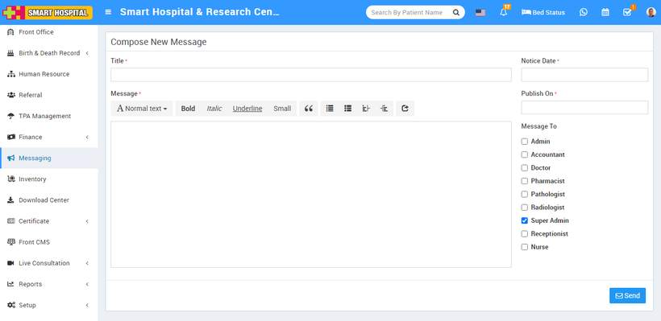
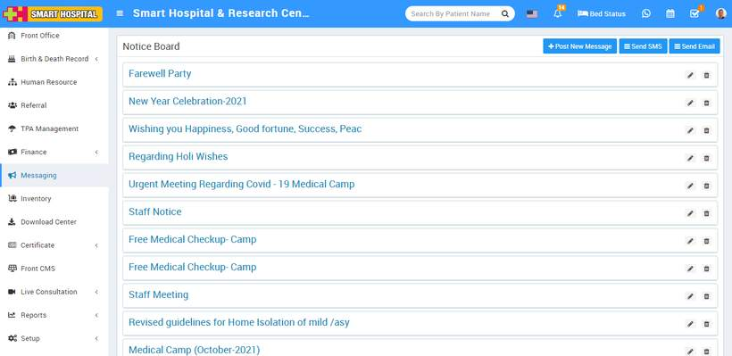

# How Notice Board works?

_Mon, 01 Nov, 2021_ · [Messaging (4)](https://smart-hospital.in/category/messaging) · vendor article: https://smart-hospital.in/article/how-notice-board-works

### How Notice Board works?

Mon, 01 Nov, 2021

[Articles](https://smart-hospital.in/articles)[Messaging](https://smart-hospital.in/category/messaging)

---

Notice board basically a messaging system for communication to patient and staff.

Notice Board is for sending common messages to all staff members to add new notice board message click on **+Post New Message** button, here enter Message Title, Message Text, Notice Date, Publish On Date and Message To different types of staff users.  
  
  
  
  
You can check this added Notice at Notice list page.  
  
  
  
From here you can edit or delete created Notice.
