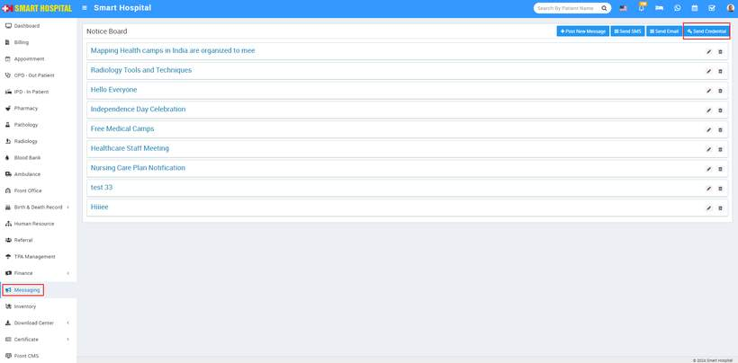
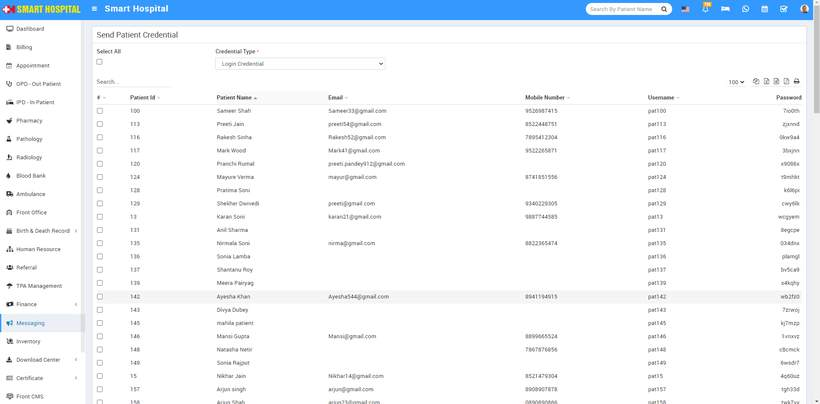
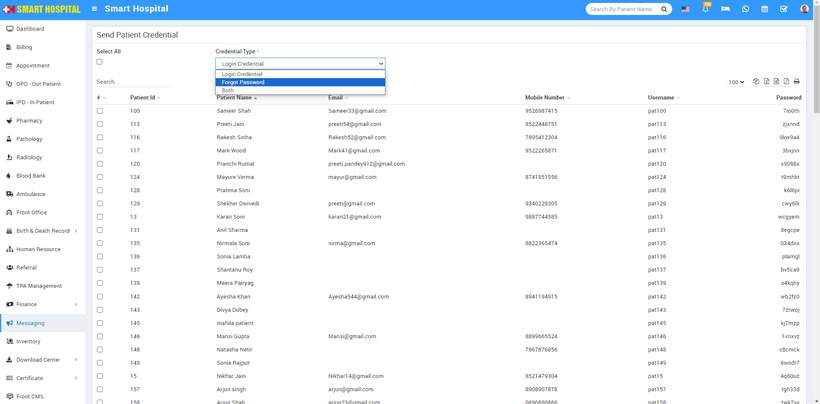
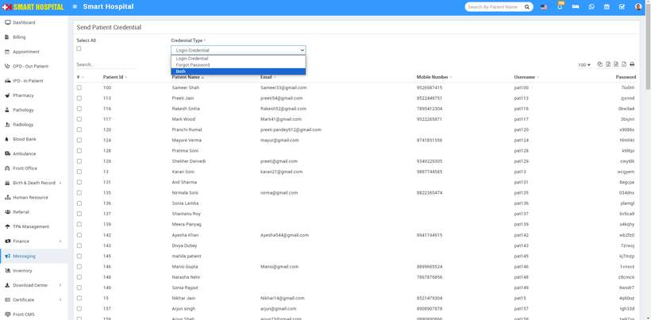

# How send patient credential in Smart Hospital?

_Fri, 30 Aug, 2024_ · [Messaging (4)](https://smart-hospital.in/category/messaging) · vendor article: https://smart-hospital.in/article/how-send-patient-credential-in-smart-hospital

### How send patient credential in Smart Hospital?

Fri, 30 Aug, 2024

[Articles](https://smart-hospital.in/articles)[Messaging](https://smart-hospital.in/category/messaging)

---

To send the patient credential, simply go to the **Messaging** > **Send Credentials  
  
**After click on Send Credential button, **Send Patient Credential** page will be open, here in this page multple patient with their login credentials are available  
  
  
  
To send the credentials to the patient, simply select the checkbox next to the patient's id . You can select multiple checkboxes to send credentials to multiple patients. Then click on the **Save** button, located at the bottom right corner  
  
You can also send a '**Forgot Password**' to the patient by following the same process. Just click on the '**Credential Type**' dropdown and select '**Forgot Password**'  
  
  
  
  
And if you want to send both Credentials and Forgot Password, simply select **both** from the '**Credential Type'** dropdown and follow the same process as sending the credentials  
  
****
