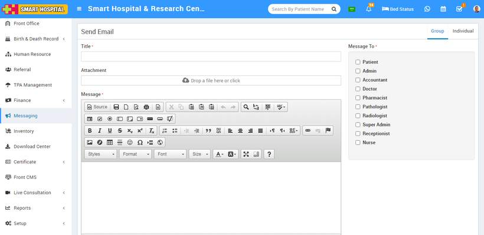
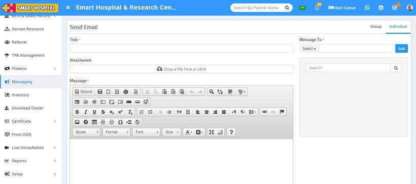

# How to send Email in Smart Hospital?

_Mon, 01 Nov, 2021_ · [Messaging (4)](https://smart-hospital.in/category/messaging) · vendor article: https://smart-hospital.in/article/how-to-send-email-in-smart-hospital

### How to send Email in Smart Hospital?

Mon, 01 Nov, 2021

[Articles](https://smart-hospital.in/articles)[Messaging](https://smart-hospital.in/category/messaging)

---

To send Email, **go to Messaging > Send Email.** Here you can see two tabs present at top right corner in the send Email page for sending email to a **Group or  Individual.**

  
**Send Email to Group-**  
  
To send Email to Group (Patient, Doctor, Admin etc), click on the **Group** tab present at top right corner of the page then enter the details that is message **Title, Attachment,** **Message**and select **Message To** (Patient, Doctor, Admin etc) and then click on **Send** button.  
  
  
  

**Send Email to Individual-**

To send Email individual, click on the Individual tab present at top right corner of the page then enter the details message **Title, Attachment, Message, Select user type from drop down**and then search for the user name in the textbox then select searched user or users and click on **Send** button.  
  

