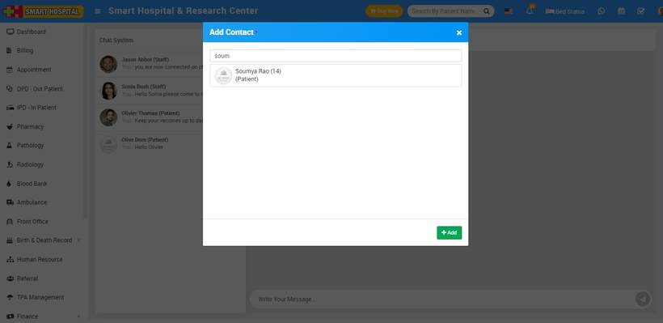
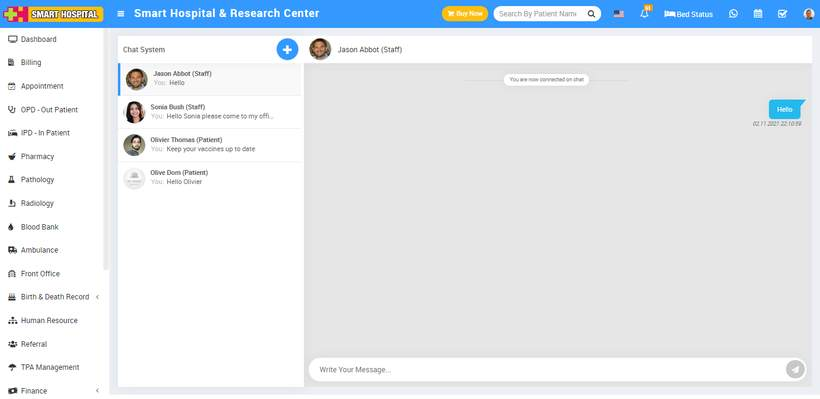

# How to add contact in chat?

_Tue, 09 Nov, 2021_ · [Miscellaneous (6)](https://smart-hospital.in/category/miscellaneous) · vendor article: https://smart-hospital.in/article/how-to-add-contact-in-chat

### How to add contact in chat?

Tue, 09 Nov, 2021

[Articles](https://smart-hospital.in/articles)[Miscellaneous](https://smart-hospital.in/category/miscellaneous)

---

To add contact in chat, Superadmin/ Admin user need to login in Smart Hospital, then click on **Chat** icon present at top right corner in the header, at click of this icon add chat page will be open.  
  
  
  
  
  
Now click on **+** icon present in the chat system page, at click of this icon **Add Contact** modal will be open. Here search the patient whom you want to add and then click on **Add** button. You can view this added patient on the chat system page.  
  
  
  
Now to start chat click on the **member name** (staff, patient) from chat system, at click of the name a **member's chat window** will open, here enter the message and click to Send button. You can also check new messages in the chat system.  
  

