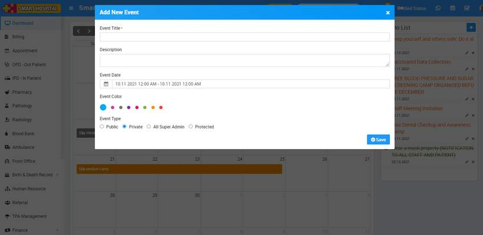
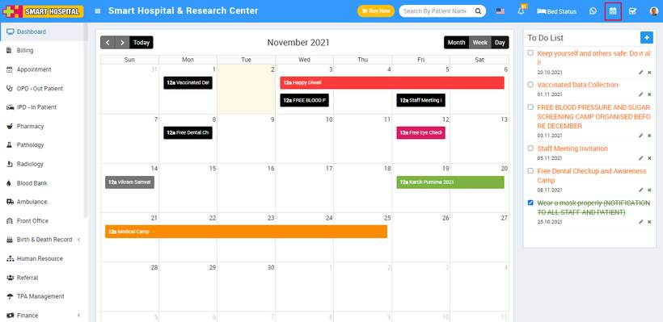

# How to add new event in calendar?

_Tue, 02 Nov, 2021_ · [Miscellaneous (6)](https://smart-hospital.in/category/miscellaneous) · vendor article: https://smart-hospital.in/article/how-to-add-new-event-in-calendar

### How to add new event in calendar?

Tue, 02 Nov, 2021

[Articles](https://smart-hospital.in/articles)[Miscellaneous](https://smart-hospital.in/category/miscellaneous)

---

To add event in calendar, Superadmin /Admin user need to login in Smart Hospital, then click on **Calendar** icon present at top right corner in the header, this will redirect you in the calendar page, then click on the date you want to add the event then enter **Event Title, Description, Event Date, Event Color** and select **Event Type** (**Public** is visible to all, **Private** is only you can see this event, **All <your role>** is this event will be visible to all users of your role, **Protected** that means it is visible to all staff members but not patient) and then click on **Save** button.  
  
  
  

