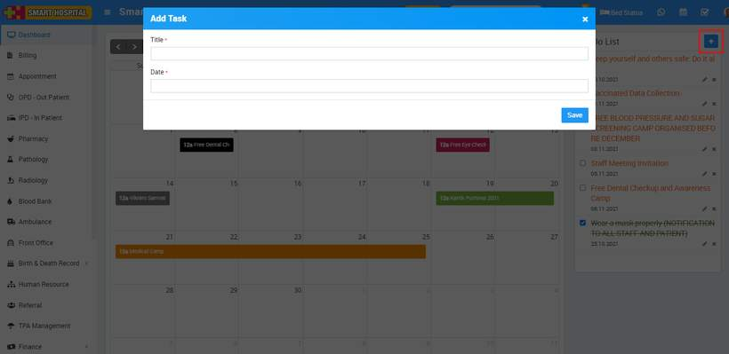

# How to add To Do List?

_Tue, 02 Nov, 2021_ · [Miscellaneous (6)](https://smart-hospital.in/category/miscellaneous) · vendor article: https://smart-hospital.in/article/how-to-add-to-do-list

### How to add To Do List?

Tue, 02 Nov, 2021

[Articles](https://smart-hospital.in/articles)[Miscellaneous](https://smart-hospital.in/category/miscellaneous)

---

To add to do list, click on the **Calendar** icon present on the top right corner of the header, it will redirect you in the calendar page, here  click on **Add** icon present at the right side of the page, then enter **Title, Date** and then click on **Save** button. Once record is added you can see it in the **To Do List**.  
  
  
  
  
  
To edit to do list, click on **Edit** icon and to delete to do list, click on **Delete** icon present in the to do list.
