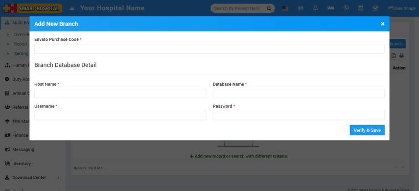
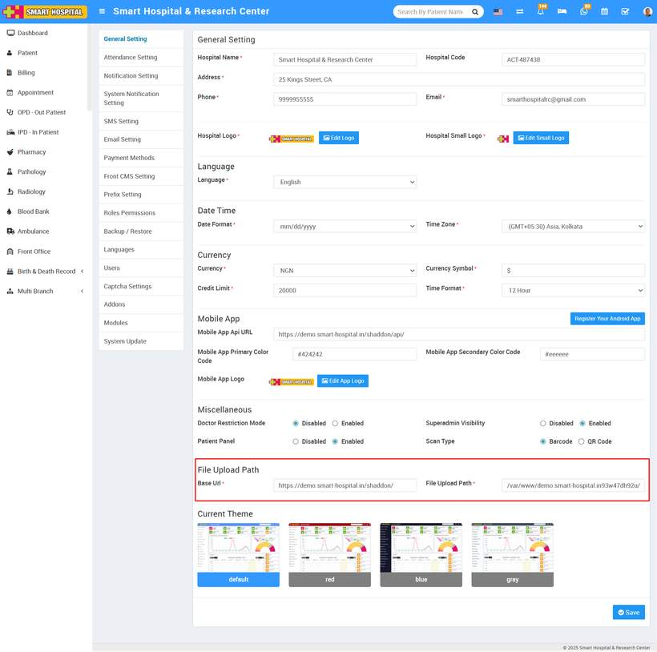

# How to add the new branch in smart hospital home branch?

_Sat, 16 Aug, 2025_ · [Multi Branch (7)](https://smart-hospital.in/category/multi-branch) · vendor article: https://smart-hospital.in/article/how-to-add-the-new-branch-in-smart-hospital-home-branch

### How to add the new branch in smart hospital home branch?

Sat, 16 Aug, 2025

[Articles](https://smart-hospital.in/articles)[Multi Branch](https://smart-hospital.in/category/multi-branch)

---

**To add a new branch**, log in from the **Super Admin Panel**, then go to **Multi Branch > Settings** and click on the **+ Add New Branch** button. This will open the Add New Branch window.

Enter the **Envato Purchase Code**, and below that, fill in the **branch database details** including:

* Hostname
* Database Name
* Username
* Password

Once all the required information is entered, click on the **Verify & Save** button located at the bottom right corner.

**Note:** (1) When you add the new branch in your **Smart Hospital**, database **Username** and **Password** must be same for the all branches including home branch database.  
(2) If any addons are installed in your **other branches** but they are not installed in your **home branch** then these addons will not be available in your **home branch** (with multi branch addon) while accessing other branches data.  
  
  
  
Once a branch is created, you will see the details of the **New Multi Branch**.

  
  
  
**Note:** Please check your Smart Hospital main branch and sub branch, **Base Url** and **File Upload Path** are entered correctly in your **Setup > Settings >** **General Setting > File Upload Path**. After saving general setting please once logout then relogin so changes will be come in effect.  
  

