# How to check Multi Branch overview?

_Sat, 16 Aug, 2025_ · [Multi Branch (7)](https://smart-hospital.in/category/multi-branch) · vendor article: https://smart-hospital.in/article/how-to-check-multi-branch-overview

### How to check Multi Branch overview?

Sat, 16 Aug, 2025

[Articles](https://smart-hospital.in/articles)[Multi Branch](https://smart-hospital.in/category/multi-branch)

---

In the **Multi Branch Overview**, you can check all the details of your different branches with the help of different modules. Please click on the **Multi Branch** button in the left side bar to access the Overview page, then select the first option, **Overview,** the Overview page will now be displayed. 

**On the Overview page of your system (likely software or a dashboard), there’s a summary table for each of these key modules. For example:**

* **Appointment – details about patient bookings**
* **OPD / IPD – outpatient and inpatient data**
* **Operation Theatre – surgeries performed**
* **Pharmacy – medicine transactions**
* **Pathology / Radiology – test records**
* **Blood Transactions – blood donations, issues, and component tracking**
* **Ambulance – ambulance usage and costs**
* **Birth / Death Records – vital statistics**
* **Staff Attendance / Payroll – HR details**
* **Transactions – financial records**

**All the data in these tables is shown branch-wise, so you can see how each location is performing in various departments.**

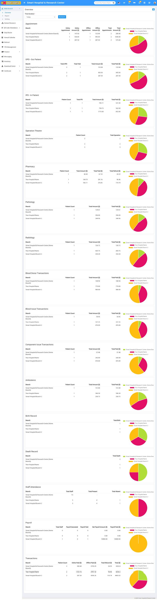  
**Appointment:**  In Appointment, here you can see the different columns under Branch. **Online Appointment > Online Amount > Offline Appointment > Offline Amount > Total Appointments > Total Amount**

**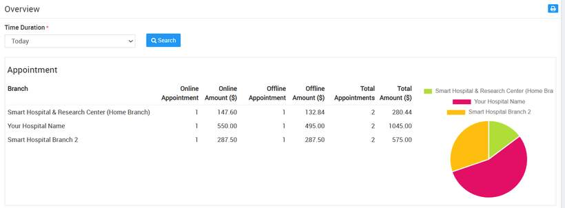**

**In the Appointment section of the system, there’s a table showing several columns of data:**

* **Branch – Displays the names of the hospital branches are operating.**
* **Online Appointment – the number of appointments booked online.**
* **Online Amount – the total amount collected from online appointments.**
* **Offline Appointment – the number of appointments booked offline (e.g. walk-ins, phone calls).**
* **Offline Amount – the total amount collected from offline appointments.**
* **Total Appointments – the combined total number of online and offline appointments.**
* **Total Amount – the combined total revenue from both online and offline appointments.**

**So, this section helps you track and analyse appointment details for each branch, showing how many appointments were booked online or offline, and the amounts collected from each.**

**OPD - Out Patient:** In OPD - Out Patient Details, here you can see the different columns under **Branch** > **Total OPD > Total Visit > Total Amount > Total Paid**

**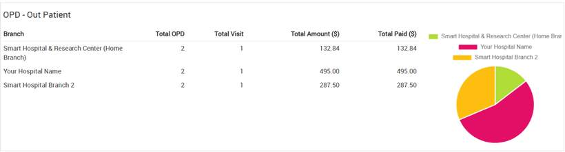**

**In the OPD - Out Patient section of the system, there’s a table showing information in several columns:**

* **Branch – Displays the names of the hospital branches are operating**
* **Total OPD – the total number of out-patient records or unique out-patients at that branch**
* **Total Visit – the total number of visits made by out-patients (some patients might visit multiple times)**
* **Total Amount – the total charges billed for OPD services**
* **Total Paid – the amount that has already been paid by patients for those services**

**So, this section helps you monitor and analyse out-patient services at each branch, including the number of patients, visits, billing, and payments received.**

**IPD - In Patient**: In IPD - In Patient details, here you can see the different columns for **branch** > **Patient Count > Total IPD > Total Amount > Total Paid**

**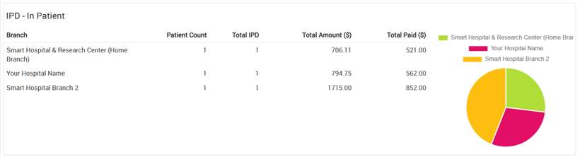**In the **IPD - In Patient** section of the system there’s a table showing information in several columns:

* **Branch** – Displays the names of the hospital branches are operating
* **Patient Count** – the number of patients admitted as in-patients
* **Total IPD** – the total number of in-patient department (IPD) cases handled at that branch
* **Total Amount** – the total charges billed for IPD services
* **Total Paid** – the amount that has already been paid by patients for those services

So, this section helps you **track and manage details related to in-patient services** at each branch, including how many patients were treated, the total billing, and how much has been paid.

**Operation Theatre:** In Operation Theatre details, here you can see the different columns of **Branch > Patient Count > Total Operation.  
  
****Operation Theatre details section**, there is a table or list that displays information in multiple columns:

* **Branch:** Displays the names of the hospital branches are operating.
* **Patient Count:** Displays how many patients have undergone operations in each branch.
* **Total Operation:** Indicates the total number of surgical operations performed in each branch.

In other words, this section provides a summary of surgical activities across different branches of the hospital, including how many patients were treated and how many operations were conducted.

**Pharmacy:** In Pharmacy, here you can see the different column of **Branch > Patient Count > Total Amount > Total Paid > Total Refund.  
  
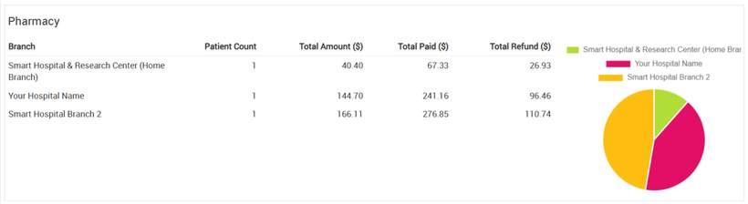**

In the **Pharmacy section**, there is a table that shows several columns of information:

* **Branch:** Displays the names of the hospital branches are operating
* **Patient Count:** Shows the number of patients who made purchases from the pharmacy in each branch.
* **Total Amount:** Indicates the total value of pharmacy sales or bills generated for those patients.
* **Total Paid:** Shows how much money has actually been received from patients for pharmacy purchases.
* **Total Refund:** Displays the amount of money refunded to patients for returned or canceled pharmacy items

**In short, this table provides a summary of pharmacy transactions for each hospital branch, showing how many patients bought medicines, how much money was charged, paid, and refunded.**

**Pathology:** The Pathology displays the following columns: **Branch > Patient Count > Total Amount > Total Paid.****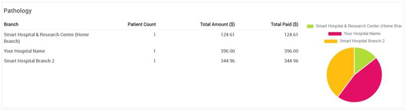  
  
  
In the Pathology section of the system or report, there is a table that contains several columns of information:**

* **Branch: Shows the names of the hospital branches being operating**
* **Patient Count: Displays the number of patients who have undergone pathology tests in each branch.**
* **Total Amount: Indicates the total charges or bills generated for pathology services in each branch.**
* **Total Paid: Shows how much money has actually been received from patients for those pathology services.**

**In short, this table gives an overview of pathology-related activities and payments for each hospital branch.**

**Radiology:** In Radiology, here you can see the different columns of **Branch > Patient Count> Total Amount > Total Paid.  
  
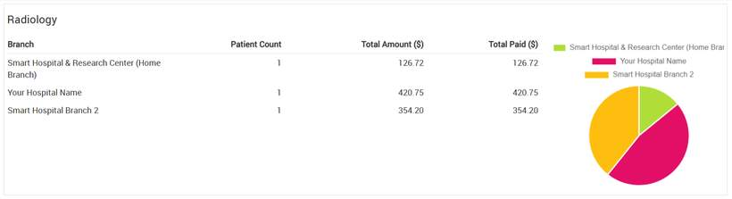**in the **Radiology section** of the system or report, there’s a table showing several columns of information:

* **Branch:** Lists the names of the hospital branches is being operating.
* **Patient Count:** Shows how many patients have undergone radiology tests or procedures in each branch.
* **Total Amount:** Displays the total charges or bills generated for radiology services in each branch.
* **Total Paid:** Indicates how much money has been received from patients for those radiology services.

In short, this table provides a summary of radiology activities and payments across different branches of the hospital.

**Blood Donor Transactions:** In Blood Donor Transactions, here you can see the different columns of **Branch > Patient Count > Total Amount > Total Paid.**  
  
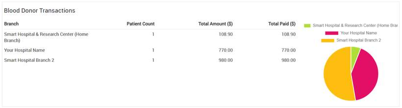  
In the **Blood Donor Transactions section** of the system or report, there’s a table displaying several columns:

* **Branch:** Shows the names of the hospital branches is being operating.
* **Patient Count:** Displays the number of donors or patients involved in blood donation transactions in each branch.
* **Total Amount:** Indicates the total charges or value associated with blood donor transactions in each branch (e.g. costs for blood processing, testing, or storage fees, if applicable).
* **Total Paid:** Shows how much money has actually been received related to these transactions in each branch.

In summary, this table provides an overview of blood donor activities and financial details across the different branches of the hospital.

**Blood Issue Transactions: In Blood Issue Transactions, you can see the different columns of Branch > Patient Count > Total Amount > Total Paid.  
  
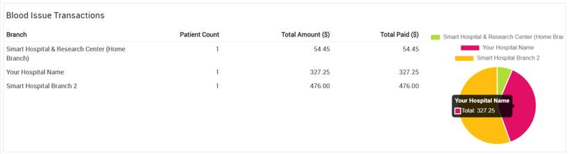**In the **Blood Issue Transactions section** of the system or report, there’s a table displaying several columns:

* **Branch:** Shows the names of the hospital branches being operating.
* **Patient Count:** Displays the number of patients who have received blood issues or transfusions in each branch.
* **Total Amount:** Indicates the total charges or costs associated with issuing blood in each branch.
* **Total Paid:** Shows how much money has actually been received for these blood issue transactions in each branch.

In short, this table summarizes blood transfusion activities and related financials across the hospital’s branches.

**Component Issue Transactions: In Component Issue Transactions, you can see the different columns of Branch > Patient Count > Total Amount > Total Paid.  
  
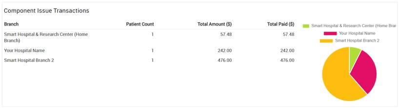**

**The Component Issue Transactions section in the system or report. The table in this section contains the following columns:**

* **Branch: Displays the names of the hospital branches involved in component issue transactions (e.g. issuing blood components like plasma, platelets, etc.).**
* **Patient Count: Shows the number of patients who received blood components in each branch.**
* **Total Amount: Indicates the total charges for all issued components in each branch.**
* **Total Paid: Reflects the amount actually received from patients for those components.**

**In short, this section provides an overview of blood component issues and their related payments across hospital branches.**

**Ambulance: In Ambulance, you can see the different columns of Branch > Patient Count > Total Amount > Total Paid.  
  
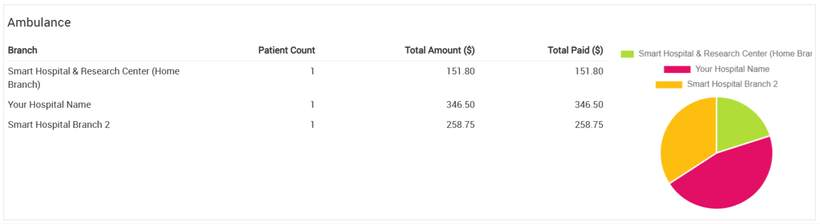****In the Ambulance section of the system, there is a table or list showing several details. The table has different columns labelled:**

* **Branch – Shows the names of the hospital branches being operating the ambulance service**
* **Patient Count – how many patients used the ambulance service from that branch**
* **Total Amount – the total charges billed for the ambulance services**
* **Total Paid – the amount of money that has already been paid against those charges**

**So, this section lets you view and track ambulance-related data branch-wise, including how many patients were served, how much money was billed, and how much has been paid so far.**

**Birth Record: In Birth Record, you can see the different columns of Branch > Total Birth.**

**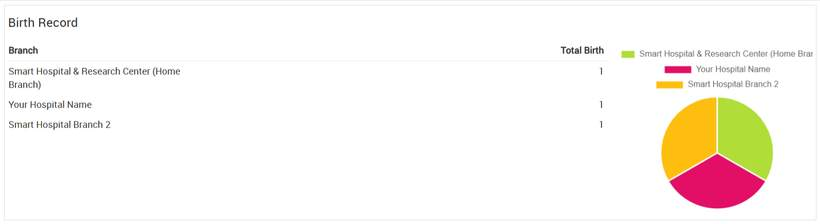  
  
In the Birth Record section of the system, there is a table showing information in columns. The columns include:**

* **Branch – Shows the names of the hospital branches being operating**
* **Total Birth – the total number of births recorded at that branch**

**So, this section helps you view how many births have taken place at each branch.**

**Death Record: In Death Record, you can see the different columns of columns of Branch > Total Death.  
  
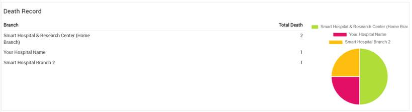**

In the **Death Record** section of the system, there is a table showing data in columns. These columns include:

* **Branch** – **Shows the names of the hospital branches being operating.**
* **Total Death** – the total number of deaths recorded at that branch

So, this section lets you **view and track how many deaths have been recorded at each branch.**

**Staff Attendance: In Staff Attendance, you can see the different columns of Branch > Total Staff > Total Present > Total Absent.  
  
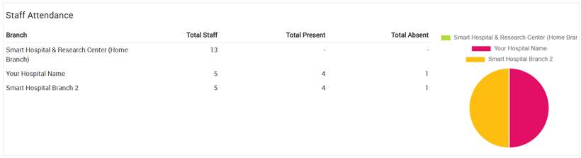**

In the **Staff Attendance** section of the system, there is a table that shows data in several columns:

* **Branch** – **Shows the names of the hospital branches being operating**
* **Total Staff** – the total number of staff members working at that branch
* **Total Present** – the number of staff members who are present on a that day
* **Total Absent** – the number of staff members who are absent on that day

So, this section helps you **monitor and track staff attendance at each branch.**

**Payroll: In Payroll, you can see the different columns of Branch > Total Staff > Payroll Generated > Payroll Paid > Net Payroll Amount > Payroll Paid.  
  
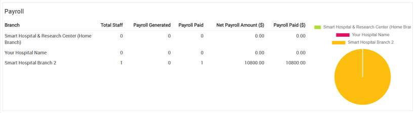**

In the **Payroll** section of the system, there is a table that displays several columns:

* **Branch** – **Shows the names of the hospital branches being operating**
* **Total Staff** – the total number of staff members in that branch
* **Payroll Generated** – the total salary amount that has been calculated for all staff
* **Payroll Paid** – the amount of payroll that has already been paid to the staff
* **Net Payroll Amount** – the remaining amount to be paid or the final payable amount after deductions and payments

So, this section allows you to **track and manage payroll details for each branch**, including how many staff there are and how much salary has been processed and paid.

**Transactions: In Transactions, you can see the different columns of Branch > Patient Count > Online Paid > Offline Paid > Total Refund > Total.  
  
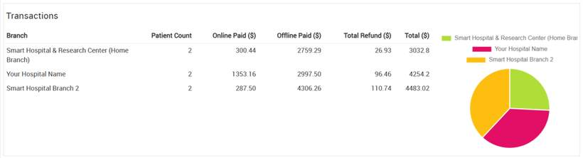****In the Transactions section of the system, there’s a table that shows several columns:**

* **Branch – Shows the names of the hospital branches being operating**
* **Patient Count – the total number of patients related to those transactions**
* **Online Paid – the amount of money received through online payments**
* **Offline Paid – the amount of money received through cash or other offline payments**
* **Total Refund – the total amount refunded to patients**
* **Total – the overall total amount collected after considering payments and refunds**

**So, this section helps you monitor and analyse financial transactions branch-wise, including how much was paid online and offline, how many refunds were given, and the overall totals.**
