# How to check multi branch report in smart Hospital?

_Sat, 16 Aug, 2025_ · [Multi Branch (7)](https://smart-hospital.in/category/multi-branch) · vendor article: https://smart-hospital.in/article/how-to-check-multi-branch-report-in-smart-hospital

### How to check multi branch report in smart Hospital?

Sat, 16 Aug, 2025

[Articles](https://smart-hospital.in/articles)[Multi Branch](https://smart-hospital.in/category/multi-branch)

---

To view the reports, go to **Multi Branch > Report**. Here, you will see all reports related to multiple branches.  
  
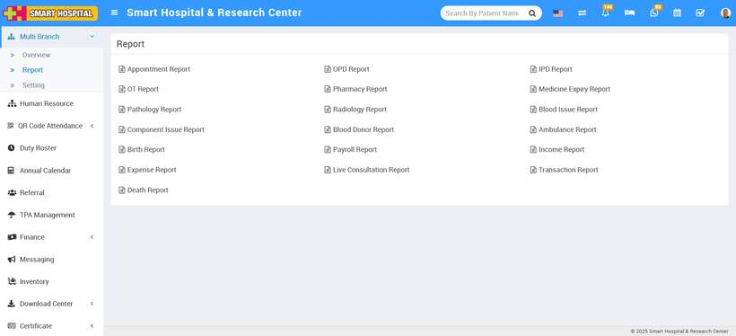  
  
  
**Appointment Report**  
  
While searching the Appointment Report details using a From Date to To Date filter, you can see the data displayed in columns showing **Branch > Date > Paid  
  
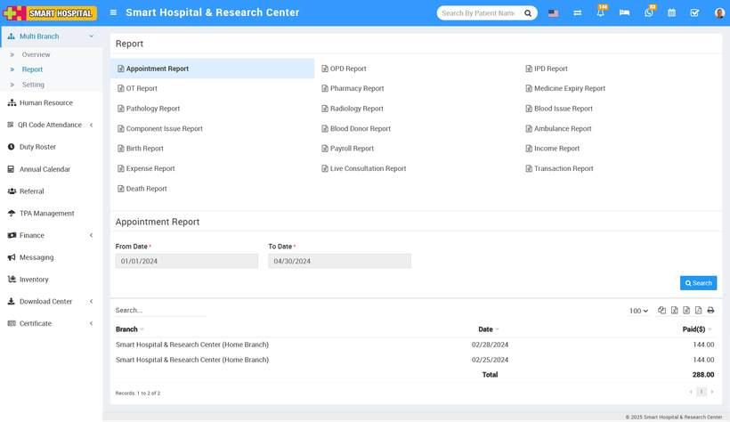**

After running the search, the system displays the results in a table with these columns:

* + **Branch** – Displays the names of the hospital branches are operating
  + **Date** – the specific date of the appointments
  + **Paid** – the amount paid or payment status for the appointments on that date

So, this allows you to **see payment details for appointments at different branches within the selected date range.**

  
**OPD Report**While searching the OPD Report details using a From Date to To Date filter, you can see the data displayed in columns showing B**ranch > Date > Total > Paid**  
  
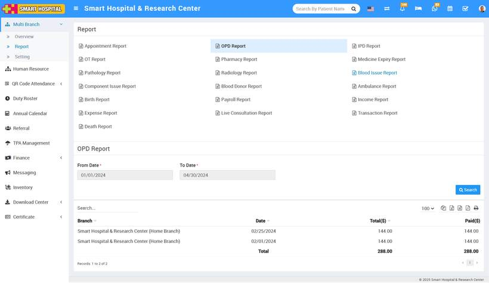  
  
  

* After running the search, the system shows the results in a table with these columns:

  + **Branch** – Displays the names of the hospital branches are operating
  + **Date** – the specific date of OPD activities
  + **Total** – the total number of OPD cases or the total amount billed (depending on context)
  + **Paid** – the amount that has been paid for those OPD services on that date

So, this helps you **analyze OPD activity and payments branch-wise and date-wise.**

  
**IPD Report**  
While searching the IPD Report details using a From Date to To Date filter, you can see the data displayed in columns showing **Branch > Date > Total > Paid**.  
  
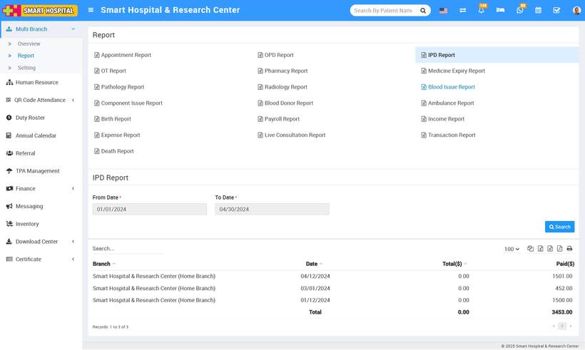  
  

Once you run the search, the system shows a table with these columns:

* + **Branch** – Displays the names of the hospital branches are operating
  + **Date** – the specific date of IPD activities
  + **Total** – the total number of IPD cases or the total amount billed.
  + **Paid** – the amount that has been paid for those IPD services on that date

So, this feature allows you to **analyze in-patient data and payments for different branches over the selected time period.**

  
**OT Report**  
While searching the OT Report details using a From Date to To Date filter, you can see the data displayed in columns showing **Branch > Date > Total Operation**.  
  
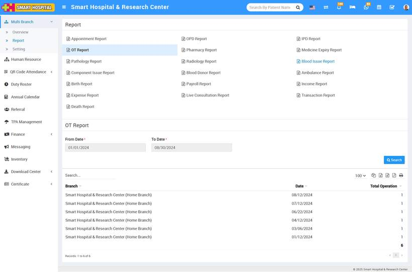  
  

Once you run the search, the system shows a table with these columns:

* **Branch** – Displays the names of the hospital branches where operations are performed
* **Date** – Shows the specific date of the operations
* **Total Operations** – Indicates the total number of surgical operations carried out on that date in that branch

When you search the OT Report using a date range (From Date to To Date), the system displays the results in a table with columns for Branch, Date, and Total Operations. This allows you to analyze surgical activity across different branches over the selected time period.

 **Pharmacy Report**  
While searching the **Pharmacy Report** details using a From Date to To Date filter, you can see the data displayed in columns showing **Branch > Date > Paid > Refund  >  Amount.**  
  
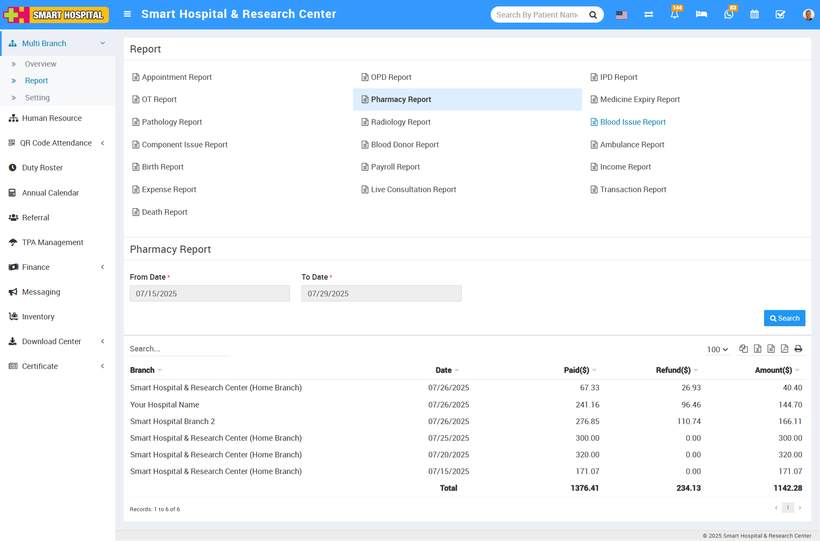  
  

Once you run the search, the system shows a table with these columns:

* **Branch** – Displays the names of the hospital branches where pharmacy transactions occurred
* **Date** – Shows the specific date of the pharmacy transactions
* **Paid** – Indicates the amount received for pharmacy sales on that date
* **Refund** – Shows the amount refunded for returned pharmacy items on that date
* **Amount** – Represents the net amount (i.e. Paid minus Refund) for pharmacy transactions on that date

When you search the Pharmacy Report using a date range (From Date to To Date), the system displays the results in a table with columns for Branch, Date, Paid, Refund, and Amount. This allows you to analyze pharmacy sales, refunds, and net revenue across different branches over the selected time period.  
  
**Medicine Expiry Report**  
While searching the **Medicine Expiry Report** details using a From Date to To Date filter, you can see the data displayed in columns showing **Branch > Medicine Name > Batch Number > Company Name > Medicine Category > Medicine Group > Supplier > Expiry Date > Qauntity  
  
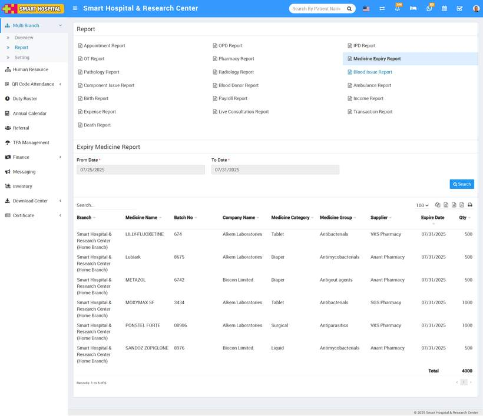**

Once you run the search, the system shows a table with these columns:

When you search the Medicine Expiry Report using a date range (From Date to To Date), the system displays the results in a table with columns for Branch, Medicine Name, Batch Number, Company Name, Medicine Category, Medicine Group, Supplier, Expiry Date, and Quantity. This helps track medicines that are nearing expiry across different branches.

**Pathology Report**  
While searching the **Pathology Report** details using a From Date to To Date filter, you can see the data displayed in columns showing **Branch > Date > Net Amount > Paid  
  
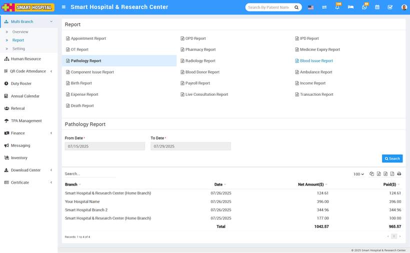**

Once you run the search, the system shows a table with these columns:

* **Branch** – Displays the hospital branch where the pathology test was conducted
* **Date** – Shows the date on which the pathology tests were performed
* **Net Amount** – Indicates the total billed amount for the pathology tests (after discounts, if any)
* **Paid** – Shows the amount that has been paid by the patient for the pathology services on that date

When you search the Pathology Report using a date range (From Date to To Date), the system displays the results in a table with columns for Branch, Date, Net Amount, and Paid. This allows you to track pathology billing and payments across different branches during the selected period

**Radiology Report**  
While searching the **Radiology Report** details using a From Date to To Date filter, you can see the data displayed in columns showing **Branch > Date > Net Amount > Paid  
  
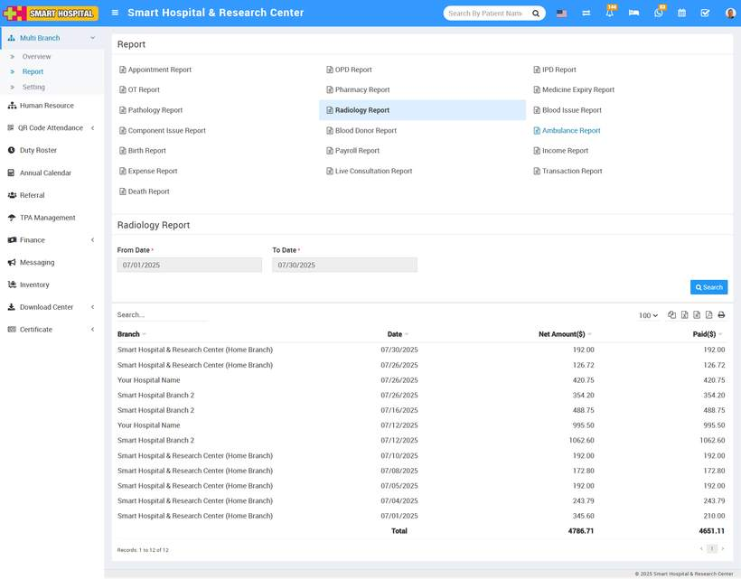**

Once you run the search, the system shows a table with these columns:

* **Branch** – Displays the hospital branch where the radiology tests were performed
* **Date** – Shows the date on which the radiology services were provided
* **Net Amount** – Indicates the total billed amount for the radiology tests (after any discounts)
* **Paid** – Shows the amount paid by the patient for the radiology services on that date

When you search the Radiology Report using a date range (From Date to To Date), the system displays the results in a table with columns for Branch, Date, Net Amount, and Paid. This helps you monitor radiology services and payments across different branches for the selected time period.

  
**Blood Issue Report**  
While searching the **Blood Issue Report** details using a From Date to To Date filter, you can see the data displayed in columns showing **Branch > Bill No > Case ID > Issue Date > Received To > Blood Group > Gender > Donor Name > Bags > Net Amount > Paid Amount > Balance Amount.  
  
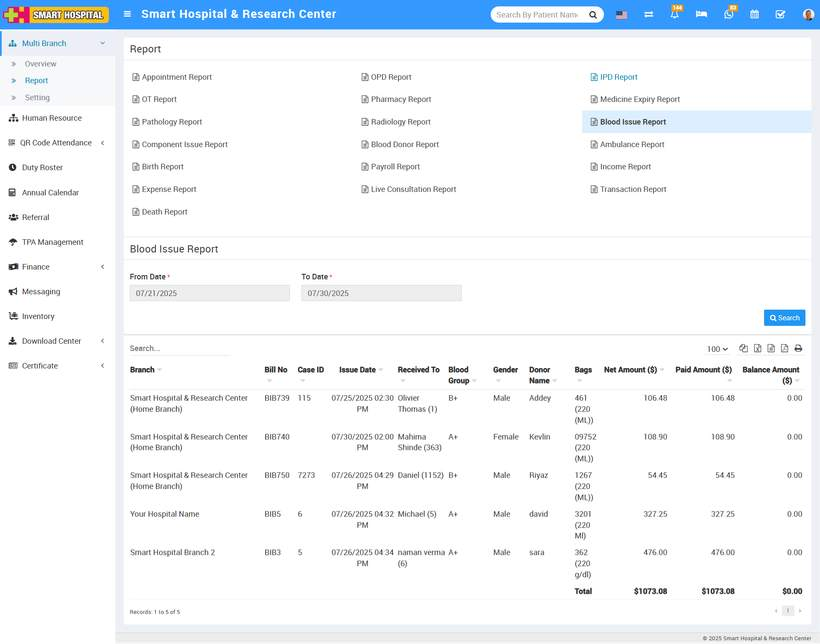**

Once you run the search, the system shows a table with these columns:

* **Branch** – Displays the hospital branch where the blood issue transaction occurred
* **Bill No** – Shows the bill number associated with the blood issue
* **Case ID** – Indicates the unique patient case or admission ID
* **Issue Date** – The date on which the blood was issued
* **Received To** – The name of the patient or department that received the blood
* **Blood Group** – Shows the patient’s blood group for which blood was issued
* **Gender** – Indicates the gender of the patient who received the blood
* **Donor Name** – Displays the name of the donor who provided the blood
* **Bags** – Indicates the number of blood bags issued
* **Net Amount** – Shows the total amount charged for the blood issue (after discounts, if any)
* **Paid Amount** – The amount paid against the blood issue bill
* **Balance Amount** – The remaining unpaid balance for the blood issue bill

When you search the Blood Issue Report using a date range (From Date to To Date), the system displays the results in a table with columns for Branch, Bill No, Case ID, Issue Date, Received To, Blood Group, Gender, Donor Name, Bags, Net Amount, Paid Amount, and Balance Amount. This helps track blood issue transactions, patient details, and financials across different branches during the selected period.

**Component Issue Report**

While searching the **Component Issue Report** details using a From Date to To Date filter, you can see the data displayed in columns showing **Branch > Bill No > Case ID > Issue Date > Received To > Blood > Component > Gender > Donor Name > Bags > Net Amount > Paid Amount > Balance Amount.  
  
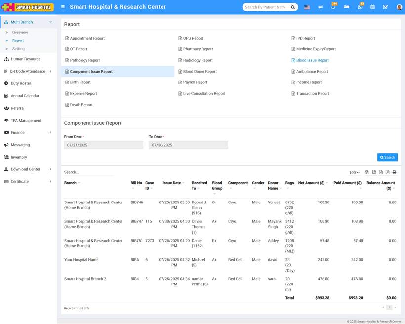**

Once you run the search, the system shows a table with these columns:

* **Branch** – Displays the hospital branch where the component issue transaction occurred
* **Bill No** – Shows the bill number related to the component issue
* **Case ID** – Indicates the unique patient case or admission ID
* **Issue Date** – The date on which the blood component was issued
* **Received To** – The patient or department receiving the blood component
* **Blood** – Displays the blood group of the patient
* **Component** – Indicates the specific blood component issued (e.g. Plasma, Platelets)
* **Gender** – Shows the gender of the patient receiving the component
* **Donor Name** – Displays the name of the donor who provided the blood/component
* **Bags** – The number of bags of the component issued
* **Net Amount** – The total amount billed for the component issue (after discounts, if any)
* **Paid Amount** – The amount paid against the component issue bill
* **Balance Amount** – The outstanding unpaid balance for the component issue bill

When you search the Component Issue Report using a date range (From Date to To Date), the system displays the results in a table with columns for Branch, Bill No, Case ID, Issue Date, Received To, Blood, Component, Gender, Donor Name, Bags, Net Amount, Paid Amount, and Balance Amount. This helps track blood component issues, patient details, and financials across different branches for the selected period.

  
**Blood Donor Report**  
While searching the **Blood Donor Report** details using a From Date to To Date filter, you can see the data displayed in columns showing **Branch > Blood Group > Bags > Donor Name > Age > Donate Date > Apply Charge > Discount Percentage > Tax Percentage > Amount > Paid Amount.  
  
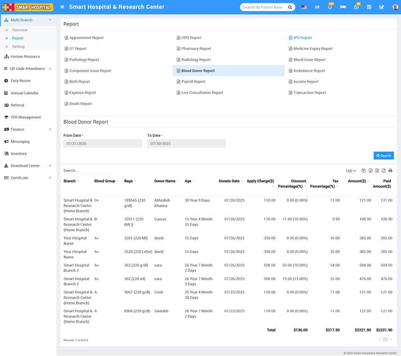**

Once you run the search, the system shows a table with these columns:

* **Branch** – Displays the hospital branch where the donation took place
* **Blood Group** – Shows the donor’s blood group
* **Bags** – Indicates the number of blood bags donated
* **Donor Name** – Displays the name of the blood donor
* **Age** – Shows the age of the donor
* **Donate Date** – The date on which the blood donation occurred
* **Apply Charge** – Indicates whether any charges were applied to the donation process
* **Discount Percentage** – Shows any discount percentage applied to the charges (if applicable)
* **Tax Percentage** – Displays the percentage of tax applied to the charges (if applicable)
* **Amount** – The total amount calculated for the donation-related charges before payments
* **Paid Amount** – The amount paid towards any applicable charges for the donation

When you search the Blood Donor Report using a date range (From Date to To Date), the system displays the results in a table with columns for Branch, Blood Group, Bags, Donor Name, Age, Donate Date, Apply Charge, Discount Percentage, Tax Percentage, Amount, and Paid Amount. This helps track blood donations, donor details, and any related financial transactions across different branches during the selected period

  
**Ambulance Report**  
While searching the **Ambulance** **Report** details using a From Date to To Date filter, you can see the data displayed in columns showing **Branch > Date > Paid  
  
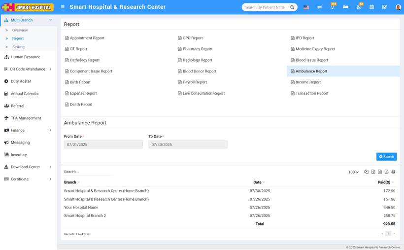**

Once you run the search, the system shows a table with these columns:

* **Branch** – Displays the hospital branch from where the ambulance service was operated
* **Date** – Shows the specific date on which the ambulance service was provided
* **Paid** – Indicates the amount paid for the ambulance service on that date

When you search the Ambulance Report using a date range (From Date to To Date), the system displays the results in a table with columns for Branch, Date, and Paid. This helps track ambulance services and related payments across different branches during the selected period

 **Birth Report  
  
While searching the Birth Report details using a From Date to To Date filter, you can see the data displayed in columns showing Branch > Birth Date > Paid  
  
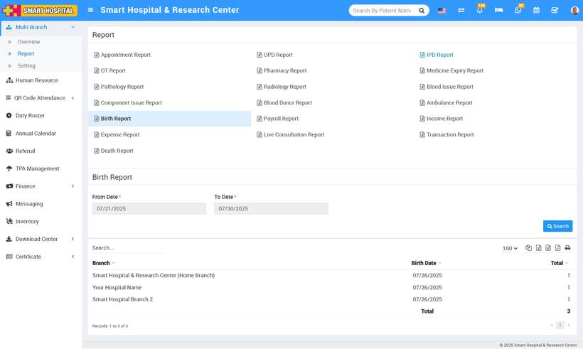**

**Once you run the search, the system shows a table with these columns:**

* **Branch** – Displays the hospital branch where the birth took place
* **Birth Date** – Shows the date on which the birth occurred
* **Paid** – Indicates the amount paid for services related to the birth on that date

When you search the Birth Report using a date range (From Date to To Date), the system displays the results in a table with columns for Branch, Birth Date, and Paid. This allows you to track birth records and related payments across different branches during the selected period

**Payroll Report**  
While searching the **Payroll** **Report** details using a From Date to To Date filter, you can see the data displayed in columns showing **Branch > Name > Role > Designation > Month > Year > Payment Date > Pay Slip > Basic Salary > Earning > Deduction > Gross Salary > Tax > Net Salary.  
  
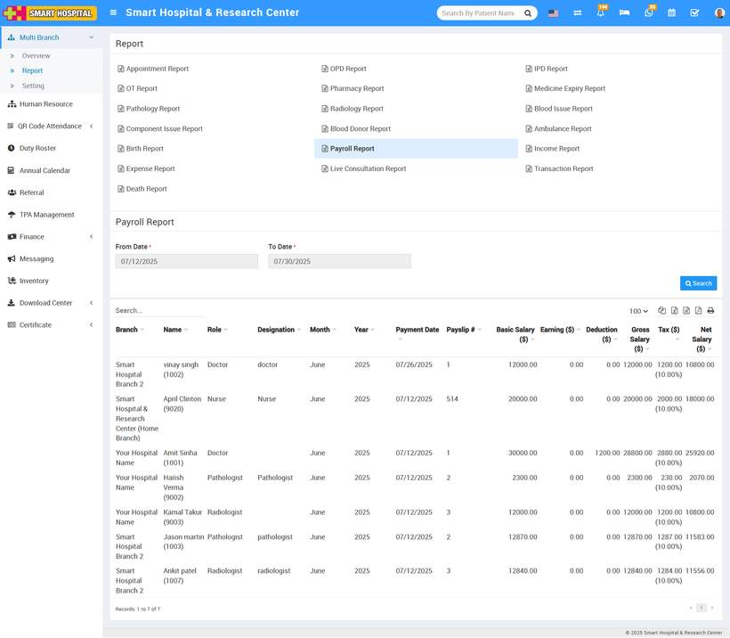**

Once you run the search, the system shows a table with these columns:

* **Branch** – Displays the hospital branch where the employee works
* **Name** – Shows the name of the employee
* **Role** – Indicates the employee’s job role (e.g. Nurse, Doctor, Clerk)
* **Designation** – Provides the employee’s specific title or position
* **Month** – Indicates the month for which the salary is processed
* **Year** – Indicates the year for which the salary is processed
* **Payment Date** – Shows the date on which the salary was paid
* **Pay Slip** – May display a link or reference to the pay slip document
* **Basic Salary** – The basic fixed salary amount before any additions or deductions
* **Earning** – Additional earnings like allowances, bonuses, or overtime
* **Deduction** – Any deductions such as provident fund, loans, or penalties
* **Gross Salary** – Total salary before tax deductions (Basic Salary + Earnings – Deductions)
* **Tax** – Shows the tax amount deducted from the salary
* **Net Salary** – The final amount paid to the employee after all deductions and tax

When you search the Payroll Report using a date range (From Date to To Date), the system displays the results in a table with columns for Branch, Name, Role, Designation, Month, Year, Payment Date, Pay Slip, Basic Salary, Earning, Deduction, Gross Salary, Tax, and Net Salary. This helps you analyze payroll details and salary transactions for employees across different branches during the selected period.

**Income Report**  

While searching the **Income Report** details using a From Date to To Date filter, you can see the data displayed in columns showing **Branch > Date > Total Amount > Total Transaction** but while you click on **Income Detailed Report** showing right side in middle and search through the date filter then the details will be displayed as **Branch > Name > Invoice Number > Date > Amount.**

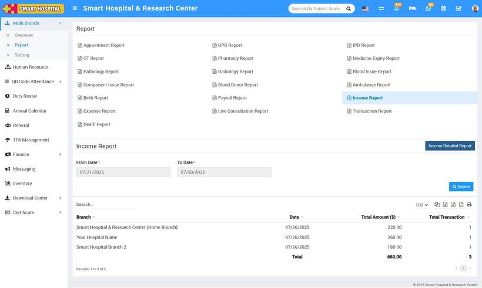  
  

---

**Once you run the search, the system shows a table with these columns:**

* **Income Report** is a summary report that shows overall income for different branches of the hospital over a selected period.
* To search this report, you choose a **From Date** and a **To Date**—meaning you pick the start and end dates for the report.
* After searching, the report shows data in a table with these columns:

  + **Branch** – The hospital branch where the income was recorded
  + **Date** – The specific date of the income
  + **Total Amount** – The total amount of money received on that date in that branch
  + **Total Transaction** – The total number of transactions that contributed to the income on that date
* On the same page, there’s a link or button called **Income Detailed Report**, usually located on the right side in the middle section of the screen.  
    
  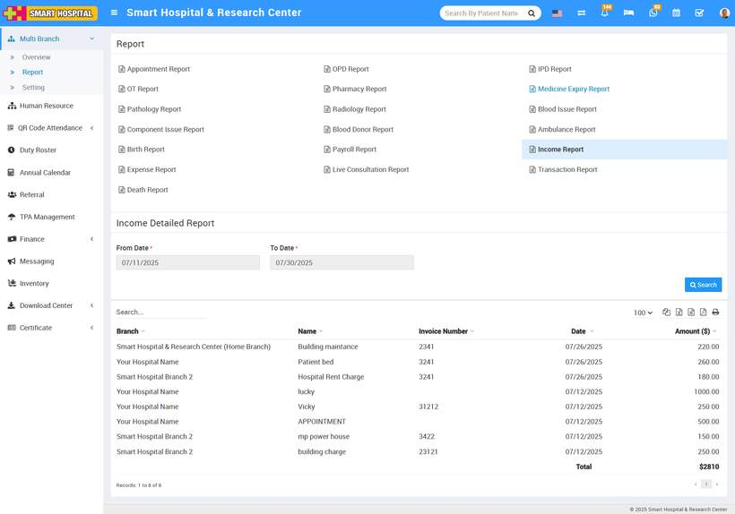
* When you click on **Income Detailed Report**, you can again search using the same date filters.
* The **Income Detailed Report** then shows more detailed information for each individual transaction. Its table displays these columns:

  + **Branch** – The hospital branch where the transaction happened
  + **Name** – The name of the person (like a patient or customer) related to the transaction
  + **Invoice Number** – The unique invoice number for the transaction
  + **Date** – The date of the specific transaction
  + **Amount** – The amount of money for that individual transaction

When you search the Income Report using a date range, you see a summary showing Branch, Date, Total Amount, and Total Transactions. But if you click on the Income Detailed Report (located on the right side of the page), and search again by date, you’ll see detailed information for each transaction, including Branch, Name, Invoice Number, Date, and Amount.

  
**Expense Report**  

While searching the **Expense Report** details using a From Date to To Date filter, you can see the data displayed in columns showing **Branch > Date > Total Amount > Total Transaction** but while you click on **Income Detailed Report** showing right side in middle and search through the date filter then the details will be displayed as **Branch > Name > Invoice Number > Date > Amount.  
  
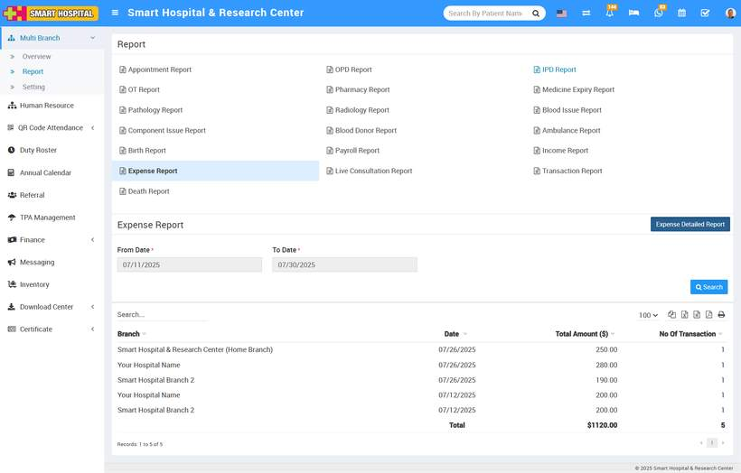**

---

**Once you run the search, the system shows a table with these columns:**

* The **Expense Report** provides a **summary** of expenses across branches for a selected date range.
* When you search the report using a **From Date** and **To Date**, it shows a table with these columns:

  + **Branch** – The hospital branch where the expenses occurred
  + **Date** – The date of the expense
  + **Total Amount** – The total amount spent on that date in that branch
  + **Total Transactions** – The total number of expense transactions on that date
* On the same screen, there’s a link or button called **Expense Detailed Report**, located on the right side in the middle of the page.  
    
  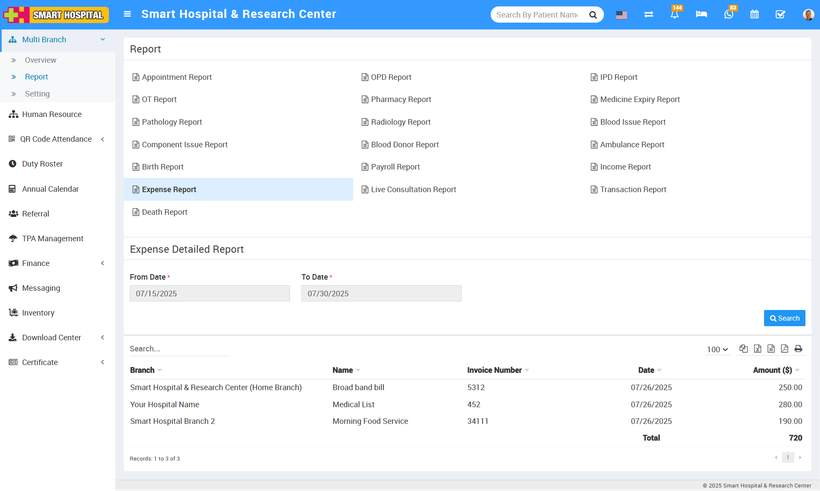
* Clicking this link opens a more detailed view, where you can again filter by date.
* The **Expense Detailed Report** shows each individual transaction with the following columns:

  + **Branch** – The hospital branch where the expense was recorded
  + **Name** – The name of the vendor, supplier, or person associated with the expense
  + **Invoice Number** – The invoice number for the expense transaction
  + **Date** – The specific date of the transaction
  + **Amount** – The amount of money spent on that transaction

When you search the Expense Report using a date range, you’ll see a summary table showing Branch, Date, Total Amount, and Total Transactions. However, if you click on the Expense Detailed Report (found on the right side of the page) and search by date, you’ll see detailed transactions with columns for Branch, Name, Invoice Number, Date, and Amount.

**Live Consultation Report**While searching the **Live Consultation Report** details using a From Date to To Date filter, you can see the data displayed in columns showing **Branch > Consultation Title > Patient > Date > Api Used > Created By > Total Join**  
 **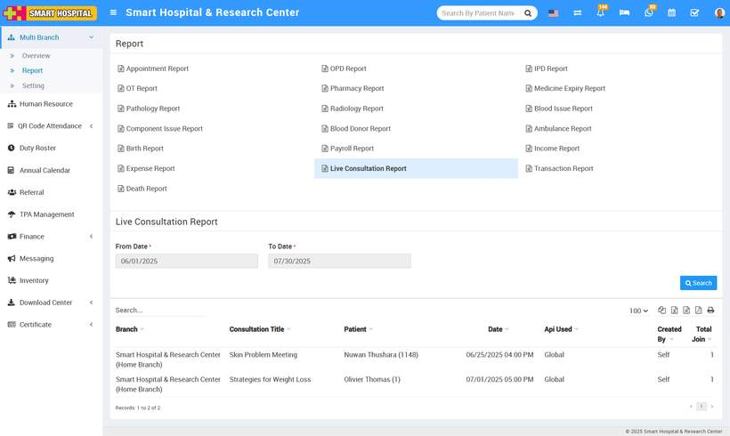**

**Once you run the search, the system shows a table with these columns:**

* **Branch** – Displays the hospital branch where the live consultation took place
* **Consultation Title** – Shows the title or subject of the live consultation session (e.g. Follow-up, Initial Consultation)
* **Patient** – Indicates the name of the patient involved in the consultation
* **Date** – The date on which the live consultation was conducted
* **API Used** – Displays the name of the video conferencing or integration API used for the consultation (e.g. Zoom, Jitsi)
* **Created By** – Shows the name of the doctor, staff member, or user who created or scheduled the live consultation
* **Total Join** – Indicates the total number of participants who joined the live consultation session

When you search the Live Consultation Report using a date range (From Date to To Date), the system displays the results in a table with columns for Branch, Consultation Title, Patient, Date, API Used, Created By, and Total Join. This helps track live consultation sessions, participants, and platform usage across different branches during the selected period.

**Daily Transaction Report**While searching the **Daily Transaction Report** details using a From Date to To Date filter, you can see the data displayed in columns showing **Branch > Date > Online > Offline > Refund > Amount** but while you click on **Transaction Detailed Report** showing right side in middle and search through the date filter then the details will be displayed as **Branch > Transaction ID > Patient > Date > Reference > Category > Collected By > Payment Type > Payment Mode > Amount.**  
 **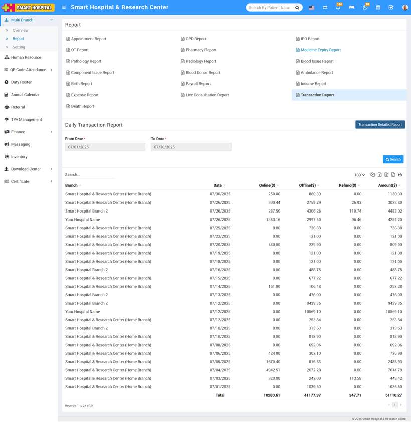**

**Once you run the search, the system shows a table with these columns:**

* The **Daily Transaction Report** provides a **summary view** of transactions over a selected date range. It displays data in these columns:  
    
  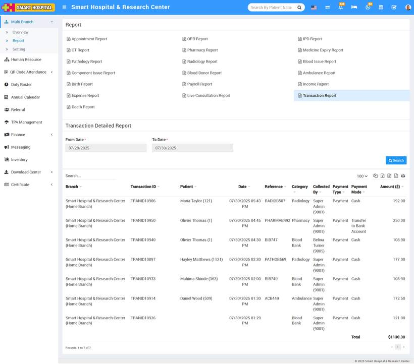

  + **Branch** – The hospital branch where the transactions occurred
  + **Date** – The specific date of the transactions
  + **Online** – Total amount received through online payments on that date
  + **Offline** – Total amount received through offline payments on that date
  + **Refund** – The amount refunded on that date
  + **Amount** – The net total amount (taking into account online, offline, and refund amounts)
* On the same screen, there’s an option or link called **Transaction Detailed Report**, typically found on the right side in the middle of the page.
* Clicking this link takes you to a more detailed view of each individual transaction. When you search using the date filter there, the report shows data in these columns:

  + **Branch** – The hospital branch where the transaction took place
  + **Transaction ID** – The unique identifier for each transaction
  + **Patient** – The name of the patient associated with the transaction
  + **Date** – The specific date of the transaction
  + **Reference** – Any reference number or additional identifier linked to the transaction (e.g. invoice number)
  + **Category** – The category of the transaction (e.g. OPD, Pharmacy, Radiology)
  + **Collected By** – The staff member who collected the payment
  + **Payment Type** – The general type of payment (e.g. receipt, refund)
  + **Payment Mode** – The specific method of payment (e.g. cash, credit card, UPI)
  + **Amount** – The amount paid in that particular transaction

When you search the Daily Transaction Report using a date range, you see summary data in columns for Branch, Date, Online, Offline, Refund, and Amount. However, if you click on the Transaction Detailed Report (found on the right side of the page) and search again by date, you’ll see detailed transactions with columns for Branch, Transaction ID, Patient, Date, Reference, Category, Collected By, Payment Type, Payment Mode, and Amount. This helps you analyze both summarized and detailed transaction records across different branches.

**Death Report  
  
While searching the Death Report details using a From Date to To Date filter, you can see the data displayed in columns showing Branch > Death Date > Paid  
  
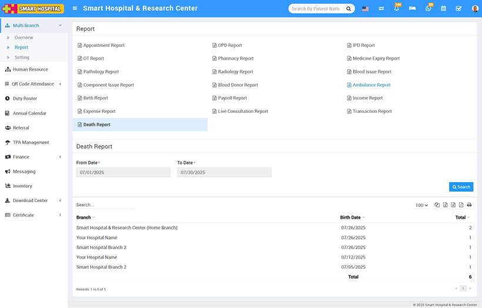**

**Once you run the search, the system shows a table with these columns:**

* **Branch** – Displays the hospital branch where the death was recorded
* **Death Date** – Shows the date on which the death occurred
* **Paid** – Indicates the amount paid for services related to the death record (such as documentation fees, hospital charges, etc.)

When you search the Death Report using a date range (From Date to To Date), the system displays the results in a table with columns for Branch, Death Date, and Paid. This allows you to track death records and related payments across different branches during the selected period.
