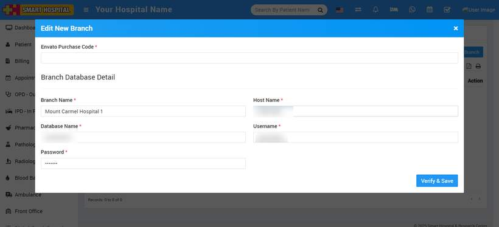

# How to edit a branch?

_Sat, 16 Aug, 2025_ · [Multi Branch (7)](https://smart-hospital.in/category/multi-branch) · vendor article: https://smart-hospital.in/article/how-to-edit-a-branch

### How to edit a branch?

Sat, 16 Aug, 2025

[Articles](https://smart-hospital.in/articles)[Multi Branch](https://smart-hospital.in/category/multi-branch)

---

To edit a branch, click the **Settings** button. When you click this button, an **Edit Detail** modal will open. Next, click the **Edit** icon located in the top left corner; this will open the **Edit Branch** modal. Update the details as needed, then click the **Verify & Save** button in the bottom right corner  
  

