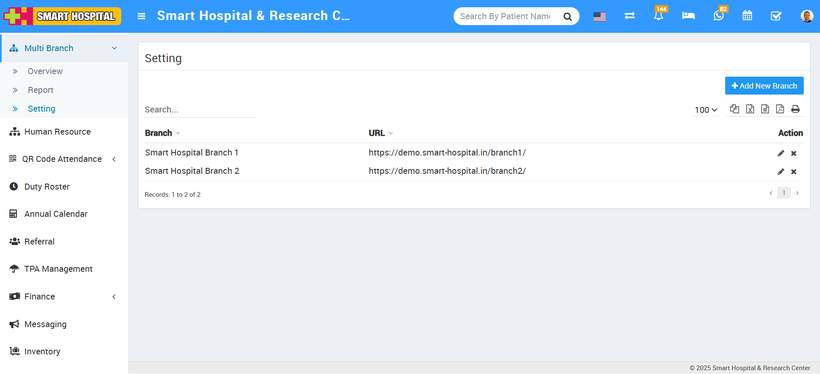
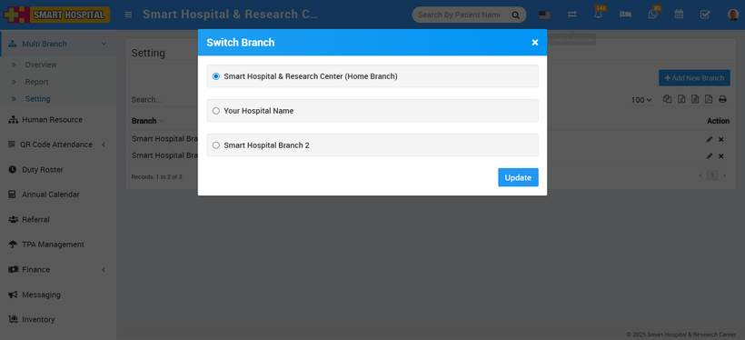

# How to switch the branch?

_Sat, 16 Aug, 2025_ · [Multi Branch (7)](https://smart-hospital.in/category/multi-branch) · vendor article: https://smart-hospital.in/article/how-to-switch-the-branch

### How to switch the branch?

Sat, 16 Aug, 2025

[Articles](https://smart-hospital.in/articles)[Multi Branch](https://smart-hospital.in/category/multi-branch)

---

To switch branches, click the **Switch Branch** icon in the upper right corner.   
  
  
  
  
  
The **Switch Branch** modal will now appear, and you can change the branch by clicking on the **radio**button, then click on the **Update** button, which is located in the below.   
  
  

