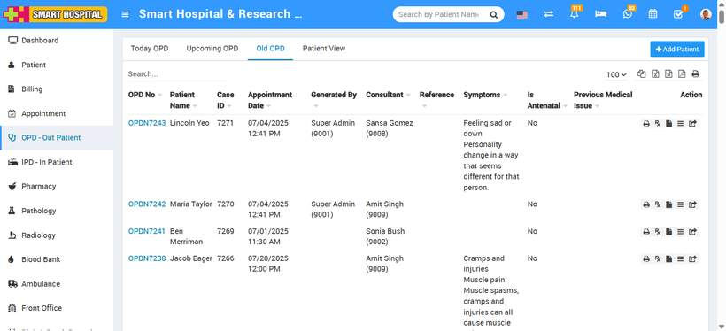

# About OPD - Out Patient

_Tue, 22 Jul, 2025_ · [OPD - Out Patient (9)](https://smart-hospital.in/category/opd-out-patient) · vendor article: https://smart-hospital.in/article/about-opd-out-patient

### About OPD - Out Patient

Tue, 22 Jul, 2025

[Articles](https://smart-hospital.in/articles)[OPD - Out Patient](https://smart-hospital.in/category/opd-out-patient)

---

**OPD (Outpatient Department)**  
The OPD, or Outpatient Department, is a section of the hospital where patients can consult with general physicians or specialists regarding their health concerns without the need for hospitalization.

In a hospital, the general OPD ward is where patients receive medical assistance and treatment on an outpatient basis. Under the OPD category, patients are not required to stay or be admitted to the hospital.

Modern OPDs offer a wide range of services, including illness diagnosis, medical tests, and treatment for minor injuries or conditions that do not require overnight admission.  
  

