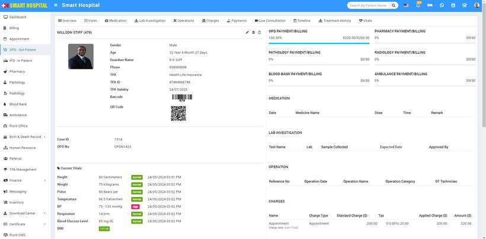

# BMI For OPD - Out Patient

_Fri, 30 Aug, 2024_ · [OPD - Out Patient (9)](https://smart-hospital.in/category/opd-out-patient) · vendor article: https://smart-hospital.in/article/bmi-for-opd-out-patient

### BMI For OPD - Out Patient

Fri, 30 Aug, 2024

[Articles](https://smart-hospital.in/articles)[OPD - Out Patient](https://smart-hospital.in/category/opd-out-patient)

---

In the **OPD - Out Patient** for **BMI**, you need to go to the OPD - Out Patient. Here, select the patient whose BMI details you want to see. Click on the OPD number of the patient. The patient's overview page will open, where you can see the **BMI** details  
  

