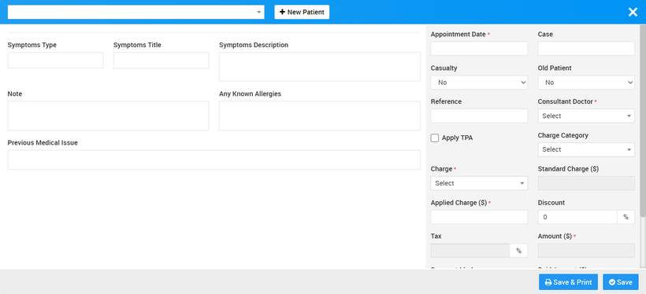
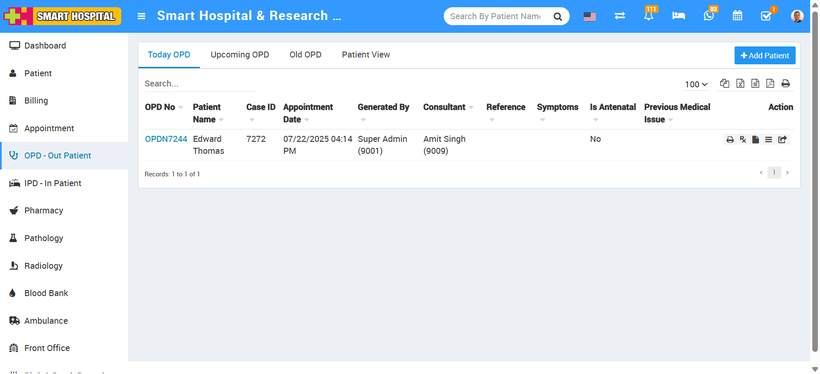
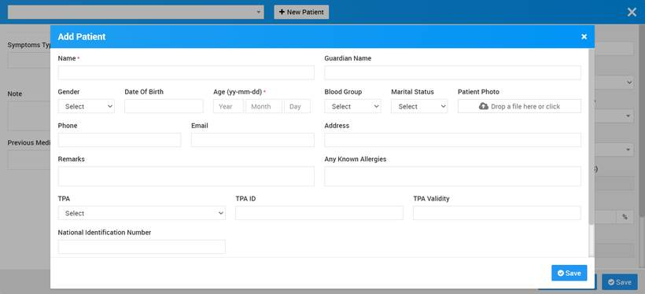
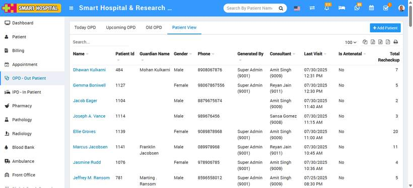

# How to add patient in OPD - Out Patient?

_Tue, 22 Jul, 2025_ · [OPD - Out Patient (9)](https://smart-hospital.in/category/opd-out-patient) · vendor article: https://smart-hospital.in/article/how-to-add-patient-in-opd-out-patient

### How to add patient in OPD - Out Patient?

Tue, 22 Jul, 2025

[Articles](https://smart-hospital.in/articles)[OPD - Out Patient](https://smart-hospital.in/category/opd-out-patient)

---

OPD (Out Patient Department) module is for managing out patient who just come for doctor for their issue/disease checkup.

To add new OPD patient click on **+ Add Patient** button now enter Select Patient from dropdown or add **+New Patient**, **Guardian Name, Gender, Age, Blood Group, Marital Status, Patient Photo, Phone, Email, Address, Remarks, Any Known Allergies, Height, Weight, BP, Symptoms, Note, Appointment Date, Case, Casualty, Old Patient, TPA (Third Party Administrator), Reference, Consultant Doctor, Charge Category, Charge, Tax, Standard Charges, Applied Charges, Amount, Payment Mode, Paid Amount** and select **Live Consultation** (if yes than live consultation for the patient will create and it will list on patient profile Live Consultation tab).

### **OPD Appointments**

On the OPD main page, you will find three tabs to help manage and track patient appointments efficiently:

* **Today’s OPD**:  
  This tab displays all appointments scheduled for the current day. Any OPD appointment added for today will appear in this list.
* **Upcoming OPD**:  
  This section includes all appointments that are booked for future dates. It helps in planning and managing upcoming patient visits.
* **Old OPD**:  
  Appointments that have already passed will automatically move to this tab for record-keeping and reference.

For example, the appointment you recently added is scheduled for today, so it will be listed under the **‘Today’s OPD’** tab.

  
  
  
To add a new patient in OPD, go to the **"Add Patient"** button located at the top-right corner of the page, then click on **"New Patient"**. This will open the **Add New Patient** page where you can enter the patient's details such as **Name, Gardian Name, Gendar, Date of Birth, Age, Blood Group, Marital Status, Patient Photo, Phone, Email Address, Remark, Any Known Allergies, TPA, TPA ID, TPA Validity, National Identification** etc then client on the save button   
  
  
  
  
So, these details will be saved and it will be displayed on **Patient** **View** page  
  

