# How to add the vitals details of the patient in OPD - Out Patient ?

_Fri, 30 Aug, 2024_ · [OPD - Out Patient (9)](https://smart-hospital.in/category/opd-out-patient) · vendor article: https://smart-hospital.in/article/how-to-add-the-vitals-details-of-the-patient-in-opd-out-patient

### How to add the vitals details of the patient in OPD - Out Patient ?

Fri, 30 Aug, 2024

[Articles](https://smart-hospital.in/articles)[OPD - Out Patient](https://smart-hospital.in/category/opd-out-patient)

---

To add the vitals details from **OPD - Out Patient**, simply go to **OPD - Out Patient** and click on it, here **OPD View** page will be open   
  
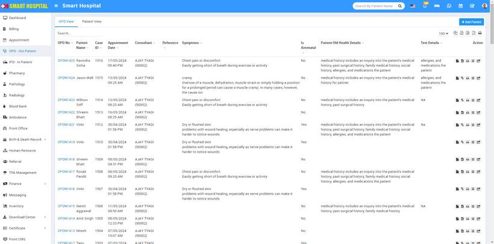  
  
  
Now, click on the **OPD No** of the patient for whom you want to add the vital details. Here, we will click on a random OPD number of a patient  
  
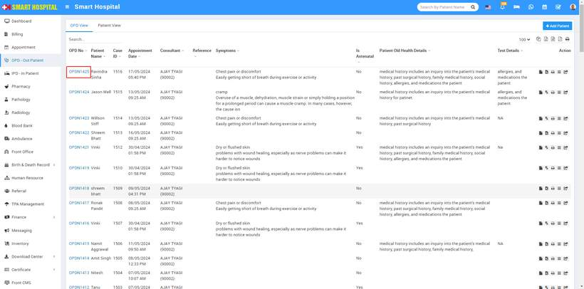  
  
After click on OPD No of the patient, patient **Overview** details page will be open, Now from the last right top side you can see the Vitals option is available   
  
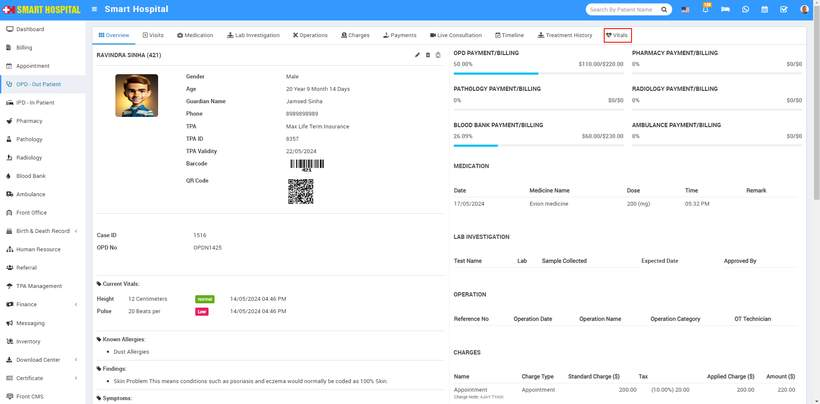  
  
  
Simply click on Vitals; the Vitals form window will open. If you have previously added some details for this patient's vitals, you can see them on this page.   
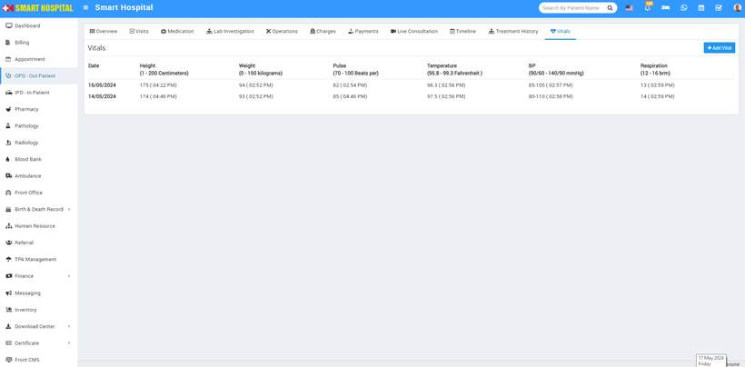  
  
Now click on the **Add Vitals** button to add the patient's vital details, vitals window willl be open  
  
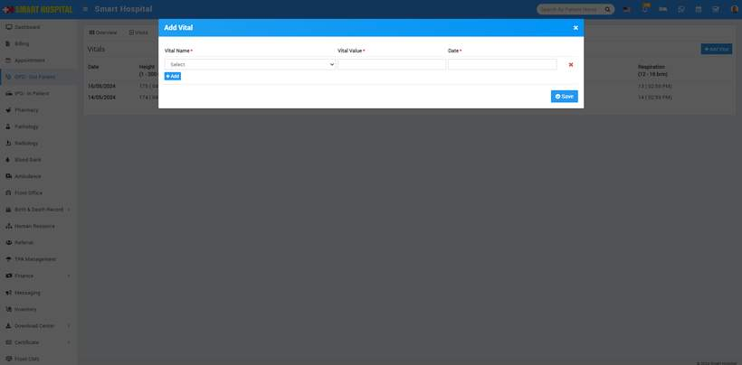  
  
Next, click on **Vitals Name**. A dropdown will open, and you can select one value from the multiple options. Then, enter the **Vital Value** and the **Date**. You can also add multiple fields of vitals for that patient by clicking on the add button and then saving it  
  
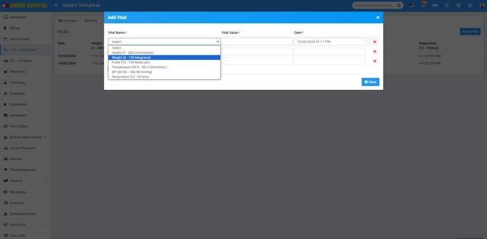  
  
After save the vitals details of the patient it will show in below  
  
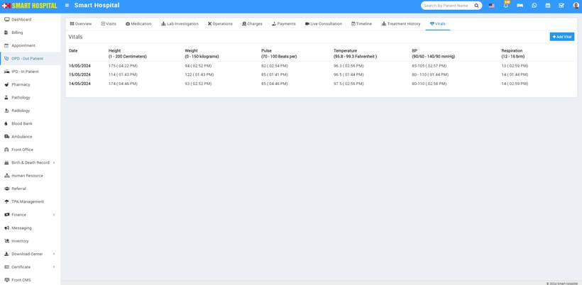  
  
For Vitals Details of the patient in OPD - Out Patient there is a another way to reach the Vital option, simply go to the **Paitent View** page in the OPD - Out Patient   
  
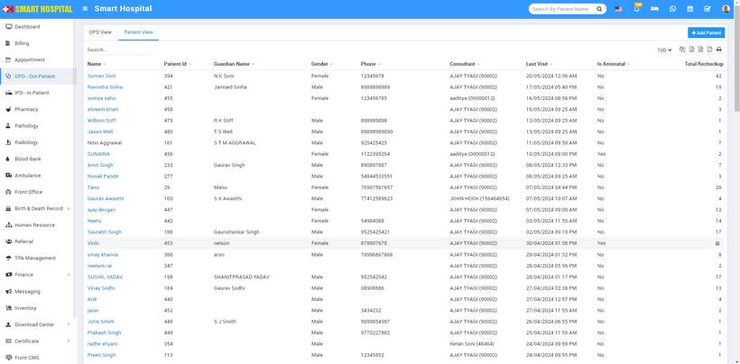  
  
  
In patient view page on the last column **Show** icon are displaying while hovering the mouse on it   
  
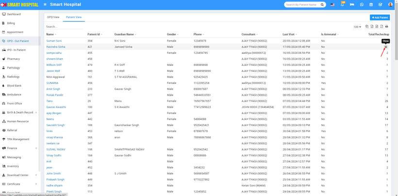  
  
Now click on show icon patient **Overview** page will be open here you will see all details related to patient  
  
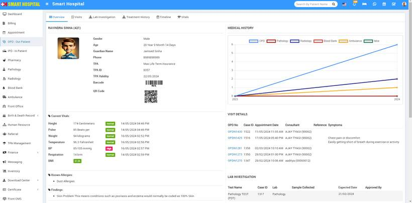  
  
Now, on the top right side, the Vitals option is available. Click on Vitals, and the Vitals page will open. Follow the same process as above to add the patient's vital details   
  
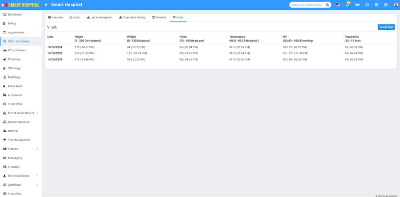  
  
  
Simply click on the **Edit** icon. The **Edit** Vitals window will open. Now update the details of the vitals and **save,** If you want to delete the vitals value of the patient, you can also do that by clicking on the **Delete** icon  
  
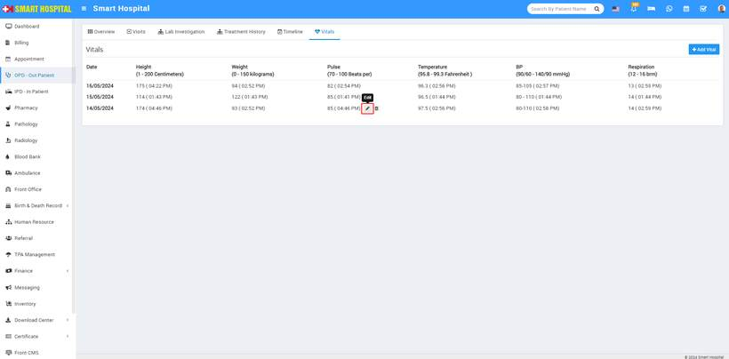  
  
After click on Save, Vitals details will be save succesfully
