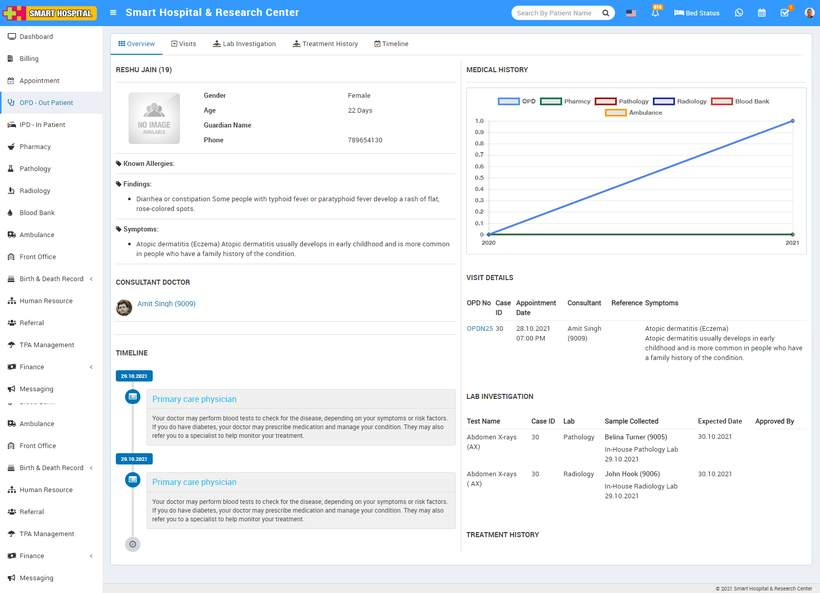
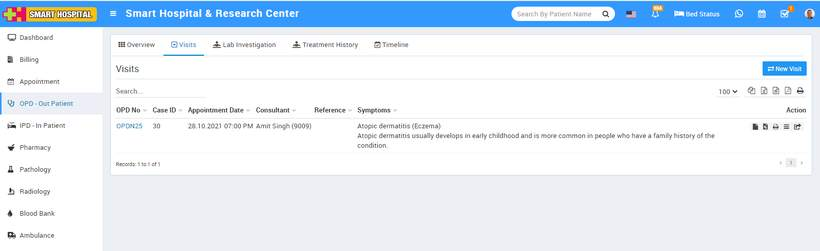
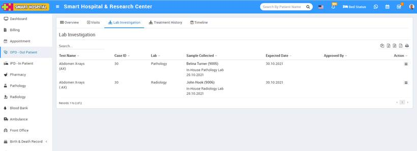
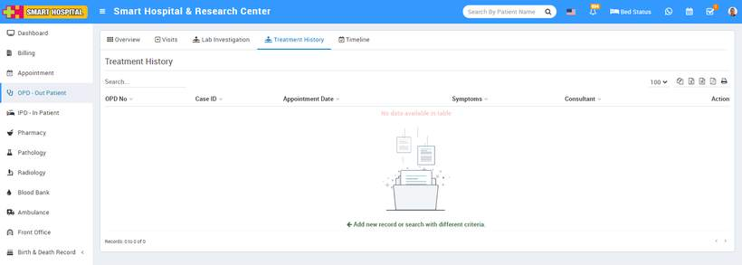
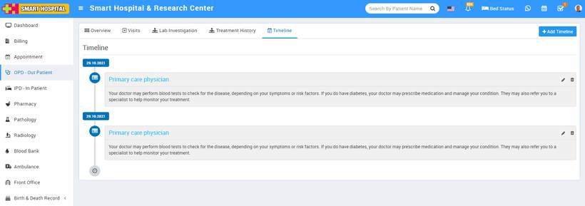

# How to check OPD patient's profile?

_Fri, 12 Nov, 2021_ · [OPD - Out Patient (9)](https://smart-hospital.in/category/opd-out-patient) · vendor article: https://smart-hospital.in/article/how-to-check-opd-patients-profile

### How to check OPD patient's profile?

Fri, 12 Nov, 2021

[Articles](https://smart-hospital.in/articles)[OPD - Out Patient](https://smart-hospital.in/category/opd-out-patient)

---

To check opd patient's profile, click on the **OPD** **- Out Patient** link present at the sidebar this will redirect you in **OPD Patient** list page, then click on the **Show** icon present at the last column (icon will be show on mouseover) so you will be redirecte to the opd patient's profile page.  
  
  
Here you will see 5 tabs are available **Overview**, **Visits**, **Lab** **Investigations**, **Treatment** **History** and **Timeline**.  
  
**Overview -** This tab describes patient's overview like patient's Allergies, Findings, Symptoms, Consultant Doctors, Timeline, Medical History (latest 5), Visit Details (latest 5), Lab investigation (latest 5) etc.  
  
  
  
   
**Visits -** This tab describes patient's all opd visits.  
  
  
  
**Lab Investigations -**This tab describes patient's all pathology and radiology investigation.  
  
  
  
  
**Treatment History -** This tab describes patients treatment history.  
  
  
  
**Timeline -**This tab describes patients all timeline.  
  
  
  
Note - Please [click here](https://smart-hospital.in/article/opd-patient-visits) to understand how you can check OPD patient all visit details.
