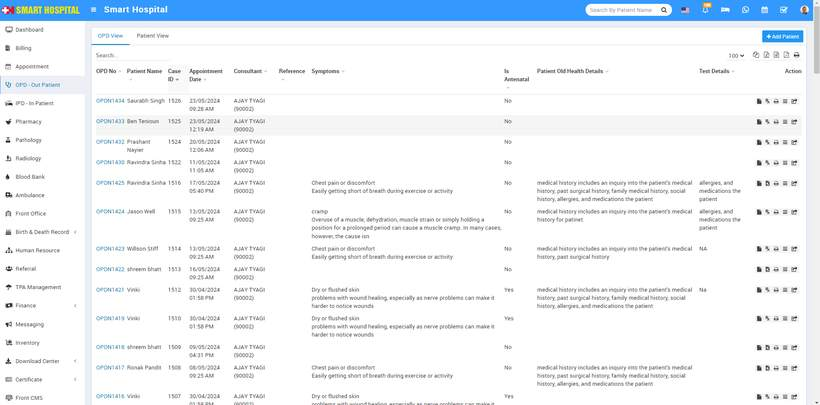
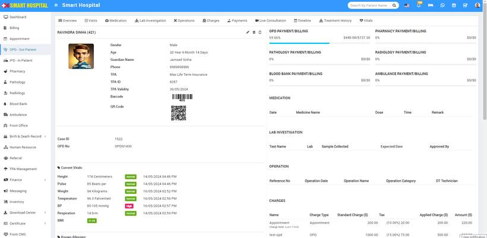
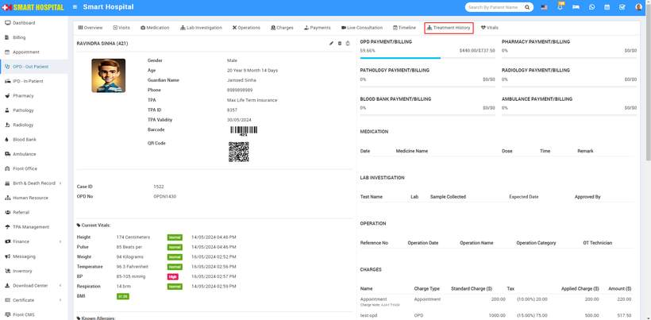
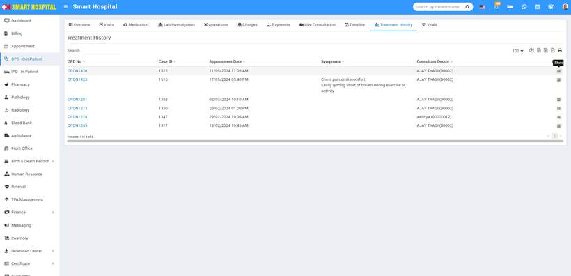
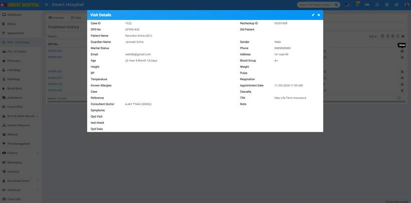
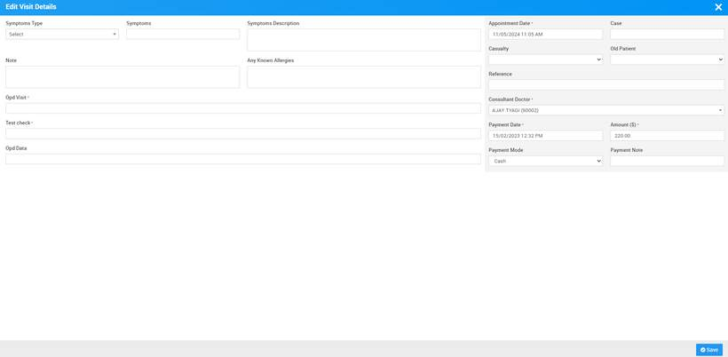

# How to check the treatment history in OPD - Out Patient?

_Fri, 30 Aug, 2024_ · [OPD - Out Patient (9)](https://smart-hospital.in/category/opd-out-patient) · vendor article: https://smart-hospital.in/article/how-to-check-the-treatment-history-in-opd-out-patient

### How to check the treatment history in OPD - Out Patient?

Fri, 30 Aug, 2024

[Articles](https://smart-hospital.in/articles)[OPD - Out Patient](https://smart-hospital.in/category/opd-out-patient)

---

To view **Treatment History**, go to the **OPD - Out Patient** module. The **OPD View** page will open, displaying multiple patient details below. Click on the specific patient's **OPD No** for whom you want to see the treatment history.  
  
  
  
After click on OPD No of the specific patient, that patient **Overview** page will be open  
  
  
  
  
Now in this page on the right top side, second last option for the Treatment History is available   
  
  
  
Now click on **Treatment History**, Patient details will be open in below  
  
  
  
In this page at the last column you will see the show icon available, simple click on that, **Visit Details** of the patent will be open   
  
  
  
In **Visit Details**, you can see all the details related to the patient and their treatment. If you want to edit the visit details, simply click on the Edit icon in the top right corner of the Visit Details page. The Edit Visit Details page will open  
  

