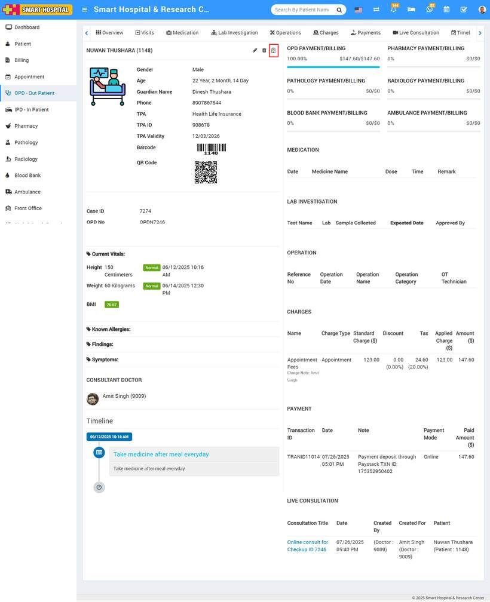
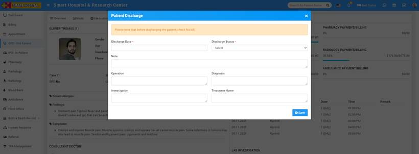

# How to Discharge patient from OPD?

_Sat, 02 Aug, 2025_ · [OPD - Out Patient (9)](https://smart-hospital.in/category/opd-out-patient) · vendor article: https://smart-hospital.in/article/how-to-discharge-patient-from-opd

### How to Discharge patient from OPD?

Sat, 02 Aug, 2025

[Articles](https://smart-hospital.in/articles)[OPD - Out Patient](https://smart-hospital.in/category/opd-out-patient)

---

To discharge OPD patient in Smart Hospital, go to **OPD - Out Patient**, then click on **Show** button or Patient name which patient you want to discharge. Now after click on it you will get 5 tabs **Overview, Visits, Lab Invetigation, Treatment History** and **Timeline**. Click on **Vistits** tab so you will get patient's all visits list. Now to discharge patient, click on **OPD No** so it will redirect you to **Overview** tab for selected Visit. Here at **Overview** tab you will find **Patient Discharge** button icon after click on it a window will open to fill discharge details.   
  
  
  
  
Please note that you must clear all the pending bill of the patient before discharge the patient. Now here you should enter **Discharge Date, Discharge Status** (Discharge status can be Death, Normal or can be referral if patient will be referred to another hospital or to consultant for further treatment), then enter **Note, Operation, Diagnosis, Investigation** and **Treatment Home** details then click on **Save** button.   
  
  
 **Patient Discharge due to death -** If the purpose for discharge patient is death then select **Discharge Status** as **Death**. After selecting status as Death there some more fields will automatically add in a form that are **Death Date, Guardian Name, Attachment** and **Report** so after fill these details click on **Save** button to discharge patient.  
  
**Patient Discharge for Referral -** If the purpose for discharge patient is referral then select **Discharge Status** as **Referral**. After selecting status as Referral there some more fields will automatically add in a form that are **Referral Date, Referral Hospital Name** and **Reason For Referral** so after fill these details click on **Save** button to discharge patient.  
  
To print Discharge Patient summary click on **Print** icon present at Discharge patient page.
