# OPD Patient Visits

_Tue, 22 Jul, 2025_ · [OPD - Out Patient (9)](https://smart-hospital.in/category/opd-out-patient) · vendor article: https://smart-hospital.in/article/opd-patient-visits

### OPD Patient Visits

Tue, 22 Jul, 2025

[Articles](https://smart-hospital.in/articles)[OPD - Out Patient](https://smart-hospital.in/category/opd-out-patient)

---

In OPD, when you click on a patient's name or the **Show** icon, the **Overview** page will open. The **Overview** tab contains all the details of the patient's visit.

To view complete OPD patient information, click on the **Show** icon. You will see five tabs: **Overview**, **Visits**, **Lab Investigation**, **Treatment History**, **Timeline** and **Vital** — each providing specific details related to the patient’s consultation and treatment history.

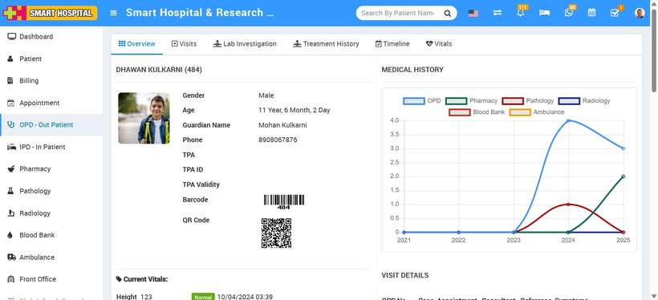  
  
  
Under Visit tab we will get some more tabs which will show other details also for OPD patients those are **Medication, Operations, Charges** and **Payments**. Now let's have a look for these options in more details-

---

  

### **Overview**

This section provides complete details of the patient’s visit, including allergies, symptoms and findings, consulting doctor, medical history timeline, lab investigations, and more.

  
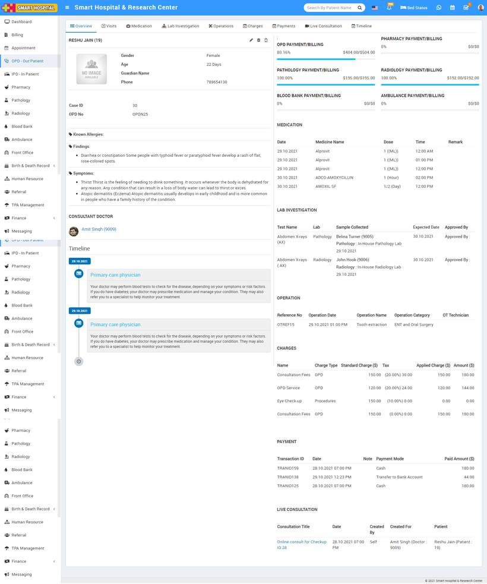  
  

---

### **Add New Checkup**

To add new OPD Checkups click on **+New Checkup** button. Here enter **Any Known Allergies, Height, Weight, BP, Symptoms, Note, Appointment Date, Case, Casualty, Old Patient, TPA (Third Party Administrator), Reference, Consultant Doctor, Charge Category, Charge, Tax, Standard Charges, Applied Charges, Amount, Payment Mode, Paid Amount**and select**Live Consultation** (if yes than live consultation for the patient will create and it will list on patient profile Live Consultation tab) and click on **Save** button.   
  
  
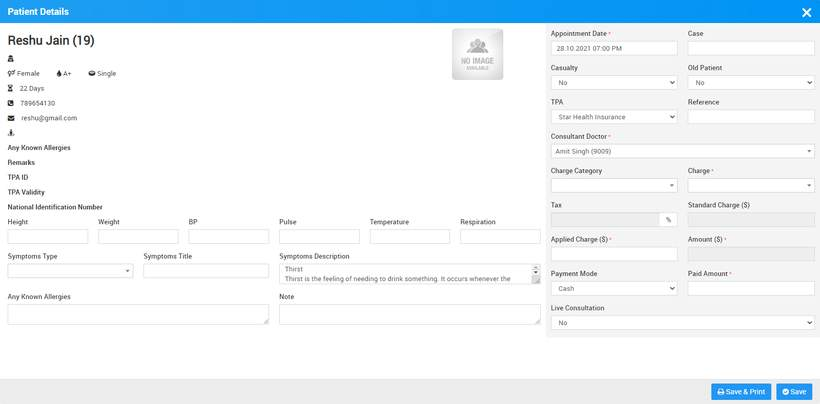  
  
**Note** :  While you add **New Checkup** for the Female patient so in this adding form at the bottom **Is Antenatal** option with checkbox will be show  
  
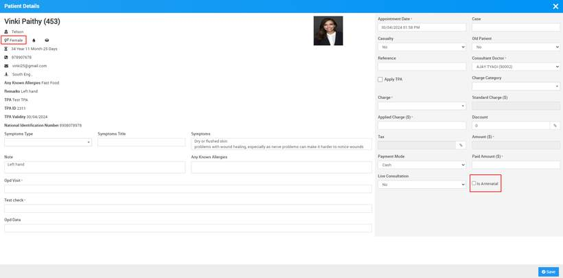  
  
  
  

---

### **Add Prescription**

To add prescription for OPD patient,  go to OPD- out patient list click on OPD patient details (for this show details button icon will show when you mouse hover at Total Recheck up column) then click on **Visits** tab Now here you will find Add Prescription option at Visits tab.

When you click on Add prescription button it will open add prescription page.

Here in Add Prescription you can add **Header Notes, Findings details (Symptoms finding in patient), Attachment, Medicines, Footer Note**, also in add prescription page you can prescribed **Pathology** and **Radiology** tests to patient and send notification from **Notification** To option to staff members.  
  
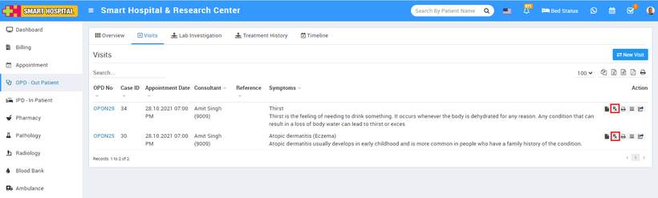  
  
  
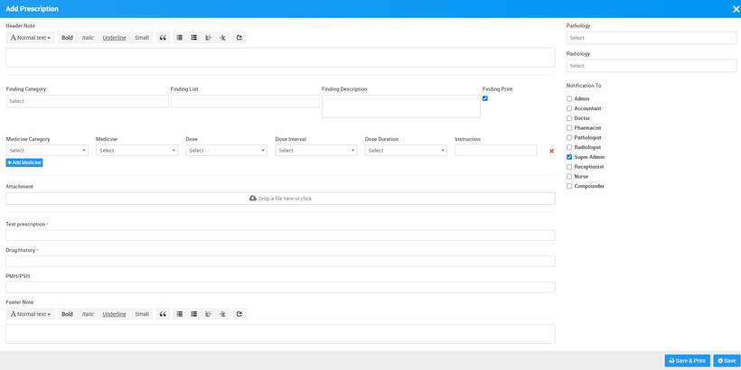  
  
  

---

### **Medication**

Medication is for comparing a patient's medication orders to all of the medications that the patient has been taking. This reconciliation is done to avoid medication errors such as omissions, duplications, dosing errors, or drug interactions.

To add medication for OPD patient go to **OPD – Out Patient** then click to detail option (show button icon will show for this at last column on mouse hover) then click on OPD no (under which OPD you want to create) here you will get **Medication** tab to add Medication for patient.

To add Medication click on **+ Add Medication** here enter **Date, Time, Medication Category, Medication Name, Dosage** and **Remarks** then **Save** button.  
  
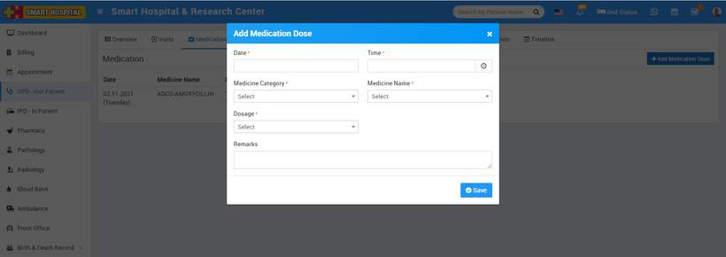

You can view this added record in the **Medication List** under Medication tab.

To edit Medication click on**Edit** icon and to delete Medication click on **Delete** icon present in the Medication list.  
  

---

### **Lab Investigation**

In OPD patient list you can also check patient all **Pathology** and **Radiology** test under **Lab Investigation** tab.

Here in Lab Investigation List you can check all listed lab reports of. You can check lab test report details from show option available at **Action** column.  
  
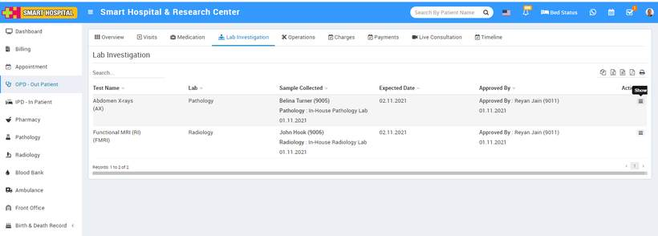

Also you can print Test Report from print icon present at show report details popup.

---

### **Operations**

You can add operations done for OPD patients under Operation Theatre tab. These can be small operation like dental surgeries.

To add Operation for OPD patient go to **OPD – Out Patient** then click to detail option (show button icon will show for this at last column on mouse hover) then click on OPD no (under which OPD you want to create) here you will get Operation Theatre tab to add Operations for patient.  
  
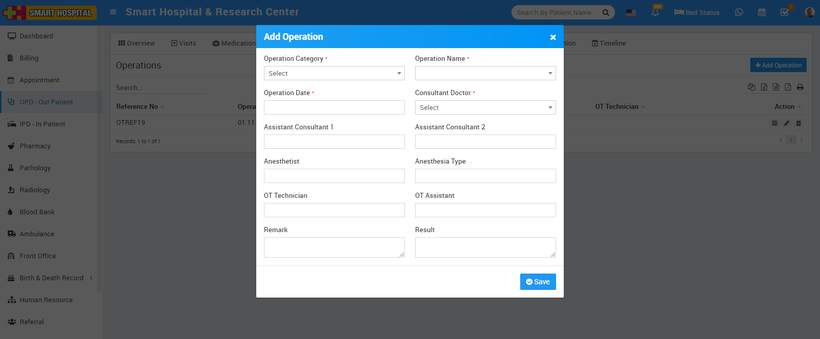

After create Operation record you can view this added record at Operation Theatre.

To view added operation record click on view button icon present at **Action** column.

To edit Operation record click on**Edit** icon and to delete Operation record click on **Delete** icon present in the Operation Theatre list.  
  

---

### **Charges**

Please [click here](https://smart-hospital.in/article/hospital-charges) to understand how to add Charges in Smart Hospital.  
  

---

### **How to add charges in OPD**

To add charges in for OPD patient, go to the **OPD – out patient** click on Show button present at **Action** column. After click on Show button here you will get 4 tabs that are **Overview, Visits, Lab Investigation, and Timeline**.

Now click on **Visits** tab and then click on OPD No. (for which you want to add charges) then click on **Charges** tab.

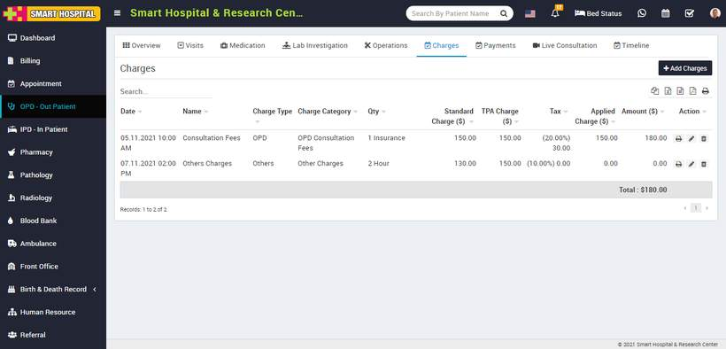

To add charges for OPD patient click on **+Add Charges** button, here you should add **Charge Type, Charge Category, Charge Name** and other details and click on **Save** button.

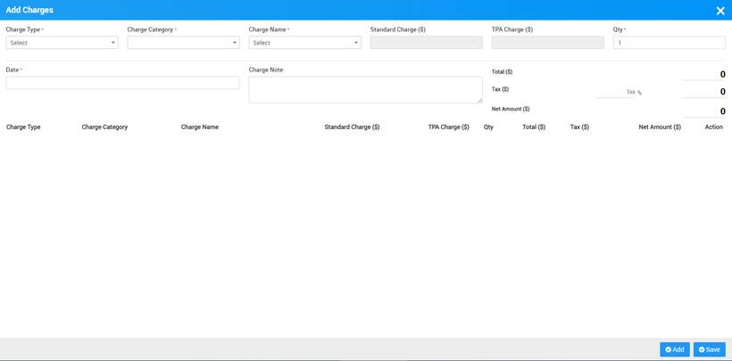

You can also Print, Edit and Delete the applied charges from options available at **Action** column.

---

### **Add Payments in OPD**

To add payment for OPD patient go to OPD – Out Patient then click to detail option (show button icon will show for this at last column on mouse hover) then click on OPD no (under which OPD you want to create) here you will get **Payment** tab to add Payment for patient.

To add new payment click on **+ Add Payment** button here enter **Date, payment Amount, Payment Mode** and **Note** then click on **Save** button.

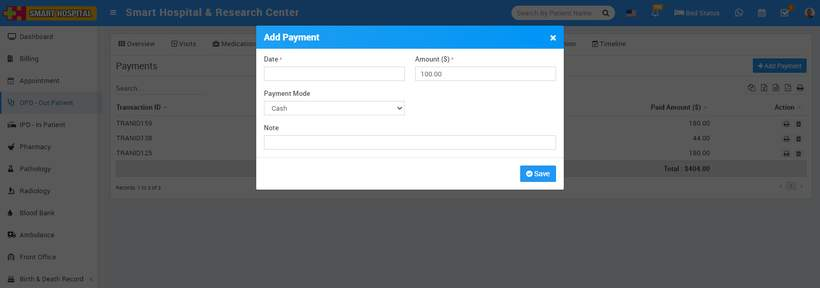  
  
To see patient OPD Payment details click **Payment** tab. Here you can see all payments done by patient.  
  

### Live Consultation

Using **Live Consultation** Patients can consult to doctor through zoom video call.  
  
From OPD Live Consultation doctor can give live consultation. For this click go to OPD Out Patient here click on Show button present at **Action** column. After click on Show button here you will get 4 tabs that are **Overview, Visits, Lab Investigation, and Timeline**.

Now click on **Visits** tab and then click on OPD No. (for which you want to add charges) then click on **Live Consultation** tab.

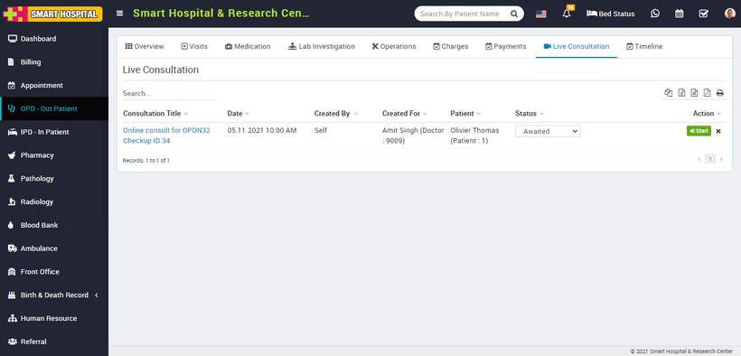  
  
  
To start video call click on **Start** button present at **Action** column, you can also change status for Live consultation as **Awaited, Finished** or **Cancelled**.  
  
Note - Please [click here](https://smart-hospital.in/article/zoom-setting) to see settings for **Live Consultation**.  

---

### **OPD Timeline**

From **Timeline** feature you can add any notes or quick access details regarding patient.

To add Timeline for OPD patient go to **OPD –Out Patient** then go to detail page (click on show button which will show on mouse hover at last column in OPD list). Here you will find **Timeline** tab.

To add Timeline click on **+ Add Timeline** button then enter **Title, Date, Description, Attach Document** and check on **Visible** **to the Patient** (optional) then click on **Save** button.  
  
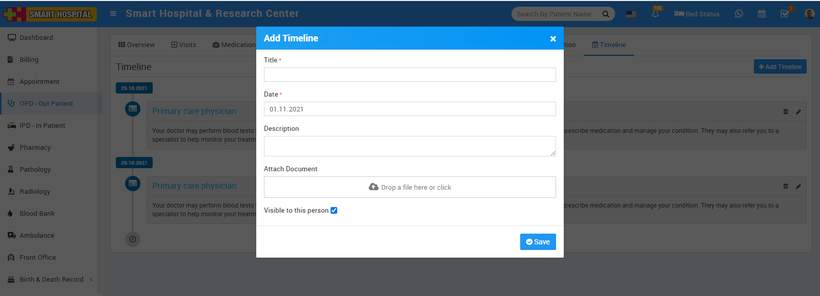

You can view this added Timeline at **Timeline** list page.

---

###
